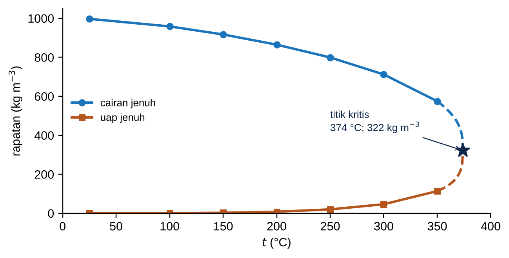
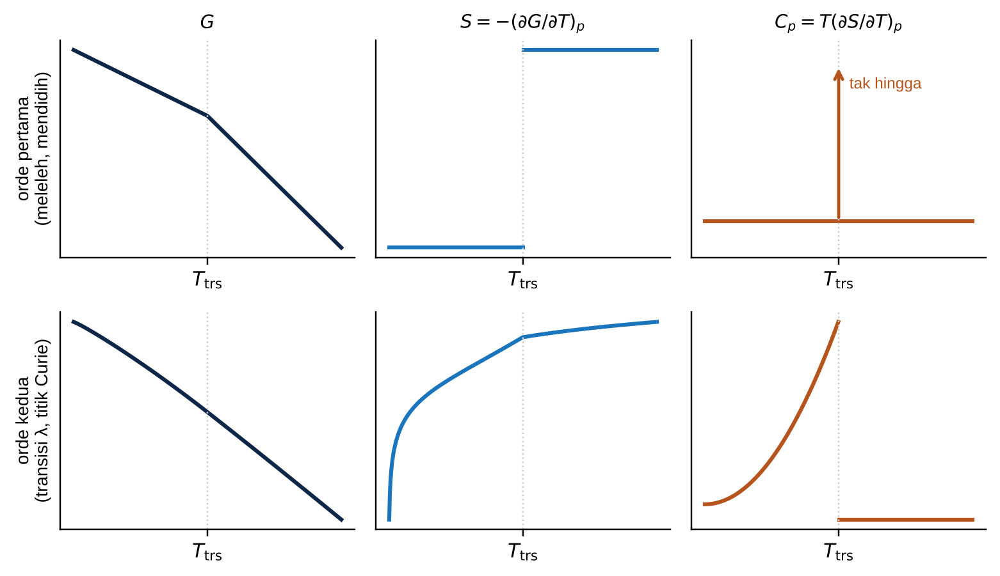

## 8.5 Diagram fasa air

Kini kita dapat menggambar peta lengkapnya. Setiap garis batas fasa berawal atau berakhir di titik istimewa, dan kemiringannya diberikan oleh persamaan Clapeyron. Gambar 8.5 memperlihatkan hasilnya untuk air. Sumbu tekanan dibuat logaritmik supaya rentang dari seperseratus ribu bar sampai ribuan bar dapat terlihat dalam satu gambar.

{width=80%}

Cara membaca diagram ini sederhana. Setiap titik (*T*, *p*) menyatakan satu keadaan. Bila titik itu jatuh di dalam salah satu daerah, fasa yang tertulis di sana adalah satu-satunya fasa stabil. Bila jatuh tepat pada garis, dua fasa setimbang. Perjalanan sepanjang garis mendatar adalah pemanasan atau pendinginan pada tekanan tetap; perjalanan sepanjang garis tegak adalah pemampatan atau pengembangan pada suhu tetap. Setiap kali perjalanan memotong garis, terjadi transisi fasa.

Tiga garis membentuk diagram itu:

- **Garis cair–gas** adalah kurva tekanan uap air. Ia naik dari titik tripel (0,01 °C; 611,657 Pa) menurut Clausius–Clapeyron, melewati 1 atm pada 100 °C, dan berakhir di **titik kritis** (373,95 °C; 220,64 bar). Di atas titik itu tidak ada lagi garis.
- **Garis padat–gas** adalah kurva tekanan uap es. Ia lebih curam daripada garis cair–gas di titik tripel, karena $\Delta_\text{sub}H > \Delta_\text{vap}H$.
- **Garis padat–cair** hampir tegak dan miring ke kiri, dengan kemiringan −135 bar K⁻¹ (Contoh 8.5).

Lereng ke kiri itu membuat air berbeda dari hampir semua zat lain. Bagi kehidupan, akibatnya besar: karena es kurang rapat daripada air, es mengapung. Danau dan laut membeku dari permukaan ke bawah, dan lapisan es di atasnya menyekat air di bawahnya dari udara dingin, sehingga ikan dapat hidup sepanjang musim dingin. Seandainya es tenggelam, danau akan membeku dari dasar sampai penuh.

::: {.contoh}
**Contoh 8.14 · Tiga perjalanan di diagram fasa air**

Gambarkan apa yang terjadi pada sampel air dalam setiap perjalanan berikut. (a) Es pada −20 °C dipanaskan sampai 150 °C pada tekanan tetap 1 atm. (b) Es pada −20 °C dipanaskan sampai 50 °C pada tekanan tetap 300 Pa. (c) Uap air pada −5 °C dimampatkan dari 100 Pa sampai 1000 bar pada suhu tetap.

**Penyelesaian.** (a) Garis 1 atm memotong garis padat–cair pada 0 °C (es meleleh) lalu garis cair–gas pada 100 °C (air mendidih). Di atasnya uap air.

(b) Tekanan 300 Pa lebih rendah daripada tekanan titik tripel (611,657 Pa), sehingga garis mendatar itu tidak pernah melewati daerah cair. Ia memotong garis padat–gas pada suhu tempat tekanan uap es sama dengan 300 Pa, sekitar −8 °C: es **menyublim** langsung menjadi uap.

(c) Tekanan uap es pada −5 °C sekitar 402 Pa (hitung seperti Contoh 8.12). Ketika tekanan mencapai 402 Pa, uap mengendap menjadi es. Es itu terus dimampatkan, dan ketika tekanan mencapai sekitar $5 \times 135 = 670$ bar, garis padat–cair terpotong dan es **meleleh** menjadi air. Di atas tekanan itu, pada −5 °C, air cair adalah fasa stabil.

**Memahami hasil.** Perjalanan (c) memperlihatkan keanehan air: pemampatan yang biasanya mengubah cairan menjadi padatan di sini mengubah padatan menjadi cairan. Perjalanan (b) adalah dasar pengeringan beku, dan juga alasan mengapa salju dapat hilang pada hari yang cerah dan kering walaupun suhu tidak pernah naik di atas 0 °C.
:::

::: {.contoh}
**Contoh 8.15 · Air di Mars**

Tekanan udara rata-rata di permukaan Mars sekitar 600 Pa, dan di dasar cekungan Hellas, tempat terendah di planet itu, sekitar 1155 Pa. Dapatkah air cair murni berada dalam kesetimbangan di kedua tempat? Bila dapat, pada rentang suhu berapa? Pakai $\Delta_\text{vap}H = 45{,}05$ kJ mol⁻¹.

**Penyelesaian.** Air cair hanya stabil di atas tekanan titik tripel, 611,657 Pa. Tekanan rata-rata 600 Pa sedikit di bawahnya, sehingga di sebagian besar permukaan Mars es menyublim langsung, dan air cair tidak dapat stabil pada suhu berapa pun.

Di Hellas, air cair stabil antara titik leleh (praktis 0 °C) dan titik didih, yang diperoleh dari (8.5) dengan titik tripel sebagai titik acuan:
$$
\frac{1}{T_\text{b}} = \frac{1}{273{,}16} - \frac{8{,}314}{45\,050}\ln\frac{1155}{611{,}7} = 3{,}6609 \times 10^{-3} - 1{,}173 \times 10^{-4} = 3{,}5436 \times 10^{-3}\ \text{K}^{-1} ,
$$
sehingga $T_\text{b} = 282$ K, sekitar 9 °C.

**Memahami hasil.** Bahkan di tempat terbaik di Mars, air cair hanya stabil dalam rentang sembilan derajat. Siang hari di musim panas Mars dapat melewati rentang itu, tetapi air yang terbentuk akan cepat mendidih atau membeku lagi. Itulah sebabnya pencarian air cair di Mars berpusat pada air **asin** di bawah permukaan: garam terlarut menurunkan titik beku dan menaikkan titik didih, seperti yang akan kita hitung di Bab 10.
:::

Diagram pada Gambar 8.5 hanya menunjukkan es biasa, yang disebut es Ih. Di atas sekitar 2000 bar, garis padat–cair berbelok, dan muncul bentuk-bentuk es lain yang lebih rapat: es III, V, VI, VII, dan seterusnya. Es VII, yang stabil di atas sekitar 22 000 bar, lebih rapat daripada air cair dan meleleh pada suhu jauh di atas 100 °C. Es seperti ini diperkirakan ada di dalam bulan-bulan es Jupiter dan Saturnus. Setiap bentuk es mempunyai daerahnya sendiri di diagram fasa lengkap, dan setiap dua daerah yang berbatasan dipisahkan oleh garis yang kemiringannya diberikan oleh persamaan Clapeyron.

::: {.kuis}
**Kuis cepat 8.5** Mengapa air yang ditaruh dalam ruang hampa pada suhu kamar mendidih sambil membeku?
:::

## 8.6 Diagram fasa CO₂

Diagram fasa karbon dioksida (Gambar 8.6) tampak serupa dengan air, tetapi dua perbedaan kecil menimbulkan akibat besar.

{width=80%}

Perbedaan pertama: **titik tripel CO₂ terletak pada 5,18 bar**, jauh di atas tekanan udara. Garis 1 atm karenanya melewati diagram di bawah titik tripel, tidak pernah menyentuh daerah cair, dan hanya memotong garis padat–gas pada −78,5 °C (194,7 K). Inilah sebabnya es kering menyublim. CO₂ cair hanya ada di atas 5,18 bar.

Perbedaan kedua: **garis padat–cair miring ke kanan**, seperti kebanyakan zat. CO₂ padat lebih rapat daripada cairannya dan tenggelam di dalamnya. Tekanan menaikkan titik leleh CO₂.

Titik kritisnya, 31,0 °C dan 73,8 bar, sangat dekat dengan suhu kamar. Pada 25 °C, CO₂ di dalam tabung tertutup berupa cairan yang setimbang dengan uapnya pada tekanan 64 bar. Selama masih ada cairan di dalam tabung, tekanannya tetap 64 bar, berapa pun banyaknya cairan yang tersisa. Akibat praktisnya: manometer pada tabung CO₂ **tidak** menunjukkan isi tabung. Petugas pemadam api dan pengelola laboratorium menimbang tabung untuk mengetahui sisanya.

::: {.contoh}
**Contoh 8.16 · Membaca diagram fasa CO₂**

Dari titik-titik pada Gambar 8.6: titik tripel (216,55 K; 5,18 bar), titik kritis (304,13 K; 73,8 bar), dan titik sublimasi pada 1 atm (194,65 K), taksir (a) $\Delta_\text{vap}H$ CO₂ dari dua titik ujung garis cair–gas; (b) $\Delta_\text{fus}H$ di titik tripel, dengan $\Delta_\text{sub}H = 26{,}1$ kJ mol⁻¹ (Contoh 8.13).

**Penyelesaian.** (a) Dari (8.5):
$$
\Delta_\text{vap}H = \frac{R\ln(73{,}8/5{,}18)}{1/216{,}55 - 1/304{,}13} = \frac{(8{,}314)(2{,}657)}{1{,}330 \times 10^{-3}}\ \text{J mol}^{-1} = 16{,}6\ \text{kJ mol}^{-1} .
$$
(b) Dari (8.7): $\Delta_\text{fus}H = 26{,}1 - 16{,}6 = 9{,}5$ kJ mol⁻¹.

**Memahami hasil.** Nilai terukur $\Delta_\text{fus}H$ adalah 9,0 kJ mol⁻¹. Hasil (a) sebenarnya adalah rata-rata yang kurang tepat, karena entalpi penguapan menuju nol di titik kritis dan uap CO₂ pada puluhan bar jauh dari ideal. Tetapi gabungan tiga titik saja pada diagram fasa sudah memberi ketiga entalpi transisi dengan ketelitian sekitar 5%.
:::

Mengapa titik tripel CO₂ begitu tinggi, sedangkan titik tripel air sangat rendah? Molekul CO₂ hanya diikat oleh gaya dispersi yang lemah, sehingga ia mudah lepas dari padatan, dan tekanan uap padatnya sudah 1 atm pada −78 °C. Cairan CO₂ baru menjadi lebih stabil daripada padatan pada suhu yang lebih tinggi, ketika tekanan uapnya sudah 5 bar. Untuk air, ikatan hidrogen menahan molekul dengan kuat, sehingga tekanan uap es pada titik lelehnya hanya 0,6 kPa.

::: {.terapan}
**CO₂ superkritis sebagai pelarut hijau.** Titik kritis CO₂ yang rendah membuatnya mudah dibawa ke daerah superkritis (subbab 2.10). Di sana, kemampuannya melarutkan dapat diatur dengan tekanan: sedikit menaikkan tekanan menaikkan rapatannya dan melarutkan lebih banyak zat. Kafein diekstraksi dari biji kopi dengan CO₂ superkritis pada sekitar 300 bar; minyak atsiri dari rempah-rempah dan hop diekstraksi dengan cara yang sama. Setelah ekstraksi, tekanan diturunkan, CO₂ kembali menjadi gas dan pergi tanpa meninggalkan sisa pelarut. Bagi industri pangan dan farmasi, keunggulan ini sangat berarti: tidak ada pelarut organik beracun yang harus dihilangkan dari produk.
:::

::: {.kuis}
**Kuis cepat 8.6** Bila sepotong es kering dimasukkan ke dalam botol plastik kecil yang tertutup rapat, apa yang akan terjadi? Mengapa tindakan ini berbahaya?
:::

## 8.7 Titik tripel dan titik kritis

Dua titik pada setiap diagram fasa layak dibahas tersendiri.

**Titik tripel** adalah satu-satunya suhu dan tekanan tempat tiga fasa setimbang bersama. Karena syarat (8.2) kini harus dipenuhi oleh tiga pasang fasa sekaligus, $\mu(s) = \mu(l) = \mu(g)$, kita mempunyai dua persamaan dengan dua variabel, yang biasanya hanya mempunyai satu penyelesaian. Titik tripel adalah sifat zat, bukan hasil pilihan peneliti: ia tidak dapat digeser oleh apa pun. Karena itu titik tripel air menjadi patokan yang sangat teliti. Dari 1954 sampai 2019, kelvin **didefinisikan** dengan menetapkan suhu titik tripel air tepat 273,16 K. Sejak 2019, kelvin didefinisikan melalui tetapan Boltzmann, tetapi titik tripel air tetap dipakai untuk menera termometer di seluruh dunia, dengan sel kaca kecil berisi air murni.

Titik tripel juga mengikat ketiga garis secara termodinamika. Di titik itu ketiga fasa berada pada *T* dan *p* yang sama, sehingga hubungan (8.7) berlaku tepat, dan kemiringan ketiga garis tidak bebas satu sama lain.

::: {.contoh}
**Contoh 8.17 · Kemiringan garis di titik tripel air**

Hitung kemiringan garis cair–gas dan garis padat–gas di titik tripel air (273,16 K; 611,657 Pa), dengan $\Delta_\text{vap}H = 45{,}05$ dan $\Delta_\text{sub}H = 51{,}06$ kJ mol⁻¹. Bandingkan dengan garis padat–cair.

**Penyelesaian.** Dari Clausius–Clapeyron dalam bentuk $dp/dT = p\,\Delta H/RT^2$:
$$
\text{cair–gas: } \frac{(611{,}657)(45\,050)}{(8{,}314)(273{,}16)^2} = 44{,}4\ \text{Pa K}^{-1} , \qquad \text{padat–gas: } \frac{(611{,}657)(51\,060)}{(8{,}314)(273{,}16)^2} = 50{,}3\ \text{Pa K}^{-1} .
$$
Garis padat–cair: $-1{,}35 \times 10^7$ Pa K⁻¹ (Contoh 8.5).

**Memahami hasil.** Garis padat–gas 13% lebih curam daripada garis cair–gas, tepat perbandingan $\Delta_\text{sub}H/\Delta_\text{vap}H$. Selisihnya kecil, sehingga pada Gambar 8.5 kedua garis tampak hampir menyambung. Garis padat–cair, sebaliknya, sekitar tiga ratus ribu kali lebih curam: pada skala gambar ia tegak lurus.
:::

**Titik kritis** adalah ujung garis cair–gas. Kita sudah bertemu dengannya di Bab 2 dari sudut pandang persamaan keadaan: di sana titik kritis adalah titik belok isoterm van der Waals, dengan $T_\text{c} = 8a/27Rb$. Untuk CO₂, rumus itu memberi 304 K, sangat dekat dengan nilai terukur. Kini kita melihatnya dari sudut pandang kesetimbangan fasa.

Bayangkan memanaskan air di dalam tabung kaca tebal yang tertutup, sehingga cairan dan uapnya selalu setimbang. Ketika suhu naik, cairan memuai dan rapatannya turun; tekanan uap naik dan rapatan uap naik. Kedua rapatan bergerak saling mendekati (Gambar 8.7). Entalpi penguapan juga mengecil, karena makin sedikit perbedaan antara molekul di cairan dan di uap. Pada suhu kritis, kedua rapatan menjadi sama, $\Delta_\text{vap}H$ menjadi nol, dan **meniskus**, batas antara cairan dan uap, lenyap. Tepat sebelum itu, isi tabung tampak keruh berkilau seperti susu, gejala yang disebut **opalesensi kritis**: rapatan berfluktuasi pada skala yang sebanding dengan panjang gelombang cahaya, sehingga cahaya dihamburkan kuat.

Di atas titik kritis hanya ada satu fasa fluida. Karena garis cair–gas berakhir, kita dapat mengubah cairan menjadi gas **tanpa pernah mendidih**: panaskan cairan pada tekanan tinggi sampai di atas suhu kritis, turunkan tekanan, lalu dinginkan. Perjalanan memutari titik kritis ini tidak pernah memotong garis fasa, sehingga tidak ada saat ketika dua fasa terlihat bersama. Cairan dan gas, ternyata, bukan dua jenis keadaan yang secara mendasar berbeda; keduanya adalah dua ujung satu keadaan fluida yang sinambung.

{width=80%}

::: {.dalam}
**Lebih dalam: mengapa garis padat–cair tidak berakhir.** Garis cair–gas berakhir di titik kritis karena cairan dan gas berbeda hanya secara **kuantitatif**: keduanya tidak teratur, hanya rapatannya yang berbeda, dan perbedaan itu dapat dibuat menjadi nol secara bertahap. Padatan kristal dan cairan berbeda secara **kualitatif**: padatan mempunyai susunan berulang dengan simetri tertentu, sedangkan cairan tidak. Simetri tidak dapat berubah sedikit demi sedikit; ia ada atau tidak ada. Karena itu tidak ada jalan sinambung dari kristal ke cairan, dan garis padat–cair (sejauh yang diketahui) tidak mempunyai titik kritis. Argumen ini, yang dikemukakan Lev Landau, menghubungkan termodinamika dengan simetri dan menjadi dasar teori modern transisi fasa.
:::

::: {.kuis}
**Kuis cepat 8.7** Dapatkah gas CO₂ pada 40 °C dicairkan dengan menaikkan tekanannya saja? Bagaimana dengan gas CO₂ pada 20 °C?
:::

## 8.8 Aturan fasa Gibbs untuk satu komponen

Kita sudah melihat pola yang berulang. Di dalam daerah satu fasa, suhu dan tekanan dapat diubah dengan bebas tanpa munculnya fasa baru. Di garis dua fasa, hanya satu yang bebas: bila suhu dipilih, tekanan sudah ditentukan. Di titik tripel, tidak ada yang bebas. Banyaknya variabel intensif yang dapat diubah secara bebas tanpa mengubah banyaknya fasa disebut **derajat kebebasan**, *F*.

Josiah Willard Gibbs memberi rumus umumnya. Untuk satu komponen, penurunannya hanya memerlukan penghitungan. Keadaan sistem ditentukan oleh dua variabel intensif, *T* dan *p*. Setiap pasang fasa yang setimbang menambah satu persamaan pengikat (8.2). Bila ada *P* fasa, ada $P - 1$ persamaan semacam itu ($\mu_1 = \mu_2$, $\mu_2 = \mu_3$, dan seterusnya). Derajat kebebasan adalah banyaknya variabel dikurangi banyaknya pengikat:

$$
F = 2 - (P - 1) = 3 - P . \qquad \text{(8.8)}
$$

Bentuk umumnya, untuk *C* komponen, adalah

::: {.inti}
$$
F = C - P + 2 . \qquad \text{(8.9)}
$$
**Aturan fasa Gibbs.** *C* banyaknya komponen, *P* banyaknya fasa yang setimbang, *F* derajat kebebasan. Untuk zat murni, *C* = 1 dan *F* = 3 − *P*.
:::

Bentuk (8.9) akan kita turunkan dengan lengkap di Bab 11, ketika komposisi juga menjadi variabel. Untuk zat murni, ada tiga kemungkinan:

| Banyaknya fasa *P* | *F* = 3 − *P* | Pada diagram fasa | Contoh |
|---|---|---|---|
| 1 | 2 (*T* dan *p* bebas) | daerah | air cair pada 25 °C dan 1 atm |
| 2 | 1 (*T* atau *p*) | garis | air mendidih; tekanan menentukan suhu |
| 3 | 0 | titik | titik tripel |

Karena *F* tidak dapat negatif, **empat fasa satu zat murni tidak pernah dapat setimbang bersama**. Zat yang mempunyai banyak fasa, seperti air dengan berbagai bentuk es, mempunyai banyak titik tripel, tetapi tidak satu pun titik kuadrupel.

::: {.contoh}
**Contoh 8.18 · Derajat kebebasan**

Tentukan *F* untuk setiap sistem berikut, dan jelaskan arti fisisnya. (a) Uap air saja di dalam tabung. (b) Air mendidih di dalam panci presto. (c) Es, air, dan uap air dalam sel titik tripel. (d) Es Ih, es III, dan air cair yang setimbang.

**Penyelesaian.** (a) *P* = 1, *F* = 2. Suhu dan tekanan dapat diatur sendiri-sendiri (selama tetap di daerah gas).

(b) *P* = 2, *F* = 1. Begitu tekanan dalam panci ditetapkan oleh katupnya, suhu air sudah ditentukan, sekitar 120 °C untuk 2 bar. Kita tidak dapat menaikkan suhu air mendidih tanpa menaikkan tekanannya.

(c) *P* = 3, *F* = 0. Suhu dan tekanan sudah tertentu: 273,16 K dan 611,657 Pa.

(d) *P* = 3, *F* = 0. Kombinasi ini juga titik tripel, tetapi di tempat lain pada diagram fasa lengkap, pada sekitar 251 K dan 2100 bar.

**Memahami hasil.** Aturan fasa tidak memberi tahu **di mana** titik tripel berada; untuk itu diperlukan data μ setiap fasa. Ia hanya memberi tahu **berapa banyak** pilihan yang tersisa. Hasil (b) menjelaskan mengapa titik didih dapat dipakai sebagai termometer yang sangat stabil: selama tekanan dijaga, suhu air mendidih tidak dapat berubah.
:::

::: {.contoh}
**Contoh 8.19 · Diagram fasa belerang**

Belerang mempunyai empat fasa: padat rombik, padat monoklin, cair, dan gas. Rombik stabil pada suhu kamar dan berubah menjadi monoklin pada 95,5 °C pada 1 atm; monoklin meleleh pada 119 °C. (a) Berapa banyak fasa paling banyak yang dapat setimbang bersama? (b) Berapa banyak titik tripel yang mungkin? (c) Mengapa belerang rombik yang dipanaskan dengan cepat meleleh pada sekitar 113 °C?

**Penyelesaian.** (a) Tiga, karena *F* = 3 − *P* ≥ 0.

(b) Ada empat cara memilih tiga dari empat fasa, sehingga paling banyak empat titik tripel. Tiga di antaranya stabil (rombik–monoklin–gas, monoklin–cair–gas, dan rombik–monoklin–cair); yang keempat, rombik–cair–gas, bersifat metastabil, karena di dekatnya fasa monoklin selalu mempunyai μ lebih rendah.

(c) Perubahan rombik → monoklin di dalam padatan berlangsung lambat. Bila dipanaskan cepat, belerang rombik tetap rombik di atas 95,5 °C sebagai fasa metastabil, dan meleleh langsung ketika garis μ-nya memotong garis μ cairan, pada sekitar 113 °C.

**Memahami hasil.** Diagram fasa menunjukkan fasa yang **paling stabil**; kenyataan di laboratorium juga ditentukan oleh laju. Kombinasi aturan fasa dan pemahaman tentang keadaan metastabil inilah yang dipakai ahli metalurgi dan ahli farmasi ketika memilih bentuk kristal suatu logam atau obat: bentuk yang paling stabil belum tentu yang paling mudah dibuat atau yang paling cepat larut di dalam tubuh.
:::

::: {.kuis}
**Kuis cepat 8.8** Mengapa tidak mungkin ada suatu suhu dan tekanan tempat es, air cair, uap air, dan es III berada bersama dalam kesetimbangan?
:::

## 8.9 Klasifikasi transisi fasa

Semua perubahan fasa yang kita bahas sejauh ini mempunyai kalor laten: es menyerap 6,01 kJ mol⁻¹ saat mencair, air menyerap 40,7 kJ mol⁻¹ saat mendidih. Tetapi ada perubahan fasa yang terjadi **tanpa kalor laten sama sekali**. Besi kehilangan sifat magnetnya pada 1043 K (titik Curie) tanpa menyerap kalor pada satu suhu tertentu. Helium cair berubah menjadi superfluida pada 2,17 K, juga tanpa kalor laten, tetapi kapasitas kalornya melonjak tajam di sekitar suhu itu. Apakah keduanya termasuk "perubahan fasa" dalam arti yang sama dengan pendidihan? Pertanyaan itu dijawab dengan melihat **turunan** energi Gibbs.

### Klasifikasi Ehrenfest

Pada setiap transisi fasa, energi Gibbs molar kedua fasa sama di suhu transisi (subbab 8.2). Yang membedakan jenis transisi adalah perilaku turunannya. Dari subbab 7.5 kita tahu
$$
\left(\frac{\partial G_\text{m}}{\partial T}\right)_p = -S_\text{m}, \qquad \left(\frac{\partial G_\text{m}}{\partial p}\right)_T = V_\text{m} .
$$
Paul Ehrenfest (1933) menggolongkan transisi menurut turunan **pertama** yang melompat:

* Pada **transisi orde pertama**, turunan pertama *G* tidak kontinu: entropi dan volume melompat di suhu transisi. Lompatan entropi berarti ada kalor laten, $\Delta_\text{trs}H = T_\text{trs}\Delta_\text{trs}S$. Pelelehan, pendidihan, penyubliman, dan sebagian besar perubahan bentuk kristal termasuk di sini.
* Pada **transisi orde kedua**, turunan pertama kontinu, sehingga tidak ada kalor laten dan tidak ada lompatan volume, tetapi turunan **kedua** melompat. Turunan kedua *G* terhadap suhu adalah $-(\partial S/\partial T)_p = -C_p/T$, jadi yang melompat adalah kapasitas kalor (juga koefisien muai dan kompresibilitas).

Gambar 8.8 memperlihatkan perbedaan itu. Pada transisi orde pertama, kurva *G* patah: kemiringannya berubah mendadak. Akibatnya *S* melompat, dan kapasitas kalor pada suhu transisi tak hingga, karena kalor dapat masuk tanpa menaikkan suhu sampai seluruh zat berubah fasa. Pada transisi orde kedua, kurva *G* tetap mulus dan hanya kelengkungannya yang berubah; *S* hanya menekuk, dan *C*$_p$ yang melompat.

{width=86%}

Mengapa persamaan Clapeyron tidak berlaku untuk transisi orde kedua? Persamaan (8.4) adalah $dp/dT = \Delta_\text{trs}S/\Delta_\text{trs}V$. Pada transisi orde kedua, pembilang dan penyebutnya sama-sama nol, sehingga persamaan itu tidak memberi informasi. Ehrenfest menurunkan pengganti yang memakai lompatan turunan kedua, $dp/dT = \Delta C_p/(TV\Delta\alpha)$, tetapi bentuk ini jarang dipakai, karena transisi orde kedua yang "bersih" hampir tidak ada di alam.

### Transisi λ

Kebanyakan transisi tanpa kalor laten di alam tidak berupa lompatan *C*$_p$ yang rapi seperti Gambar 8.8, melainkan **puncak** *C*$_p$ yang naik tajam menuju tak hingga dari kedua sisi. Bentuk kurvanya mirip huruf Yunani λ, sehingga disebut **transisi λ**. Contohnya:

* helium-4 cair menjadi superfluida pada 2,17 K;
* besi kehilangan feromagnetisme pada titik Curie, 1043 K;
* kuningan β (CuZn) berubah dari kristal teratur (Cu dan Zn bergantian di kisi) menjadi tak teratur di sekitar 740 K.

Semua transisi λ mempunyai ciri yang sama: suatu **keteraturan** (penjajaran spin magnet, susunan atom yang bergantian) tidak hilang sekaligus pada satu suhu, tetapi berkurang sedikit demi sedikit ketika suhu naik, lalu lenyap tepat di suhu transisi. Karena keteraturan itu hilang secara bertahap, tidak ada kalor laten; tetapi tepat sebelum suhu transisi, sedikit kenaikan suhu menghancurkan banyak keteraturan, sehingga zat menyerap banyak kalor per kelvin, dan *C*$_p$ memuncak.

::: {.contoh}
**Contoh 8.20 · Menggolongkan transisi dari data**

Golongkan transisi berikut menurut Ehrenfest: (a) es → air pada 0 °C, Δ*H* = 6,01 kJ mol⁻¹; (b) belerang rombik → monoklin pada 95,5 °C, Δ*H* = 0,40 kJ mol⁻¹; (c) besi feromagnetik → paramagnetik pada 1043 K, tanpa kalor laten dan volume tidak melompat, tetapi *C*$_p$ memuncak; (d) helium I → helium II pada 2,17 K, tanpa kalor laten.

**Penyelesaian.** (a) dan (b) mempunyai kalor laten, jadi entropi melompat: transisi orde pertama. Kalor laten belerang kecil karena kedua bentuk padat itu hampir sama teraturnya, tetapi besarnya tidak penting; yang penting ia tidak nol. (c) dan (d) tidak mempunyai kalor laten maupun lompatan volume, tetapi *C*$_p$ memuncak: transisi λ, yang dalam klasifikasi Ehrenfest paling dekat dengan orde kedua.

**Memahami hasil.** Ukuran kalor laten tidak menentukan golongan transisi. Ujiannya hanya satu: apakah ada lompatan entropi atau volume. Dalam praktik, kalorimeter pemindaian (DSC) membedakan keduanya dengan mudah. Transisi orde pertama muncul sebagai puncak yang luasnya sama dengan kalor laten, sedangkan transisi λ muncul sebagai lonjakan garis dasar *C*$_p$ tanpa luas tambahan yang jelas.
:::

::: {.contoh}
**Contoh 8.21 · Lompatan turunan pertama pada pelelehan es**

Pada 0 °C dan 1 atm, rapatan es 0,9167 g cm⁻³ dan rapatan air 0,9998 g cm⁻³. Hitung lompatan volume molar dan entropi molar saat es mencair, lalu pakai keduanya untuk menghitung kemiringan garis padat–cair air.

**Penyelesaian.** $V_\text{m}(\text{es}) = 18{,}015/0{,}9167 = 19{,}65$ cm³ mol⁻¹ dan $V_\text{m}(\text{air}) = 18{,}015/0{,}9998 = 18{,}02$ cm³ mol⁻¹, sehingga $\Delta_\text{fus}V = -1{,}63$ cm³ mol⁻¹. Lompatan entropinya $\Delta_\text{fus}S = 6010/273{,}15 = 22{,}0$ J K⁻¹ mol⁻¹. Dari persamaan Clapeyron,
$$
\frac{dp}{dT} = \frac{\Delta_\text{fus}S}{\Delta_\text{fus}V} = \frac{22{,}0\ \text{J K}^{-1}\,\text{mol}^{-1}}{-1{,}63 \times 10^{-6}\ \text{m}^3\,\text{mol}^{-1}} = -1{,}35 \times 10^{7}\ \text{Pa K}^{-1} = -135\ \text{bar K}^{-1} .
$$

**Memahami hasil.** Kedua lompatan itu adalah lompatan turunan pertama *G*, tanda transisi orde pertama. Perbandingannya memberi kemiringan garis fasa, dan tanda negatifnya menjelaskan mengapa garis padat–cair air condong ke kiri (Gambar 8.5). Hitungan ini sama dengan Contoh 8.5, tetapi kini terlihat sebagai akibat klasifikasi Ehrenfest: persamaan Clapeyron hanya bermakna karena kedua lompatan itu tidak nol.
:::

::: {.kuis}
**Kuis cepat 8.9** Pada titik kritis air, entalpi penguapan menjadi nol. Apakah itu berarti titik kritis adalah transisi orde kedua? Jelaskan dengan perilaku *S* dan *V* di sekitar titik kritis.
:::

### Menuju bab berikutnya

Seluruh bab ini dibangun dari satu syarat sederhana: dua fasa setimbang bila potensial kimianya sama. Dari syarat itu kita memperoleh persamaan Clapeyron, Clausius–Clapeyron, bentuk diagram fasa air dan CO₂, dan aturan fasa. Tetapi kita hanya membahas zat murni, tempat potensial kimia sama dengan energi Gibbs molar.

Di dunia nyata, kimiawan hampir selalu bekerja dengan campuran: larutan garam, campuran pelarut, udara. Bagaimana potensial kimia satu zat berubah bila zat lain dicampurkan ke dalamnya? Bab 9 menjawab pertanyaan itu dengan memperkenalkan besaran molar parsial dan potensial kimia dalam campuran. Dengan alat itu, Bab 10 akan menjelaskan mengapa air laut membeku di bawah 0 °C, mengapa garam di jalan bersalju mencairkan es, dan mengapa sel darah merah pecah di dalam air murni.
