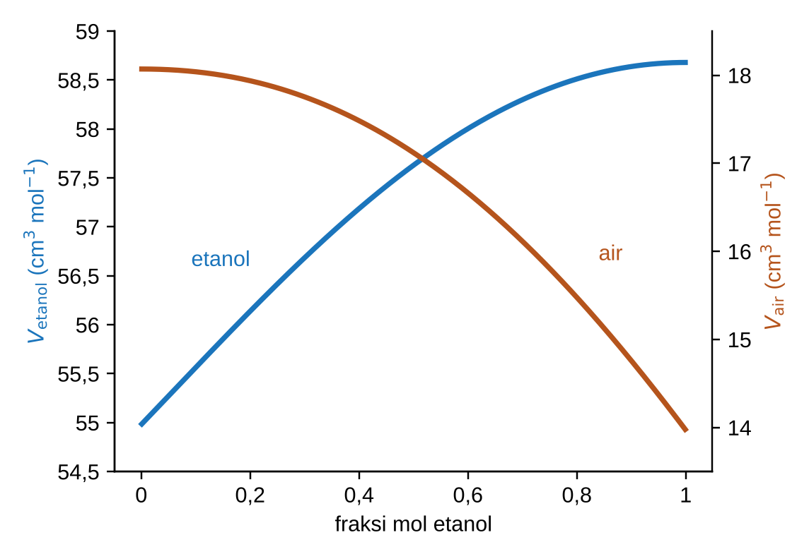

# Bab 9 Potensial Kimia dan Besaran Molar Parsial

Tuangkan 50 mL etanol ke dalam 50 mL air, aduk, dan ukur volumenya dengan gelas ukur yang teliti. Hasilnya bukan 100 mL, melainkan sekitar 97 mL. Tidak ada yang tumpah, tidak ada yang menguap. Tiga mililiter itu hilang begitu saja. Ke mana perginya?

Pengamatan sederhana ini membuka pertanyaan yang lebih dalam. Selama delapan bab kita membahas zat murni: satu gas, satu cairan, satu padatan. Untuk zat murni, setiap besaran ekstensif sebanding dengan banyaknya zat. Dua mol air menempati volume dua kali satu mol air, mempunyai energi Gibbs dua kali, dan seterusnya. Tetapi begitu dua zat dicampur, aturan itu runtuh. Sumbangan setiap zat terhadap volume, entalpi, atau energi Gibbs campuran bergantung pada **lingkungannya**, yaitu pada molekul-molekul lain di sekitarnya.

Bab ini memperkenalkan alat untuk menangani campuran: **besaran molar parsial**, yang mengukur sumbangan satu mol suatu zat terhadap besaran campuran pada komposisi tertentu. Besaran molar parsial yang paling penting adalah energi Gibbs molar parsial, yang diberi nama khusus: **potensial kimia**. Di Bab 8 kita bertemu dengannya untuk zat murni, tempat ia sama dengan $G_\text{m}$. Kini kita akan melihat bahwa potensial kimia mengatur ke mana setiap zat bergerak dalam campuran: oksigen dari paru-paru ke darah, karbon dioksida dari darah ke paru-paru, zat terlarut dari satu pelarut ke pelarut lain. Bab ditutup dengan potensial kimia gas, ideal maupun nyata, yang membawa kita ke konsep **fugasitas**, "tekanan efektif" gas nyata.

::: {.strategi}
**Pertanyaan pembuka**

1. Mengapa 50 mL etanol dan 50 mL air tidak menghasilkan 100 mL larutan?
2. Bagaimana mengukur sumbangan satu zat terhadap volume campuran?
3. Apa arti fisis potensial kimia, dan mengapa disebut "potensial"?
4. Mengapa oksigen berpindah dari udara di paru-paru ke dalam darah?
5. Bila komposisi campuran berubah, apakah besaran molar parsial semua komponennya dapat berubah dengan bebas?
6. Bagaimana menyatakan potensial kimia gas nyata dengan rumus yang sederhana?
:::

::: {.tujuan}
**Tujuan belajar**

Setelah mempelajari bab ini, kamu mampu:

1. Mendefinisikan besaran molar parsial dan menjelaskan mengapa volume campuran tidak aditif.
2. Menentukan volume molar parsial dari data volume dengan metode garis singgung dan metode titik potong.
3. Mendefinisikan potensial kimia dan menuliskan persamaan fundamental untuk sistem terbuka.
4. Memakai potensial kimia untuk meramalkan arah perpindahan zat.
5. Menurunkan dan memakai persamaan Gibbs–Duhem.
6. Menghitung potensial kimia dan energi Gibbs pencampuran gas ideal.
7. Menjelaskan fugasitas dan koefisien fugasitas serta menghitungnya dari persamaan keadaan.
:::

::: {.mat}
**Prasyarat**

Dari Bab 7: persamaan fundamental $dG = -S\,dT + V\,dp$ dan $G_\text{m}(p) = G_\text{m}^\circ + RT\ln(p/p^\circ)$ untuk gas ideal (subbab 7.5, 7.8). Dari Bab 6: entropi pencampuran gas ideal (subbab 6.3). Dari Bab 2: faktor kompresi dan koefisien virial (subbab 2.1, 2.7). Dari Bab 8: syarat kesetimbangan fasa $\mu(\alpha) = \mu(\beta)$. Dari matematika: turunan parsial terhadap salah satu dari beberapa variabel.
:::

## 9.1 Besaran molar parsial

Mari kita mulai dari volume, besaran yang paling mudah dibayangkan. Bayangkan sebuah kolam besar berisi air murni. Tambahkan satu mol air lagi, sekitar 18 mL; volume kolam bertambah 18 mL. Sekarang bayangkan kolam itu berisi etanol murni, dan tambahkan satu mol air ke dalamnya. Ternyata volume bertambah hanya sekitar 14 mL. Molekul air yang sama, dalam jumlah yang sama, menambah volume yang berbeda, bergantung pada molekul apa yang mengelilinginya.

Mengapa demikian? Di dalam air murni, setiap molekul air terikat dalam jaringan ikatan hidrogen yang terbuka dan cukup longgar, seperti dalam es tetapi kurang teratur. Di dalam etanol, molekul air dikelilingi gugus OH dan gugus etil yang tersusun dengan cara lain; ia dapat menyelip dan terikat lebih rapat. Volume yang "ditempati" satu mol zat dalam campuran tidak ditentukan oleh ukuran molekulnya saja, tetapi juga oleh cara molekul-molekul tetangganya menyesuaikan diri.

Untuk menangkap gagasan ini dengan tepat, definisikan **volume molar parsial** zat J sebagai laju perubahan volume campuran terhadap banyaknya mol J, sementara suhu, tekanan, dan banyaknya mol semua zat lain dijaga tetap:

::: {.inti}
$$
V_\text{J} = \left(\frac{\partial V}{\partial n_\text{J}}\right)_{T,\,p,\,n'} . \qquad \text{(9.1)}
$$
**Volume molar parsial.** Lambang *n′* berarti banyaknya mol semua zat selain J dijaga tetap. Secara fisis, $V_\text{J}$ adalah pertambahan volume bila satu mol J ditambahkan ke campuran yang sangat besar, sehingga komposisinya tidak berubah.
:::

Syarat "campuran yang sangat besar" penting. Bila satu mol etanol ditambahkan ke satu mol air, komposisi berubah jauh selama penambahan, dan $V_\text{J}$ ikut berubah. Turunan (9.1) mengukur sumbangan **pada satu komposisi tertentu**; ia adalah sifat campuran pada titik itu, bukan sifat zat J sendiri.

::: {.mat}
**Matematika: turunan parsial dengan banyak variabel.** Volume campuran dua zat adalah fungsi empat variabel, $V(T, p, n_\text{A}, n_\text{B})$. Turunan parsial terhadap $n_\text{A}$ berarti: ubah $n_\text{A}$ sedikit, tahan *T*, *p*, dan $n_\text{B}$, lalu lihat perubahan *V*. Diferensial totalnya pada *T* dan *p* tetap adalah
$$
dV = \left(\frac{\partial V}{\partial n_\text{A}}\right)dn_\text{A} + \left(\frac{\partial V}{\partial n_\text{B}}\right)dn_\text{B} = V_\text{A}\,dn_\text{A} + V_\text{B}\,dn_\text{B} .
$$
:::

Dari diferensial itu kita dapat memperoleh volume total. Bayangkan campuran dibangun dari nol dengan menambahkan A dan B **bersamaan** dalam perbandingan tetap, sehingga komposisinya selalu sama. Karena komposisi tidak berubah, $V_\text{A}$ dan $V_\text{B}$ juga tetap selama penambahan, dan integralnya sederhana:

$$
V = n_\text{A}V_\text{A} + n_\text{B}V_\text{B} . \qquad \text{(9.2)}
$$

Volume total adalah jumlah volume molar parsial dikali banyaknya mol, **asalkan** volume molar parsial yang dipakai adalah nilai pada komposisi campuran itu. Untuk zat murni, (9.2) kembali ke $V = nV_\text{m}$. Untuk campuran ideal, tempat molekul-molekul tidak peduli siapa tetangganya, $V_\text{J} = V^*_\text{m,J}$, volume molar zat murni (tanda bintang menandai zat murni), dan volume bersifat aditif. Untuk campuran nyata, selisih $V_\text{J} - V^*_\text{m,J}$ mengukur seberapa besar lingkungan baru mengubah ruang yang ditempati molekul J.

::: {.contoh}
**Contoh 9.1 · Tiga mililiter yang hilang**

Etanol (rapatan 0,7849 g mL⁻¹, *M* = 46,07 g mol⁻¹) sebanyak 50,0 mL dicampur dengan 50,0 mL air (rapatan 0,9970 g mL⁻¹, *M* = 18,02 g mol⁻¹) pada 25 °C. Pada komposisi campuran yang terbentuk, volume molar parsial etanol 56,34 cm³ mol⁻¹ dan air 17,88 cm³ mol⁻¹. Hitung volume campuran.

**Penyelesaian.** Banyaknya mol: etanol $(50{,}0)(0{,}7849)/46{,}07 = 0{,}8519$ mol, air $(50{,}0)(0{,}9970)/18{,}02 = 2{,}767$ mol. Fraksi mol etanol $0{,}8519/3{,}619 = 0{,}235$. Dari (9.2):
$$
V = (0{,}8519)(56{,}34) + (2{,}767)(17{,}88) = 48{,}0 + 49{,}5 = 97{,}5\ \text{cm}^3 .
$$

**Memahami hasil.** Volume molar etanol murni 58,68 cm³ mol⁻¹ dan air murni 18,07 cm³ mol⁻¹. Dalam campuran, kedua zat menempati ruang lebih sedikit: etanol kehilangan sekitar 2,3 cm³ per mol, air sekitar 0,2 cm³ per mol. Tiga mililiter itu tidak hilang; molekul-molekul hanya tersusun lebih rapat karena ikatan hidrogen antara etanol dan air, dan karena gugus etil yang kecil dapat menyelip ke dalam rongga jaringan air.
:::

Volume hanyalah contoh pertama. Setiap besaran ekstensif *X* (entalpi, entropi, energi Gibbs, kapasitas kalor) mempunyai besaran molar parsialnya sendiri, $X_\text{J} = (\partial X/\partial n_\text{J})_{T,p,n'}$, dan untuk setiap besaran itu berlaku hubungan seperti (9.2):

$$
X = \sum_\text{J} n_\text{J}X_\text{J} . \qquad \text{(9.3)}
$$

Dari semua besaran molar parsial, satu menonjol: energi Gibbs molar parsial, karena energi Gibbs menentukan arah proses pada suhu dan tekanan tetap. Kita akan membahasnya di subbab 9.3. Lebih dulu, mari kita lihat bagaimana volume molar parsial diukur.

::: {.kuis}
**Kuis cepat 9.1** Bila volume molar parsial etanol dalam suatu campuran lebih kecil daripada volume molar etanol murni, apakah volume campuran lebih kecil atau lebih besar daripada jumlah volume komponennya sebelum dicampur? Anggap volume molar parsial air sama dengan volume molar air murni.
:::

## 9.2 Volume molar parsial

Definisi (9.1) langsung memberi cara pertama mengukurnya, yaitu **metode garis singgung**. Siapkan sederet larutan dengan jumlah pelarut tetap, misalnya 1 kg air, dan jumlah zat terlarut berbeda-beda. Ukur volume setiap larutan, gambarkan *V* terhadap banyaknya mol zat terlarut, dan kemiringan kurva di setiap titik adalah volume molar parsial zat terlarut pada komposisi itu. Bila data dinyatakan sebagai rumus empiris, kemiringan itu diperoleh dengan menurunkannya.

::: {.contoh}
**Contoh 9.2 · Larutan garam dapur**

Volume larutan NaCl dalam 1,000 kg air pada 25 °C mengikuti rumus empiris
$$
V/\text{cm}^3 = 1002{,}96 + 16{,}62\,b + 1{,}77\,b^{3/2} + 0{,}12\,b^2 ,
$$
dengan *b* molalitas NaCl dalam mol kg⁻¹ (pada 1 kg air, *b* sama dengan banyaknya mol NaCl). Hitung volume molar parsial NaCl dan air pada *b* = 1,000 mol kg⁻¹.

**Penyelesaian.** Turunkan terhadap *b*:
$$
V_\text{NaCl} = \frac{\partial V}{\partial b} = 16{,}62 + \tfrac32(1{,}77)b^{1/2} + 2(0{,}12)b = 16{,}62 + 2{,}655 + 0{,}24 = 19{,}52\ \text{cm}^3\ \text{mol}^{-1} .
$$
Volume larutan pada *b* = 1: $V = 1002{,}96 + 16{,}62 + 1{,}77 + 0{,}12 = 1021{,}47$ cm³. Banyaknya air $1000/18{,}015 = 55{,}51$ mol. Dari (9.2):
$$
V_\text{air} = \frac{V - n_\text{NaCl}V_\text{NaCl}}{n_\text{air}} = \frac{1021{,}47 - 19{,}52}{55{,}51} = 18{,}050\ \text{cm}^3\ \text{mol}^{-1} .
$$

**Memahami hasil.** Volume molar air murni adalah $1002{,}96/55{,}51 = 18{,}068$ cm³ mol⁻¹, sehingga air dalam larutan garam menempati ruang sedikit lebih kecil. Lebih menarik lagi, volume molar parsial NaCl pada larutan encer (*b* → 0) adalah 16,6 cm³ mol⁻¹, jauh lebih kecil daripada volume molar NaCl padat, 27,0 cm³ mol⁻¹. Ion-ion Na⁺ dan Cl⁻ menarik molekul air di sekitarnya dengan sangat kuat sehingga air di sekeliling ion termampatkan. Gejala ini disebut **elektrostriksi**.
:::

Pada beberapa garam, elektrostriksi begitu kuat sehingga volume molar parsial zat terlarut menjadi **negatif**. Untuk MgSO₄ dalam air encer, nilainya sekitar −1,4 cm³ mol⁻¹: menambahkan sedikit MgSO₄ ke dalam air justru **mengurangi** volume. Ion Mg²⁺ yang kecil dan bermuatan dua menarik molekul-molekul air begitu rapat sehingga penyusutan air lebih besar daripada ruang yang ditempati ion-ion itu sendiri.

::: {.awas}
**Volume molar parsial bukan ukuran molekul.** Volume molar parsial adalah sifat **campuran**, yaitu perubahan volume total ketika zat ditambahkan. Ia memuat ruang yang ditempati molekul itu sendiri **ditambah** perubahan susunan semua molekul di sekitarnya. Karena itu ia dapat lebih kecil daripada volume zat murninya, dan bahkan dapat negatif, padahal setiap molekul jelas menempati ruang positif.
:::

Cara kedua, yang lebih praktis untuk campuran dua cairan dengan rentang komposisi lebar, adalah **metode titik potong**. Gambarkan volume molar campuran $V_\text{m} = V/(n_\text{A} + n_\text{B})$, atau lebih baik volume pencampuran per mol $\Delta_\text{mix}V_\text{m} = V_\text{m} - x_\text{A}V^*_\text{m,A} - x_\text{B}V^*_\text{m,B}$, terhadap fraksi mol. Tarik garis singgung pada kurva di komposisi yang diinginkan. Titik potong garis singgung itu dengan sumbu tegak di $x_\text{B} = 0$ dan $x_\text{B} = 1$ memberi volume molar parsial A dan B (atau, untuk $\Delta_\text{mix}V_\text{m}$, selisihnya terhadap zat murni). Gambar 9.1 memperlihatkan cara ini untuk campuran etanol–air.

{width=72%}

Mengapa titik potong itu memberi volume molar parsial? Tuliskan $V_\text{m} = x_\text{A}V_\text{A} + x_\text{B}V_\text{B}$ (bagi (9.2) dengan *n* total). Dapat ditunjukkan (lihat Pembahasan soal terpilih di akhir bab) bahwa garis singgung pada kurva $V_\text{m}(x_\text{B})$ di suatu titik adalah garis lurus $x_\text{A}V_\text{A} + x_\text{B}V_\text{B}$, dengan $V_\text{A}$ dan $V_\text{B}$ dihitung di titik itu dan dipandang tetap. Di $x_\text{B} = 0$ garis itu bernilai $V_\text{A}$; di $x_\text{B} = 1$ bernilai $V_\text{B}$.

::: {.contoh}
**Contoh 9.3 · Membaca Gambar 9.1**

Pada $x_\text{etanol} = 0{,}30$, garis singgung pada Gambar 9.1 memotong sumbu kiri di −0,32 cm³ mol⁻¹ dan sumbu kanan di −2,00 cm³ mol⁻¹. Hitung volume molar parsial air dan etanol, dan periksa hasilnya dengan menghitung volume molar campuran ($\Delta_\text{mix}V_\text{m} = -0{,}82$ cm³ mol⁻¹ pada komposisi itu).

**Penyelesaian.** $V_\text{air} = 18{,}07 - 0{,}32 = 17{,}75$ cm³ mol⁻¹, $V_\text{etanol} = 58{,}68 - 2{,}00 = 56{,}68$ cm³ mol⁻¹.

Pemeriksaan: $V_\text{m} = (0{,}70)(17{,}75) + (0{,}30)(56{,}68) = 12{,}43 + 17{,}00 = 29{,}43$ cm³ mol⁻¹. Dari zat murni dan volume pencampuran: $(0{,}70)(18{,}07) + (0{,}30)(58{,}68) - 0{,}82 = 12{,}65 + 17{,}60 - 0{,}82 = 29{,}43$ cm³ mol⁻¹. Cocok.

**Memahami hasil.** Pada komposisi ini etanol menyusut jauh lebih banyak daripada air, sekitar 3,4% berbanding 1,8%. Garis singgung meringkas dua informasi sekaligus: kemiringan kurva memberi selisih kedua volume molar parsial, dan ketinggian titik singgung memberi rata-ratanya.
:::

Dengan cara ini volume molar parsial dapat diperoleh pada setiap komposisi. Gambar 9.2 memperlihatkan hasilnya untuk seluruh rentang. Perhatikan pola yang mencolok: ketika volume molar parsial etanol naik, volume molar parsial air turun, dan sebaliknya. Keduanya tidak bebas. Subbab 9.4 akan menunjukkan bahwa pola cermin ini adalah keharusan termodinamika.

{width=72%}

::: {.contoh}
**Contoh 9.4 · Meracik satu liter campuran**

Seorang analis memerlukan tepat 1000 cm³ campuran etanol–air dengan fraksi mol etanol 0,500. Pada komposisi itu, $V_\text{etanol} = 57{,}63$ dan $V_\text{air} = 17{,}12$ cm³ mol⁻¹. Berapa volume etanol murni dan air murni yang harus diukur?

**Penyelesaian.** Dengan $n_\text{etanol} = n_\text{air} = n$, dari (9.2): $1000 = n(57{,}63 + 17{,}12)$, sehingga $n = 13{,}38$ mol. Volume zat murni: etanol $(13{,}38)(58{,}68) = 785{,}0$ cm³, air $(13{,}38)(18{,}07) = 241{,}7$ cm³.

**Memahami hasil.** Jumlah kedua volume itu 1026,7 cm³, hampir 27 cm³ lebih banyak daripada larutan yang dihasilkan. Karena itu kadar alkohol "persen volume" selalu didefinisikan sebagai volume etanol murni yang dipakai per volume **larutan akhir** pada suhu tertentu (20 °C), bukan per jumlah volume yang dicampurkan. Kesalahan ini sering terjadi ketika mengencerkan alkohol 96% untuk antiseptik: menambahkan air sampai volume tertentu tidak sama dengan menambahkan sejumlah volume air.
:::

::: {.contoh}
**Contoh 9.5 · Garis singgung dari data laboratorium**

Di laboratorium, rumus empiris belum tersedia; yang ada hanya hasil pengukuran. Tiga larutan NaCl dalam 1,000 kg air pada 25 °C mempunyai volume berikut:

| $n_\text{NaCl}$ (mol) | 0,900 | 1,000 | 1,100 |
|---|---|---|---|
| *V* (cm³) | 1019,53 | 1021,47 | 1023,43 |

Taksir volume molar parsial NaCl pada 1,000 mol kg⁻¹.

**Penyelesaian.** Kemiringan kurva di titik tengah ditaksir dengan selisih terpusat:
$$
V_\text{NaCl} \approx \frac{V(1{,}100) - V(0{,}900)}{1{,}100 - 0{,}900} = \frac{1023{,}43 - 1019{,}53}{0{,}200} = 19{,}5\ \text{cm}^3\ \text{mol}^{-1} .
$$

**Memahami hasil.** Hasilnya sama dengan Contoh 9.2, yang memakai turunan rumus. Dalam praktik, selisih volumenya hanya beberapa sentimeter kubik dari sekitar seribu, sehingga volume harus diukur sangat teliti, biasanya dengan **piknometer** atau densitometer osilasi yang mengukur rapatan sampai enam angka penting. Kesalahan 0,01 cm³ pada setiap volume sudah mengubah hasil sekitar 0,1 cm³ mol⁻¹.
:::

::: {.kuis}
**Kuis cepat 9.2** Pada Gambar 9.1, mengapa garis singgung di dekat $x_\text{etanol} = 0$ memotong sumbu kiri hampir tepat di nol?
:::
