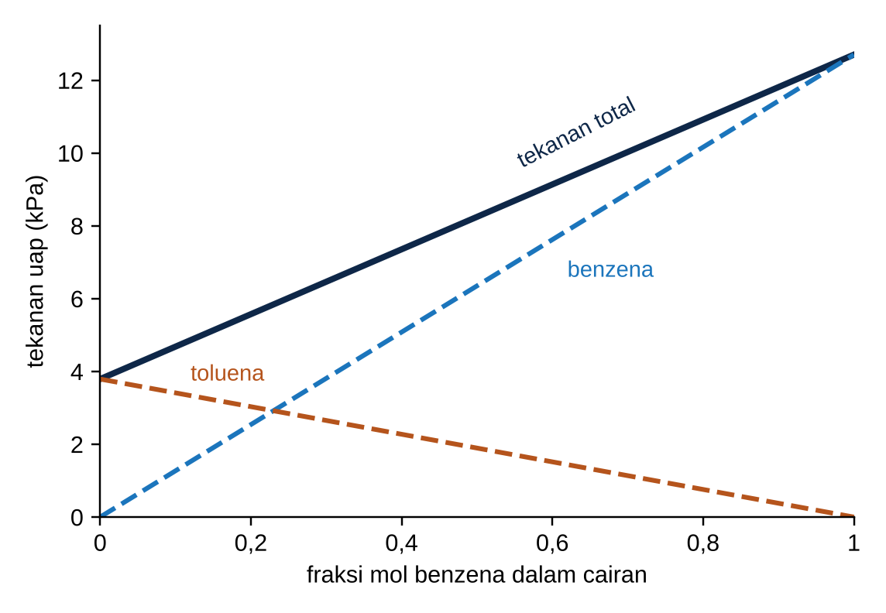

# Bab 10 Larutan Ideal dan Sifat Koligatif

Di negeri bermusim dingin, petugas jalan menaburkan garam di atas jalan yang membeku, dan es pun mencair walaupun suhu udara tetap di bawah nol. Di dapur, air yang diberi garam mendidih sedikit di atas 100 °C. Di rumah sakit, cairan infus harus mengandung tepat 0,9% NaCl. Dengan air yang lebih murni, sel darah merah menggembung dan pecah; dengan air yang lebih asin, sel mengerut. Di pabrik desalinasi, air laut ditekan sampai puluhan bar melewati membran agar menghasilkan air tawar.

Keempat gejala itu tampak tidak berhubungan, tetapi ternyata bersumber dari satu hal: **zat terlarut menurunkan potensial kimia pelarut**. Yang lebih mengejutkan, besarnya penurunan itu, dalam larutan encer, hanya bergantung pada **banyaknya** partikel zat terlarut, bukan pada jenisnya. Satu mol gula dan satu mol urea dalam satu kilogram air menurunkan titik beku dengan besar yang sama. Sifat-sifat yang hanya bergantung pada banyaknya partikel ini disebut **sifat koligatif**, dari kata Latin *colligatus*, "terikat bersama".

Di Bab 9 kita memperoleh potensial kimia gas dan menunjukkan (Contoh 9.10) bahwa bila potensial kimia satu komponen mengikuti bentuk $\mu^* + RT\ln x$, komponen lain juga harus demikian. Bab ini menunjukkan kapan bentuk itu berlaku, lewat hukum Raoult untuk pelarut dan hukum Henry untuk zat terlarut. Dari keduanya kita akan menurunkan keempat sifat koligatif: penurunan tekanan uap, kenaikan titik didih, penurunan titik beku, dan tekanan osmotik. Bab ditutup dengan larutan nyata, tempat fraksi mol diganti oleh **aktivitas**, "konsentrasi efektif" yang memainkan peran fugasitas bagi larutan.

::: {.strategi}
**Pertanyaan pembuka**

1. Apa yang membuat suatu larutan disebut ideal?
2. Mengapa uap di atas campuran benzena dan toluena lebih kaya benzena daripada cairannya?
3. Berapa banyak oksigen yang larut dalam air sungai, dan mengapa penyelam bisa terkena penyakit dekompresi?
4. Mengapa garam menaikkan titik didih dan menurunkan titik beku air?
5. Mengapa cairan infus harus 0,9% NaCl?
6. Bagaimana massa molar protein dapat diukur dengan tekanan osmotik?
7. Bagaimana menangani larutan yang tidak ideal?
:::

::: {.tujuan}
**Tujuan belajar**

Setelah mempelajari bab ini, kamu mampu:

1. Menghitung fungsi termodinamika pencampuran larutan ideal.
2. Memakai hukum Raoult untuk menghitung tekanan uap dan komposisi uap campuran ideal.
3. Memakai hukum Henry untuk menghitung kelarutan gas dan membedakan larutan ideal dari larutan encer ideal.
4. Menurunkan dan menghitung penurunan tekanan uap, kenaikan titik didih, dan penurunan titik beku.
5. Menurunkan persamaan van 't Hoff untuk tekanan osmotik dan memakainya untuk menentukan massa molar.
6. Menjelaskan aktivitas dan koefisien aktivitas serta menghitungnya dari data tekanan uap.
:::

::: {.mat}
**Prasyarat**

Dari Bab 9: potensial kimia, $\mu_\text{J} = \mu_\text{J}^\circ + RT\ln(p_\text{J}/p^\circ)$ untuk gas ideal, energi Gibbs pencampuran gas ideal, dan Contoh 9.10. Dari Bab 8: syarat kesetimbangan fasa $\mu(\alpha) = \mu(\beta)$ dan entalpi transisi. Dari Kimia Dasar: molalitas, molaritas, dan fraksi mol. Dari matematika: $\ln(1 - x) \approx -x$ untuk *x* kecil.
:::

## 10.1 Termodinamika pencampuran

Mulailah dari pertanyaan yang paling sederhana: apa yang terjadi pada energi Gibbs ketika dua cairan bercampur? Untuk gas ideal, jawabannya sudah kita peroleh di subbab 9.5. Molekul gas ideal tidak saling berinteraksi, sehingga pencampuran hanya menambah ketidakteraturan.

Molekul cairan, sebaliknya, selalu saling berinteraksi kuat; tanpa itu mereka tidak akan menjadi cairan. Tetapi bayangkan dua cairan yang molekul-molekulnya **sangat mirip**, seperti benzena dan toluena, atau heksana dan heptana. Molekul benzena dikelilingi molekul toluena merasakan hampir tepat gaya yang sama seperti bila dikelilingi molekul benzena lain. Bagi setiap molekul, tidak ada bedanya siapa tetangganya. Campuran seperti itu disebut **larutan ideal**.

Dalam larutan ideal, interaksi A–B sama dengan rata-rata interaksi A–A dan B–B. Akibatnya tidak ada kalor yang diserap atau dilepaskan ketika kedua cairan dicampur, dan volume tidak berubah. Yang berubah hanya ketidakteraturan susunan molekul, persis seperti pada gas ideal. Di Contoh 9.10 kita sudah melihat bahwa larutan seperti itu mempunyai potensial kimia

::: {.inti}
$$
\mu_\text{J}(l) = \mu_\text{J}^*(l) + RT\ln x_\text{J} . \qquad \text{(10.1)}
$$
**Potensial kimia komponen larutan ideal.** $\mu_\text{J}^*$ adalah potensial kimia cairan J murni pada suhu dan tekanan yang sama. Karena $x_\text{J} < 1$, potensial kimia setiap komponen dalam larutan lebih rendah daripada dalam keadaan murni.
:::

Subbab 10.2 akan menunjukkan dari mana (10.1) berasal secara percobaan. Untuk sekarang, kita pakai saja untuk menghitung energi Gibbs pencampuran. Penurunannya sama persis dengan subbab 9.5: sebelum dicampur $G = n_\text{A}\mu_\text{A}^* + n_\text{B}\mu_\text{B}^*$; sesudah dicampur $G = n_\text{A}(\mu_\text{A}^* + RT\ln x_\text{A}) + n_\text{B}(\mu_\text{B}^* + RT\ln x_\text{B})$. Selisihnya:

$$
\Delta_\text{mix}G = nRT\left(x_\text{A}\ln x_\text{A} + x_\text{B}\ln x_\text{B}\right) , \qquad \Delta_\text{mix}S = -nR\left(x_\text{A}\ln x_\text{A} + x_\text{B}\ln x_\text{B}\right) , \qquad \Delta_\text{mix}H = 0 , \qquad \Delta_\text{mix}V = 0 . \qquad \text{(10.2)}
$$

Rumus-rumus ini identik dengan gas ideal, tetapi alasannya berbeda. Pada gas ideal, $\Delta_\text{mix}H = 0$ karena tidak ada interaksi sama sekali. Pada larutan ideal, interaksinya ada dan kuat, tetapi **sama** untuk semua pasangan molekul, sehingga mengganti tetangga tidak mengubah energi.

::: {.contoh}
**Contoh 10.1 · Mencampur benzena dan toluena**

Hitung $\Delta_\text{mix}G$, $\Delta_\text{mix}S$, dan $\Delta_\text{mix}H$ bila 1,00 mol benzena dicampur dengan 1,00 mol toluena pada 25 °C. Anggap larutannya ideal.

**Penyelesaian.** Dengan $x = 0{,}500$ untuk keduanya dan *n* = 2,00 mol:
$$
\Delta_\text{mix}G = (2{,}00)(8{,}314)(298{,}15)(2)(0{,}500\ln0{,}500) = -3{,}44\ \text{kJ} ,
$$
$$
\Delta_\text{mix}S = -(2{,}00)(8{,}314)(2)(0{,}500\ln0{,}500) = +11{,}5\ \text{J K}^{-1} , \qquad \Delta_\text{mix}H = 0 .
$$

**Memahami hasil.** Pencampuran spontan sepenuhnya karena entropi. Pengukuran kalorimetri yang teliti memberi $\Delta_\text{mix}H$ benzena–toluena sekitar +0,03 kJ untuk campuran ini, seratus kali lebih kecil daripada $T\Delta_\text{mix}S$. Itulah sebabnya benzena–toluena sering dipakai sebagai contoh baku larutan yang hampir ideal.
:::

Bagaimana dengan cairan yang **tidak** bercampur, seperti minyak dan air? Untuk campuran itu, $\Delta_\text{mix}H$ sangat positif: molekul air harus memutuskan sebagian ikatan hidrogennya untuk memberi tempat bagi molekul minyak yang tidak dapat membentuk ikatan hidrogen. Bila $\Delta_\text{mix}H$ melebihi $T\Delta_\text{mix}S$, $\Delta_\text{mix}G$ positif dan kedua cairan memilih tetap terpisah. Larutan ideal selalu bercampur dalam segala perbandingan; larutan nyata dapat bercampur sebagian saja. Bab 11 akan membahas campuran yang bercampur sebagian.

::: {.kuis}
**Kuis cepat 10.1** Apakah larutan ideal dapat dibuat dari air dan etanol? Pakai hasil Bab 9 tentang volume campuran untuk menjawab.
:::

## 10.2 Hukum Raoult dan larutan ideal

Pada akhir abad ke-19, François-Marie Raoult mengukur tekanan uap berbagai larutan dan menemukan pola sederhana. Untuk campuran cairan yang mirip, tekanan parsial uap setiap komponen sebanding dengan fraksi molnya di dalam cairan:

::: {.inti}
$$
p_\text{A} = x_\text{A}\,p_\text{A}^* . \qquad \text{(10.3)}
$$
**Hukum Raoult.** $p_\text{A}^*$ adalah tekanan uap A murni pada suhu yang sama. Larutan yang memenuhi hukum ini untuk semua komponen dan pada semua komposisi disebut **larutan ideal**.
:::

Gambaran molekulnya sederhana. Laju molekul A lepas dari permukaan cairan sebanding dengan banyaknya molekul A di permukaan, yaitu dengan $x_\text{A}$, sedangkan laju pengembunannya sebanding dengan tekanan parsial A di dalam uap. Bila setiap molekul A terikat sama kuatnya pada tetangga apa pun, peluangnya untuk lepas tidak berubah oleh pencampuran; hanya banyaknya yang berubah. Kesetimbangan tercapai ketika tekanan uapnya turun sebanding dengan fraksi mol.

Dari hukum Raoult, rumus (10.1) langsung diperoleh. Pada kesetimbangan antara larutan dan uapnya, potensial kimia A di kedua fasa sama:
$$
\mu_\text{A}(l) = \mu_\text{A}(g) = \mu_\text{A}^\circ + RT\ln\frac{p_\text{A}}{p^\circ} .
$$
Untuk A murni, dengan cara yang sama, $\mu_\text{A}^*(l) = \mu_\text{A}^\circ + RT\ln(p_\text{A}^*/p^\circ)$. Kurangkan keduanya:
$$
\mu_\text{A}(l) = \mu_\text{A}^*(l) + RT\ln\frac{p_\text{A}}{p_\text{A}^*} . \qquad \text{(10.4)}
$$
Persamaan (10.4) berlaku untuk **larutan apa pun**, ideal atau tidak, selama uapnya ideal. Untuk larutan ideal, hukum Raoult memberi $p_\text{A}/p_\text{A}^* = x_\text{A}$, dan (10.4) menjadi (10.1). Jadi hukum Raoult adalah wajah percobaan dari rumus potensial kimia larutan ideal. Tekanan uap adalah "jendela" untuk melihat potensial kimia zat di dalam cairan.

Untuk campuran dua komponen yang keduanya mengikuti hukum Raoult, tekanan uap total adalah

$$
p = p_\text{A} + p_\text{B} = x_\text{A}p_\text{A}^* + x_\text{B}p_\text{B}^* = p_\text{B}^* + (p_\text{A}^* - p_\text{B}^*)x_\text{A} , \qquad \text{(10.5)}
$$

garis lurus dari $p_\text{B}^*$ ke $p_\text{A}^*$. Gambar 10.1 memperlihatkannya untuk benzena dan toluena.

{width=72%}

::: {.contoh}
**Contoh 10.2 · Uap di atas campuran benzena–toluena**

Pada 25 °C, tekanan uap benzena murni 12,7 kPa dan toluena murni 3,79 kPa. Untuk cairan dengan $x_\text{benzena} = 0{,}400$, hitung tekanan parsial setiap komponen, tekanan total, dan fraksi mol benzena di dalam uap.

**Penyelesaian.** Dari (10.3):
$$
p_\text{benzena} = (0{,}400)(12{,}7) = 5{,}08\ \text{kPa} , \qquad p_\text{toluena} = (0{,}600)(3{,}79) = 2{,}27\ \text{kPa} ,
$$
sehingga *p* = 7,35 kPa. Menurut hukum Dalton, fraksi mol dalam uap adalah perbandingan tekanan parsial terhadap tekanan total:
$$
y_\text{benzena} = \frac{5{,}08}{7{,}35} = 0{,}691 .
$$

**Memahami hasil.** Cairan berisi 40% benzena, tetapi uapnya 69% benzena. Komponen yang lebih mudah menguap selalu lebih banyak di dalam uap. Bila uap ini diembunkan lalu diuapkan lagi, uap kedua berisi 88% benzena. Pengulangan langkah penguapan dan pengembunan inilah prinsip **distilasi fraksional**, yang akan kita bahas dengan diagram fasa di Bab 11.
:::

::: {.contoh}
**Contoh 10.3 · Titik didih campuran**

Pada 1 atm (101,3 kPa), benzena mendidih pada 80,1 °C dan toluena pada 110,6 °C. Pada 90,0 °C, tekanan uap benzena murni 136,1 kPa dan toluena murni 54,2 kPa. Berapa komposisi cairan yang mendidih pada 90,0 °C di bawah 1 atm, dan berapa komposisi uap pertama yang terbentuk?

**Penyelesaian.** Cairan mendidih bila tekanan uap totalnya sama dengan tekanan luar. Dari (10.5):
$$
101{,}3 = 54{,}2 + (136{,}1 - 54{,}2)x_\text{benzena} \quad\Rightarrow\quad x_\text{benzena} = \frac{47{,}1}{81{,}9} = 0{,}575 .
$$
Uap: $y_\text{benzena} = (0{,}575)(136{,}1)/101{,}3 = 0{,}773$.

**Memahami hasil.** Campuran mendidih pada suhu di antara titik didih kedua komponen, dan suhu didihnya bergantung pada komposisi. Berbeda dari zat murni, campuran tidak mendidih pada satu suhu tetap: ketika benzena lebih banyak menguap, cairan yang tersisa makin kaya toluena, dan suhu didihnya terus naik.
:::

Bagaimana kita tahu suatu larutan ideal? Ujinya langsung dari percobaan: ukur tekanan uap setiap komponen pada beberapa komposisi, dan periksa apakah hasilnya terletak pada garis lurus Raoult. Hanya sedikit pasangan cairan yang mengikutinya dengan baik, yaitu pasangan yang molekulnya serupa ukuran dan sifat kimianya. Kebanyakan campuran menyimpang, ke atas (tekanan uap lebih besar, karena molekul A dan B saling "tidak suka") atau ke bawah (tekanan uap lebih kecil, karena A dan B saling menarik lebih kuat daripada sesamanya). Penyimpangan ini dibahas di subbab 10.7.

::: {.kuis}
**Kuis cepat 10.2** Dalam Contoh 10.2, mengapa fraksi mol toluena di dalam uap lebih kecil daripada di dalam cairan?
:::

## 10.3 Hukum Henry dan larutan encer ideal

Hukum Raoult berlaku baik untuk cairan yang mirip. Bagaimana dengan larutan yang zat terlarutnya sangat berbeda dari pelarut, seperti oksigen dalam air, atau garam dalam air? Di sini terjadi sesuatu yang menarik.

William Henry, pada 1803, menemukan bahwa banyaknya gas yang larut dalam cairan sebanding dengan tekanan parsial gas itu di atas cairan. Dalam bahasa tekanan uap: untuk zat terlarut B dalam larutan encer, tekanan parsial B di atas larutan juga sebanding dengan fraksi molnya, tetapi tetapan kesebandingannya **bukan** tekanan uap B murni:

::: {.inti}
$$
p_\text{B} = x_\text{B}\,K_\text{B} . \qquad \text{(10.6)}
$$
**Hukum Henry.** $K_\text{B}$ adalah tetapan Henry, yang bergantung pada zat terlarut, pelarut, dan suhu. Hukum ini berlaku untuk zat terlarut dalam larutan encer.
:::

Mengapa tetapannya berbeda? Dalam larutan encer, setiap molekul B dikelilingi hampir seluruhnya oleh molekul pelarut A, bukan oleh molekul B lain. Kecenderungannya untuk lepas ke uap ditentukan oleh interaksi B–A, yang dapat jauh lebih lemah atau lebih kuat daripada interaksi B–B di dalam B murni. Selama larutan cukup encer, lingkungan setiap molekul B tetap sama, yaitu "lautan A", sehingga tekanan uapnya tetap sebanding dengan $x_\text{B}$, tetapi dengan tetapan $K_\text{B}$ yang mencerminkan lingkungan itu.

Sementara itu, pelarut dalam larutan encer hampir murni: setiap molekul A dikelilingi oleh molekul A lain, kecuali sebagian kecil yang bertetangga dengan B. Pelarut karenanya mengikuti hukum Raoult. Larutan yang zat terlarutnya mengikuti hukum Henry dan pelarutnya mengikuti hukum Raoult disebut **larutan encer ideal**. Gambar 10.2 memperlihatkan kedua batas itu pada satu larutan nyata.

{width=72%}

::: {.contoh}
**Contoh 10.4 · Oksigen untuk ikan**

Tetapan Henry O₂ dalam air pada 25 °C adalah $4{,}34 \times 10^4$ bar (berbasis fraksi mol). Hitung kelarutan O₂ dalam air yang bersentuhan dengan udara ($p_{\text{O}_2} = 0{,}21$ bar), dalam mol kg⁻¹ dan mg L⁻¹.

**Penyelesaian.** Dari (10.6): $x_{\text{O}_2} = 0{,}21/(4{,}34 \times 10^4) = 4{,}84 \times 10^{-6}$. Satu kilogram air berisi 55,51 mol, dan karena larutan sangat encer, $n_{\text{O}_2} \approx x_{\text{O}_2} \times 55{,}51 = 2{,}69 \times 10^{-4}$ mol. Dalam satu liter (praktis satu kilogram): $(2{,}69 \times 10^{-4})(32{,}00 \times 10^3)$ mg = 8,6 mg L⁻¹.

**Memahami hasil.** Nilai terukurnya 8,3 mg L⁻¹. Ini adalah **oksigen terlarut** (DO) air jenuh pada 25 °C, salah satu ukuran utama mutu air. Ikan memerlukan sekitar 5 mg L⁻¹; di bawah 2 mg L⁻¹ kebanyakan ikan mati. Kelarutan gas turun bila suhu naik, sehingga pada musim kemarau yang panas, sungai yang tercemar bahan organik (yang menghabiskan oksigen untuk diuraikan) dapat mengalami kematian ikan massal.
:::

Tetapan Henry yang besar berarti gas sukar larut: diperlukan tekanan besar untuk melarutkan sedikit gas. O₂ dan N₂ mempunyai tetapan besar karena molekulnya nonpolar dan tidak bereaksi dengan air. CO₂ jauh lebih mudah larut, sekitar 26 kali lebih banyak per bar daripada O₂, karena molekulnya berinteraksi lebih kuat dengan air dan sebagian bereaksi membentuk asam karbonat.

::: {.contoh}
**Contoh 10.5 · Mengapa minuman bersoda berbuih**

Minuman bersoda dibotolkan di bawah tekanan CO₂ sekitar 4,0 bar. Tetapan Henry CO₂ dalam air pada 25 °C adalah $1{,}67 \times 10^3$ bar. (a) Berapa gram CO₂ yang larut per liter? (b) Berapa yang larut bila minuman dibiarkan terbuka sampai setimbang dengan udara ($p_{\text{CO}_2} = 4{,}2 \times 10^{-4}$ bar)?

**Penyelesaian.** (a) $x = 4{,}0/1670 = 2{,}40 \times 10^{-3}$; banyaknya per kg air $(2{,}40 \times 10^{-3})(55{,}51) = 0{,}133$ mol, atau $(0{,}133)(44{,}01) = 5{,}9$ g L⁻¹.

(b) Tekanannya hampir sepuluh ribu kali lebih kecil, sehingga kelarutannya juga: $5{,}9 \times (4{,}2 \times 10^{-4}/4{,}0) = 6{,}1 \times 10^{-4}$ g L⁻¹, atau sekitar 0,6 mg L⁻¹.

**Memahami hasil.** Ketika tutup botol dibuka, hampir seluruh 5,9 g CO₂ "berlebih" dan harus keluar. Ia keluar lewat gelembung yang tumbuh pada goresan dan butir debu di dinding gelas, tempat inti gelembung mudah terbentuk, seperti inti es pada air dingin-lewat di Bab 8. Minuman yang "basi" adalah minuman yang sudah mencapai kesetimbangan dengan udara.
:::

::: {.terapan}
**Penyakit dekompresi.** Pada kedalaman 30 m, tekanan total di paru-paru penyelam sekitar 4 bar, dan tekanan parsial N₂ sekitar 3,2 bar. Menurut hukum Henry, darah dan jaringan perlahan-lahan menyerap N₂ empat kali lebih banyak daripada di permukaan. Bila penyelam naik terlalu cepat, tekanan turun lebih cepat daripada N₂ dapat keluar lewat paru-paru, dan N₂ berlebih membentuk gelembung di dalam darah dan sendi, seperti buih minuman bersoda. Dengan tetapan Henry N₂ dalam air ($8{,}68 \times 10^4$ bar pada 25 °C) sebagai pendekatan, kelebihan N₂ per liter darah sekitar $1{,}5 \times 10^{-3}$ mol, yang pada suhu tubuh dan tekanan 1 bar menempati sekitar 40 mL gas. Gejalanya, yang disebut *the bends*, berkisar dari nyeri sendi sampai kelumpuhan. Pencegahannya adalah naik perlahan dengan berhenti di beberapa kedalaman, supaya N₂ sempat keluar lewat paru-paru.
:::

Larutan encer ideal mempunyai rumus potensial kimia yang mirip dengan (10.1), tetapi dengan keadaan acuan yang berbeda. Untuk zat terlarut, dari (10.4) dengan $p_\text{B} = x_\text{B}K_\text{B}$:

$$
\mu_\text{B} = \mu_\text{B}^\circ + RT\ln\frac{K_\text{B}}{p^\circ} + RT\ln x_\text{B} = \mu_\text{B}^\dagger + RT\ln x_\text{B} . \qquad \text{(10.7)}
$$

Bentuknya sama, tetapi $\mu_\text{B}^\dagger$ **bukan** potensial kimia B murni. Ia adalah potensial kimia B dalam keadaan hipotetis: B murni yang setiap molekulnya tetap merasakan lingkungan seperti dalam larutan sangat encer. Keadaan ini tidak pernah ada, tetapi seperti gas ideal hipotetis di Bab 9, ia memberikan titik acuan yang jelas. Dalam praktik, kimiawan lebih sering memakai molalitas $b_\text{B}$ atau konsentrasi molar $c_\text{B}$ daripada fraksi mol, dan keadaan standarnya dipilih $b^\circ = 1$ mol kg⁻¹ atau $c^\circ = 1$ mol L⁻¹:

$$
\mu_\text{B} = \mu_\text{B}^\circ + RT\ln\frac{b_\text{B}}{b^\circ} . \qquad \text{(10.8)}
$$

Pergantian dari $x_\text{B}$ ke $b_\text{B}$ sah karena dalam larutan encer $x_\text{B} \approx b_\text{B}M_\text{A}$, dengan $M_\text{A}$ massa molar pelarut dalam kg mol⁻¹. Maka $RT\ln x_\text{B} = RT\ln(b_\text{B}/b^\circ) + RT\ln(M_\text{A}b^\circ)$, dan suku terakhir, yang tetap, digabungkan ke dalam $\mu_\text{B}^\circ$ yang baru.

Rumus (10.8) adalah bentuk yang akan kita pakai untuk zat terlarut dalam kesetimbangan kimia (Bab 12) dan sel elektrokimia (Bab 13). Ia berlaku untuk larutan encer ideal; untuk larutan nyata, $b_\text{B}/b^\circ$ diganti aktivitas (subbab 10.7).

::: {.awas}
**Banyak satuan tetapan Henry.** Tetapan Henry ditabelkan dalam berbagai bentuk: berbasis fraksi mol (bar, seperti di bab ini), berbasis molalitas (bar kg mol⁻¹), atau sebagai kebalikannya, kelarutan per tekanan (mol L⁻¹ bar⁻¹). Nilai O₂ dalam air pada 25 °C, misalnya, adalah $4{,}34 \times 10^4$ bar, atau 782 bar kg mol⁻¹, atau $1{,}3 \times 10^{-3}$ mol L⁻¹ bar⁻¹. Selalu periksa satuan sebelum memakai tabel.
:::

::: {.kuis}
**Kuis cepat 10.3** Dalam larutan encer O₂ dalam air, komponen mana yang mengikuti hukum Raoult, dan mana yang mengikuti hukum Henry?
:::
