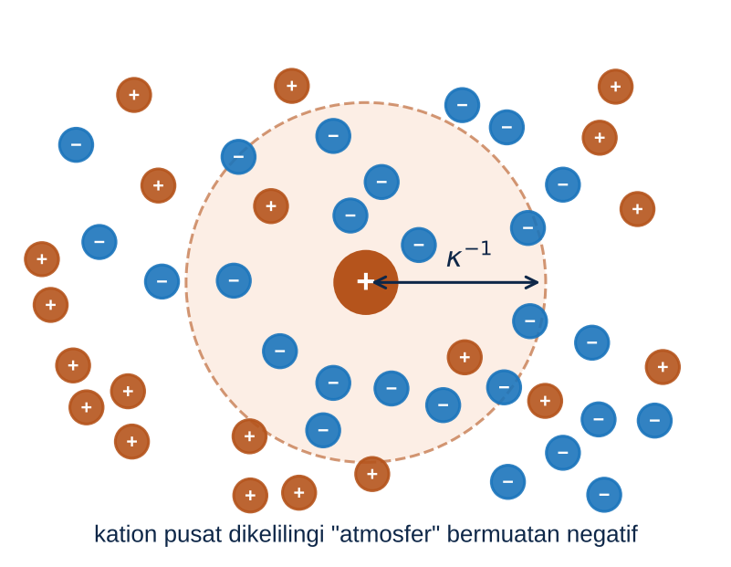

## 10.7 Larutan nyata dan aktivitas

Larutan ideal dan larutan encer ideal adalah batas. Kebanyakan larutan yang dijumpai di laboratorium berada di antara keduanya, dan pada konsentrasi menengah tidak mengikuti hukum Raoult maupun hukum Henry. Bagaimana menanganinya tanpa kehilangan semua rumus yang sudah kita bangun?

### Penyimpangan positif dan negatif

Bila molekul A dan B saling menarik **lebih lemah** daripada sesamanya, setiap molekul dalam campuran "kurang betah" dan lebih mudah lepas ke uap. Tekanan uapnya lebih besar daripada ramalan Raoult: **penyimpangan positif**. Pencampurannya menyerap kalor ($\Delta_\text{mix}H > 0$). Contohnya aseton dengan karbon disulfida, atau etanol dengan heksana: molekul polar dan nonpolar tidak saling cocok.

Bila A dan B saling menarik **lebih kuat** daripada sesamanya, terjadi **penyimpangan negatif**: tekanan uap lebih kecil daripada ramalan Raoult, dan pencampuran melepaskan kalor ($\Delta_\text{mix}H < 0$). Contoh klasiknya aseton dengan kloroform. Atom hidrogen kloroform, yang diaktifkan oleh tiga atom klor, membentuk ikatan hidrogen lemah dengan oksigen aseton, interaksi yang tidak ada di dalam masing-masing cairan murni.

Penyimpangan yang besar mempunyai akibat praktis yang penting. Campuran dengan penyimpangan cukup besar dapat membentuk **azeotrop**, campuran yang mendidih tanpa berubah komposisi, sehingga tidak dapat dipisahkan dengan distilasi biasa; etanol 95,6% dengan air adalah contoh yang terkenal. Dan bila penyimpangan positifnya sangat besar, kedua cairan berhenti bercampur sempurna. Bab 11 membahas keduanya.

### Aktivitas

Strategi untuk larutan nyata sama dengan strategi Lewis untuk gas nyata (subbab 9.5): **pertahankan bentuk rumus, dan ganti fraksi mol dengan besaran efektif**. Persamaan (10.4), $\mu_\text{A} = \mu_\text{A}^* + RT\ln(p_\text{A}/p_\text{A}^*)$, berlaku untuk larutan apa pun. Perbandingan tekanan uap di dalamnya diberi nama:

::: {.inti}
$$
\mu_\text{A} = \mu_\text{A}^* + RT\ln a_\text{A} , \qquad a_\text{A} = \frac{p_\text{A}}{p_\text{A}^*} = \gamma_\text{A}x_\text{A} . \qquad \text{(10.13)}
$$
**Aktivitas** $a_\text{A}$ adalah "fraksi mol efektif" pelarut. **Koefisien aktivitas** $\gamma_\text{A}$ mengukur penyimpangan dari hukum Raoult; $\gamma_\text{A} \to 1$ bila $x_\text{A} \to 1$. Penyimpangan positif berarti γ > 1, negatif berarti γ < 1.
:::

Perhatikan analoginya: aktivitas bagi larutan sama dengan fugasitas bagi gas. Koefisien aktivitas memainkan peran koefisien fugasitas. Dan seperti fugasitas, aktivitas dapat **diukur**: untuk pelarut, cukup dengan membandingkan tekanan uap di atas larutan dengan tekanan uap pelarut murni.

::: {.contoh}
**Contoh 10.14 · Aktivitas air dalam larutan garam**

Pada 25 °C, tekanan uap air di atas larutan NaCl 1,00 mol kg⁻¹ adalah 3,064 kPa, sedangkan air murni 3,169 kPa. Hitung aktivitas air, koefisien aktivitasnya berbasis fraksi mol, dan penurunan potensial kimianya.

**Penyelesaian.** $a_\text{air} = 3{,}064/3{,}169 = 0{,}967$. Fraksi mol air, dengan dua mol ion per mol NaCl: $x_\text{air} = 55{,}51/(55{,}51 + 2{,}00) = 0{,}965$. Maka $\gamma_\text{air} = 0{,}967/0{,}965 = 1{,}002$. Penurunan potensial kimia: $RT\ln a_\text{air} = (2479)\ln0{,}967 = -83$ J mol⁻¹.

**Memahami hasil.** Untuk pelarut, larutan garam 1 mol kg⁻¹ ini hampir ideal: koefisien aktivitas air menyimpang hanya 0,2% dari satu. Penyimpangan zat terlarutnya jauh lebih besar, seperti akan kita lihat di bawah. Ini contoh nyata dari Gibbs–Duhem (Contoh 9.9): perubahan kecil pada pelarut berpasangan dengan perubahan besar pada zat terlarut.
:::

::: {.terapan}
**Aktivitas air dan pengawetan makanan.** Mikroba memerlukan air untuk hidup, tetapi yang menentukan bukan kadar airnya, melainkan **aktivitas air** $a_\text{w}$, karena air hanya dapat masuk ke dalam sel mikroba bila potensial kimianya di luar sel cukup tinggi. Kebanyakan bakteri pembusuk berhenti tumbuh di bawah $a_\text{w} \approx 0{,}90$, kapang dan khamir di bawah sekitar 0,80 dan 0,60. Pada $a_\text{w} = 0{,}90$, potensial kimia air sudah 261 J mol⁻¹ di bawah air murni, setara tekanan osmotik sekitar 145 bar yang harus dilawan sel. Ikan asin, dendeng, selai, dan madu awet karena garam dan gula menurunkan $a_\text{w}$: larutan garam jenuh mempunyai $a_\text{w}$ sekitar 0,75, dan madu sekitar 0,6. Industri pangan mengukur $a_\text{w}$ dengan mengukur kelembapan relatif udara yang setimbang dengan sampel, yang tidak lain adalah $p_\text{air}/p_\text{air}^*$.
:::

### Model larutan reguler

Mengapa koefisien aktivitas berubah dengan komposisi? Model paling sederhana yang menangkap fisikanya adalah **larutan reguler**. Anggap molekul-molekul tetap tersusun acak, seperti pada larutan ideal, sehingga entropi pencampurannya sama dengan (10.2), tetapi energi interaksi A–B berbeda dari rata-rata A–A dan B–B. Banyaknya pasangan A–B dalam susunan acak sebanding dengan $x_\text{A}x_\text{B}$, sehingga entalpi pencampuran, yang sekarang tidak nol, adalah

$$
\Delta_\text{mix}H = n\,w\,x_\text{A}x_\text{B} , \qquad \text{(10.14)}
$$

dengan *w* parameter yang mengukur selisih energi interaksi. Energi Gibbs pencampuran kini memperoleh suku tambahan, yang disebut **energi Gibbs ekses** $G^\text{E} = nw\,x_\text{A}x_\text{B}$. Menurunkan suku itu terhadap $n_\text{A}$ (lihat Pembahasan soal terpilih di akhir bab) memberi koefisien aktivitas:

$$
\ln\gamma_\text{A} = \beta x_\text{B}^2 , \qquad \ln\gamma_\text{B} = \beta x_\text{A}^2 , \qquad \beta = \frac{w}{RT} . \qquad \text{(10.15)}
$$

Bila β > 0 (A–B lebih lemah), γ > 1: penyimpangan positif. Bila β < 0, penyimpangan negatif. Bila $x_\text{B} \to 0$, $\gamma_\text{A} \to 1$: pelarut kembali mengikuti Raoult. Dan bila $x_\text{B} \to 0$, $\gamma_\text{B} \to e^\beta$, tetap: zat terlarut encer mengikuti hukum Henry dengan $K_\text{B} = e^\beta p_\text{B}^*$. Gambar 10.3 dibuat dengan model ini. Satu model sederhana menghasilkan kedua hukum batas sekaligus.

::: {.contoh}
**Contoh 10.15 · Tekanan uap larutan reguler**

Campuran A ($p_\text{A}^* = 20{,}0$ kPa) dan B ($p_\text{B}^* = 10{,}0$ kPa) pada suatu suhu dapat digambarkan sebagai larutan reguler dengan β = 1,20. Untuk $x_\text{B} = 0{,}400$, hitung koefisien aktivitas, tekanan parsial, dan tekanan total, lalu bandingkan dengan ramalan Raoult. Hitung juga energi Gibbs ekses per mol pada 25 °C.

**Penyelesaian.** Dari (10.15): $\gamma_\text{A} = e^{(1{,}20)(0{,}400)^2} = e^{0{,}192} = 1{,}212$; $\gamma_\text{B} = e^{(1{,}20)(0{,}600)^2} = e^{0{,}432} = 1{,}540$.

Tekanan parsial: $p_\text{A} = \gamma_\text{A}x_\text{A}p_\text{A}^* = (1{,}212)(0{,}600)(20{,}0) = 14{,}5$ kPa; $p_\text{B} = (1{,}540)(0{,}400)(10{,}0) = 6{,}16$ kPa. Tekanan total 20,7 kPa. Raoult: $(0{,}600)(20{,}0) + (0{,}400)(10{,}0) = 16{,}0$ kPa.

Energi Gibbs ekses per mol: $G^\text{E}_\text{m} = \beta RT x_\text{A}x_\text{B} = (1{,}20)(2479)(0{,}240) = 714$ J mol⁻¹.

**Memahami hasil.** Tekanan uap 29% di atas ramalan Raoult: molekul-molekul yang "tidak betah" lebih mudah lepas. Model reguler meramalkan bahwa bila β melebihi 2, energi Gibbs pencampuran pada komposisi tengah menjadi cukup tinggi sehingga campuran lebih suka terpisah menjadi dua fasa cair. Ambang β = 2 ini akan kita turunkan di Bab 11.
:::

### Aktivitas zat terlarut dan ion

Untuk zat terlarut, acuannya adalah hukum Henry, bukan Raoult. Dengan molalitas sebagai ukuran komposisi, (10.8) menjadi

$$
\mu_\text{B} = \mu_\text{B}^\circ + RT\ln a_\text{B} , \qquad a_\text{B} = \gamma_\text{B}\frac{b_\text{B}}{b^\circ} , \qquad \gamma_\text{B} \to 1\ \text{bila}\ b_\text{B} \to 0 . \qquad \text{(10.16)}
$$

Pada larutan sangat encer, aktivitas sama dengan molalitas (dalam satuan mol kg⁻¹). Ketika konsentrasi naik, γ menyimpang dari satu.

::: {.awas}
**Aktivitas selalu "terhadap apa".** Nilai aktivitas bergantung pada keadaan acuan yang dipilih. Untuk pelarut, acuannya pelarut murni (hukum Raoult), sehingga air murni mempunyai *a* = 1. Untuk zat terlarut, acuannya larutan encer ideal pada 1 mol kg⁻¹ (hukum Henry), sehingga zat terlarut dalam larutan 0,01 mol kg⁻¹ mempunyai *a* ≈ 0,01, bukan mendekati 1. Potensial kimia zat itu sendiri tidak bergantung pada pilihan ini; yang berubah hanyalah pembagian antara $\mu^\circ$ dan $RT\ln a$. Karena itu nilai aktivitas atau koefisien aktivitas dari dua tabel hanya boleh dibandingkan bila keadaan acuannya sama.
:::

Untuk ion, penyimpangan muncul bahkan pada konsentrasi yang sangat kecil. Gaya listrik antara ion menurun lambat dengan jarak (sebanding 1/*r*), sehingga setiap ion "merasakan" ion-ion lain walaupun mereka jauh. Setiap kation dikelilingi rata-rata sedikit lebih banyak anion daripada kation, sebuah **atmosfer ionik** yang menurunkan energinya dan menstabilkannya. Akibatnya koefisien aktivitas ion selalu kurang dari satu dalam larutan encer. Peter Debye dan Erich Hückel (1923) menghitungnya dan memperoleh, untuk larutan sangat encer dalam air pada 25 °C, **hukum pembatas Debye–Hückel**:

$$
\log\gamma_\pm = -0{,}509\,|z_+z_-|\sqrt{I} , \qquad I = \tfrac12\sum_i z_i^2\frac{b_i}{b^\circ} . \qquad \text{(10.17)}
$$

$\gamma_\pm$ adalah koefisien aktivitas **rata-rata** kation dan anion (koefisien setiap ion tidak dapat diukur sendiri, karena larutan harus netral), $z_\pm$ muatan ion, dan *I* **kekuatan ion**, ukuran banyaknya muatan dalam larutan, dengan ion bermuatan besar dihitung lebih berat.

::: {.contoh}
**Contoh 10.16 · Koefisien aktivitas ion**

Hitung $\gamma_\pm$ menurut hukum pembatas Debye–Hückel untuk (a) NaCl 0,0010 mol kg⁻¹; (b) CaCl₂ 0,010 mol kg⁻¹. Nilai terukurnya 0,966 dan 0,732.

**Penyelesaian.** (a) $I = \tfrac12[(1)^2(0{,}0010) + (1)^2(0{,}0010)] = 0{,}0010$. $\log\gamma_\pm = -(0{,}509)(1)(0{,}0316) = -0{,}0161$, sehingga $\gamma_\pm = 0{,}964$.

(b) $I = \tfrac12[(2)^2(0{,}010) + (1)^2(0{,}020)] = 0{,}030$. $\log\gamma_\pm = -(0{,}509)(2)(0{,}173) = -0{,}176$, sehingga $\gamma_\pm = 0{,}666$.

**Memahami hasil.** Untuk larutan seratus kali lebih encer daripada cairan tubuh, hukum pembatas tepat. Untuk CaCl₂ 0,010 mol kg⁻¹, ia sudah meleset 9%: hukum pembatas menganggap ion sebagai titik bermuatan, padahal ion mempunyai ukuran yang membatasi seberapa dekat atmosfer ionik dapat merapat. Perhatikan juga betapa besar pengaruh muatan: pada konsentrasi yang hanya sepuluh kali lebih besar, ion Ca²⁺ membuat aktivitas efektif turun sepertiga. Itulah sebabnya perhitungan kesetimbangan yang melibatkan ion bermuatan banyak, seperti kelarutan garam dan pH larutan penyangga, memerlukan koefisien aktivitas untuk hasil yang teliti.
:::

::: {.dalam}
**Lebih dalam: koefisien aktivitas dan sifat koligatif.** Dengan aktivitas, rumus sifat koligatif dapat diperbaiki untuk larutan nyata. Tekanan osmotik, misalnya, menjadi $\Pi V_\text{A} = -RT\ln a_\text{A}$, yang eksak (selama $V_\text{A}$ tetap). Untuk elektrolit, penyimpangan biasa dinyatakan dengan **koefisien osmotik** φ: $\Pi = \varphi\,[\text{partikel}]\,RT$. Untuk NaCl dalam darah, φ ≈ 0,93, yang menjelaskan selisih antara 7,9 dan 7,7 bar di Contoh 10.12. Faktor van 't Hoff *i* yang dipakai di Kimia Dasar adalah hasil kali banyaknya ion per satuan rumus dengan φ, sehingga nilainya selalu sedikit di bawah bilangan bulat.
:::

::: {.kuis}
**Kuis cepat 10.7** Campuran aseton–kloroform menyimpang negatif dari hukum Raoult. Apakah koefisien aktivitas kedua komponen lebih besar atau lebih kecil dari 1? Apakah pencampurannya menyerap atau melepaskan kalor?
:::

## 10.8 Larutan elektrolit

Subbab 10.7 memperkenalkan hukum pembatas Debye–Hückel sebagai rumus. Di sini kita melihat dari mana rumus itu datang, seberapa jauh ia berlaku, dan bagaimana kimiawan memperbaikinya untuk larutan yang lebih pekat, seperti air laut atau cairan tubuh. Pertanyaan pembukanya sederhana: mengapa larutan NaCl yang hanya 0,01 mol kg⁻¹ sudah menyimpang 10% dari perilaku ideal, padahal larutan sukrosa pada konsentrasi yang sama hampir tidak menyimpang sama sekali?

### Atmosfer ion

Jawabannya terletak pada jangkauan gaya listrik. Gaya antara dua molekul netral, seperti dua molekul sukrosa, turun sangat cepat dengan jarak (energinya sebanding $r^{-6}$, subbab 2.2), sehingga pada larutan encer molekul zat terlarut hampir tidak pernah saling merasakan. Energi Coulomb antara dua ion turun hanya sebanding $1/r$. Pada 0,01 mol kg⁻¹, jarak rata-rata antarion sekitar 5 nm, dan pada jarak itu energi tarik-menarik dua ion bermuatan tunggal dalam air masih sekitar sepersepuluh *kT*. Itu kecil untuk satu pasang ion, tetapi setiap ion mempunyai banyak tetangga.

Akibatnya, ion-ion tidak tersebar acak sempurna. Di sekitar setiap kation, anion sedikit lebih sering ditemukan daripada kation, dan sebaliknya. Debye dan Hückel (1923) menyebut awan bermuatan berlawanan ini **atmosfer ion** (Gambar 10.7). Atmosfer itu menurunkan energi ion pusat, karena ion dikelilingi muatan yang menariknya. Energi yang lebih rendah berarti potensial kimia yang lebih rendah, dan itulah arti $\gamma_\pm < 1$: ion "lebih stabil" di dalam larutan nyata daripada di larutan ideal yang ionnya tidak saling merasakan.

{width=58%}

Seberapa tebal atmosfer itu? Teori Debye–Hückel memberi ketebalan khasnya, yang disebut **panjang Debye** $\kappa^{-1}$. Untuk larutan dalam air pada 25 °C,
$$
\kappa^{-1} = \frac{0{,}304\ \text{nm}}{\sqrt{I}} , \qquad \text{(10.18)}
$$
dengan *I* kekuatan ion dalam mol L⁻¹. Makin besar kekuatan ion, makin banyak ion yang tersedia untuk menyusun atmosfer, sehingga atmosfer makin rapat dan makin tipis. Energi yang diturunkan atmosfer sebanding dengan $1/\kappa^{-1}$, yaitu sebanding $\sqrt{I}$, dan dari situlah akar kekuatan ion dalam hukum pembatas (10.17) berasal.

::: {.contoh}
**Contoh 10.17 · Panjang Debye di laboratorium dan di dalam sel**

Hitung panjang Debye pada 25 °C untuk (a) NaCl 0,0010 mol L⁻¹, (b) NaCl 0,010 mol L⁻¹, (c) larutan dengan kekuatan ion 0,15 mol L⁻¹, kira-kira cairan tubuh.

**Penyelesaian.** Untuk NaCl, $I = \tfrac12[(1)^2c + (1)^2c] = c$. (a) $\kappa^{-1} = 0{,}304/\sqrt{0{,}0010} = 9{,}6$ nm. (b) $0{,}304/\sqrt{0{,}010} = 3{,}0$ nm. (c) $0{,}304/\sqrt{0{,}15} = 0{,}78$ nm.

**Memahami hasil.** Di dalam sel, atmosfer ion hanya setebal dua atau tiga molekul air. Artinya muatan pada protein dan DNA "tersembunyi" dari muatan lain yang jaraknya lebih dari sekitar 1 nm. Itulah sebabnya dua muatan sejenis pada permukaan protein yang berjauhan hampir tidak saling menolak, dan mengapa banyak enzim berubah perilaku bila kekuatan ion larutan penyangga diubah. Gagasan "penyaringan muatan" yang sama menjelaskan mengapa koloid menggumpal bila garam ditambahkan: atmosfer ion yang tipis tidak lagi cukup menjaga partikel tetap terpisah.
:::

### Seberapa jauh hukum pembatas berlaku?

Hukum pembatas menganggap ion sebagai titik bermuatan. Anggapan itu hanya baik bila atmosfer jauh lebih tebal daripada ukuran ion, kira-kira 0,3–0,5 nm. Dari (10.18), syarat itu dipenuhi bila *I* jauh di bawah 0,01. Untuk larutan lebih pekat, ukuran ion harus diperhitungkan. Ion tidak dapat mendekat lebih dekat dari jumlah jari-jarinya, sehingga atmosfer tidak dapat serapat yang diramalkan. Hasilnya adalah **hukum Debye–Hückel yang diperluas**:
$$
\log\gamma_\pm = -\frac{0{,}509\,|z_+z_-|\sqrt{I}}{1 + \sqrt{I}} . \qquad \text{(10.19)}
$$
Penyebut $1 + \sqrt{I}$ adalah koreksi ukuran ion, dengan diameter ion khas sekitar 0,3 nm. Untuk larutan yang lebih pekat lagi, Davies menambahkan suku empiris yang membuat γ naik kembali:
$$
\log\gamma_\pm = -0{,}509\,|z_+z_-|\left(\frac{\sqrt{I}}{1 + \sqrt{I}} - 0{,}30\,I\right) . \qquad \text{(10.20)}
$$
Suku positif $0{,}30\,I$ mencerminkan dua hal yang diabaikan Debye–Hückel: sebagian air terikat erat pada ion (hidrasi), sehingga "pelarut bebas" berkurang dan konsentrasi efektif ion naik.

Gambar 10.8 membandingkan ketiga rumus dengan data NaCl. Hukum pembatas tepat sampai sekitar 0,005 mol kg⁻¹, lalu meleset makin jauh. Bentuk diperluas bertahan sampai sekitar 0,1 mol kg⁻¹, dan persamaan Davies sampai sekitar 0,2–0,5 mol kg⁻¹. Di atas itu, termasuk air laut (*I* ≈ 0,7), tidak ada rumus sederhana yang memadai, dan kimiawan memakai data terukur atau model yang lebih rumit (misalnya persamaan Pitzer).

{width=78%}

::: {.strategi}
**Strategi: memilih rumus koefisien aktivitas ion.**

1. Hitung kekuatan ion dari **semua** ion dalam larutan, termasuk ion yang tidak ikut bereaksi: $I = \tfrac12\sum_i z_i^2 b_i$.
2. Bila *I* < 0,005, pakai hukum pembatas (10.17).
3. Bila 0,005 < *I* < 0,1, pakai bentuk diperluas (10.19).
4. Bila 0,1 < *I* < 0,5, pakai persamaan Davies (10.20) dan anggap hasilnya hanya taksiran.
5. Di atas 0,5, cari data terukur.
6. Periksa kewajaran: γ$_\pm$ harus mendekati 1 bila larutan diencerkan, dan ion bermuatan dua atau tiga harus mempunyai γ$_\pm$ jauh lebih kecil daripada ion bermuatan satu pada kekuatan ion yang sama.
:::

### Efek garam pada kelarutan

Konsekuensi kimia yang paling mudah diamati adalah **efek garam**: garam yang sukar larut menjadi sedikit **lebih** larut bila ke dalam larutan ditambahkan garam lain yang tidak mempunyai ion sejenis. Untuk AgCl, kesetimbangan kelarutannya ditulis dengan aktivitas:
$$
K_\text{sp} = a_{\text{Ag}^+}a_{\text{Cl}^-} = \gamma_\pm^2\,s^2 ,
$$
dengan *s* kelarutan molar. Karena $K_\text{sp}$ tetap pada suhu tetap, penurunan $\gamma_\pm$ oleh garam asing harus diimbangi kenaikan *s*:
$$
s = \frac{\sqrt{K_\text{sp}}}{\gamma_\pm} .
$$
Inilah kebalikan efek ion senama yang dikenal dari kimia dasar. Garam asing tidak bereaksi dengan Ag⁺ atau Cl⁻; ia hanya menebalkan atmosfer ion di sekitar setiap ion perak dan klorida, sehingga keduanya lebih stabil di dalam larutan dan lebih banyak padatan yang larut.

::: {.contoh}
**Contoh 10.18 · AgCl dalam larutan KNO₃**

$K_\text{sp}$ AgCl pada 25 °C adalah $1{,}77 \times 10^{-10}$. Hitung kelarutannya (a) dalam air murni, (b) dalam KNO₃ 0,010 mol kg⁻¹, (c) dalam KNO₃ 0,050 mol kg⁻¹. Pakai hukum Debye–Hückel yang diperluas.

**Rencana.** Kelarutan AgCl sangat kecil, sehingga kekuatan ion praktis ditentukan oleh KNO₃ saja: *I* = *b*(KNO₃).

**Penyelesaian.** (a) Dalam air murni, *I* ≈ 0 dan γ$_\pm$ ≈ 1: $s = \sqrt{1{,}77 \times 10^{-10}} = 1{,}33 \times 10^{-5}$ mol kg⁻¹.

(b) $I = 0{,}010$: $\log\gamma_\pm = -0{,}509(0{,}100)/(1{,}100) = -0{,}0463$, sehingga γ$_\pm$ = 0,899 dan $s = 1{,}33 \times 10^{-5}/0{,}899 = 1{,}48 \times 10^{-5}$ mol kg⁻¹.

(c) $I = 0{,}050$: $\log\gamma_\pm = -0{,}509(0{,}224)/(1{,}224) = -0{,}0931$, sehingga γ$_\pm$ = 0,807 dan $s = 1{,}65 \times 10^{-5}$ mol kg⁻¹.

**Memahami hasil.** KNO₃ 0,050 mol kg⁻¹ menaikkan kelarutan AgCl sekitar 24%. Efek ini kecil dibanding efek ion senama (NaCl 0,010 mol kg⁻¹ akan menurunkan kelarutan AgCl hampir seribu kali), tetapi cukup besar untuk diperhitungkan dalam analisis gravimetri yang teliti. Ion bermuatan lebih tinggi memberi efek jauh lebih besar, karena kekuatan ion naik dengan kuadrat muatan dan log γ$_\pm$ sebanding $|z_+z_-|$. Untuk BaSO₄ (|*z*$_+$*z*$_-$| = 4) dalam larutan garam, kenaikan kelarutannya bisa beberapa kali lipat.
:::

::: {.kuis}
**Kuis cepat 10.8** Larutan A berisi NaCl 0,030 mol kg⁻¹, larutan B berisi MgSO₄ 0,0075 mol kg⁻¹. Mana yang kekuatan ionnya lebih besar? Pada larutan mana koefisien aktivitas ion rata-ratanya lebih kecil?
:::

### Menuju bab berikutnya

Bab ini dibangun dari satu rumus: $\mu = \mu^* + RT\ln x$ untuk larutan ideal, dan $\mu = \mu^* + RT\ln a$ untuk larutan nyata. Dari rumus itu kita memperoleh hukum Raoult dan Henry, keempat sifat koligatif, dan cara mengukur aktivitas dari tekanan uap. Semua sifat koligatif ternyata satu gejala yang dilihat dari empat arah: zat terlarut menurunkan potensial kimia pelarut, dan pelarut menanggapi dengan mengubah kesetimbangannya dengan uap, dengan padatan, atau dengan pelarut murni di seberang membran.

Contoh 10.2 dan 10.3 memberi isyarat tentang langkah berikutnya: uap di atas campuran dua cairan berbeda komposisinya dari cairannya, dan suhu didih bergantung pada komposisi. Bab 11 menggambarkan semua informasi ini dalam diagram fasa dua komponen, diagram tekanan–komposisi dan suhu–komposisi yang menjadi dasar distilasi, lalu memperluasnya ke azeotrop, cairan yang bercampur sebagian, dan campuran padat–cair dengan titik eutektik, seperti garam dan es di jalan bersalju.
