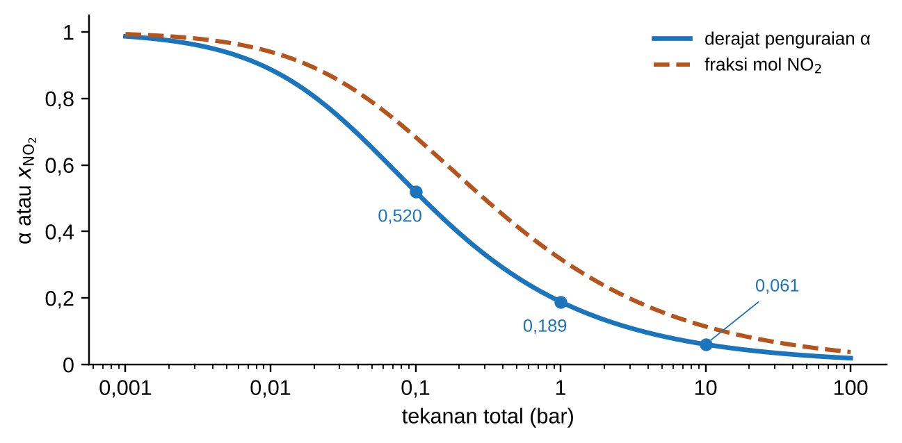

## 12.4 Menghitung komposisi kesetimbangan

Dengan *K* di tangan, pertanyaan praktisnya adalah: bila kita mulai dari campuran tertentu, berapa banyak setiap zat pada kesetimbangan? Caranya sama untuk semua reaksi. Nyatakan banyaknya setiap zat dengan satu variabel, kemajuan reaksi ξ (atau fraksi terurai α); nyatakan aktivitas setiap zat dengan variabel itu; masukkan ke *K*; selesaikan.

::: {.contoh}
**Contoh 12.6 · Penguraian N₂O₄**

Sebanyak 1,00 mol N₂O₄ dibiarkan mencapai kesetimbangan dengan NO₂ pada 25 °C dan tekanan total 1,00 bar (*K* = 0,148). Hitung fraksi N₂O₄ yang terurai dan fraksi mol NO₂.

**Rencana.** Misalkan fraksi terurai α. Susun tabel banyaknya zat, lalu nyatakan tekanan parsial dengan fraksi mol dan tekanan total.

**Penyelesaian.**

| | N₂O₄ | NO₂ | total |
|---|---|---|---|
| awal (mol) | 1 | 0 | 1 |
| kesetimbangan (mol) | 1 − α | 2α | 1 + α |
| fraksi mol | (1 − α)/(1 + α) | 2α/(1 + α) | |

Dengan $p_\text{J} = x_\text{J}p$:
$$
K = \frac{(p_{\text{NO}_2}/p^\circ)^2}{p_{\text{N}_2\text{O}_4}/p^\circ} = \frac{4\alpha^2}{(1 - \alpha)(1 + \alpha)}\cdot\frac{p}{p^\circ} = \frac{4\alpha^2}{1 - \alpha^2}\cdot\frac{p}{p^\circ} .
$$
Selesaikan untuk α: $\alpha = \sqrt{K/(K + 4p/p^\circ)} = \sqrt{0{,}148/4{,}148} = 0{,}189$. Fraksi mol NO₂: $2(0{,}189)/1{,}189 = 0{,}318$.

**Memahami hasil.** Hampir seperlima N₂O₄ terurai, tepat letak minimum pada Gambar 12.1. Perhatikan bahwa walaupun $\Delta_\text{r}G^\circ$ positif, hampir sepertiga molekul dalam campuran adalah NO₂: reaksi dengan *K* di sekitar 0,1–10 selalu menghasilkan campuran yang berarti.
:::

::: {.contoh}
**Contoh 12.7 · Hidrogen iodida**

Untuk $\text{H}_2(g) + \text{I}_2(g) \rightleftharpoons 2\text{HI}(g)$, *K* = 50 pada sekitar 700 K. Mula-mula 1,00 mol H₂ dan 1,00 mol I₂ dimasukkan ke dalam wadah. Berapa mol HI pada kesetimbangan?

**Penyelesaian.** Dengan kemajuan reaksi *x*: H₂ dan I₂ masing-masing 1 − *x*, HI 2*x*. Karena Δν = 0, tekanan total dan banyaknya mol total saling menghapus:
$$
K = \frac{(2x)^2}{(1 - x)^2} = 50 \quad\Rightarrow\quad \frac{2x}{1 - x} = \sqrt{50} = 7{,}07 \quad\Rightarrow\quad x = 0{,}780 .
$$
HI: 1,56 mol; H₂ dan I₂ masing-masing 0,220 mol.

**Memahami hasil.** Untuk reaksi dengan Δν = 0, komposisi kesetimbangan tidak bergantung pada tekanan maupun volume wadah. Reaksi ini adalah salah satu yang pertama dipelajari secara kuantitatif oleh Max Bodenstein pada 1890-an, dan pengukurannya dari kedua arah (mulai dari H₂ + I₂ atau dari HI murni) memberi *K* yang sama, bukti langsung bahwa kesetimbangan adalah keadaan, bukan riwayat.
:::

Untuk reaksi dengan perbandingan koefisien yang lebih rumit, persamaan untuk ξ menjadi persamaan pangkat tiga atau lebih, yang diselesaikan secara numerik: coba satu nilai ξ, hitung *Q*, bandingkan dengan *K*, lalu perbaiki. Kalkulator ilmiah dan lembar kerja melakukannya dalam hitungan detik.

::: {.contoh}
**Contoh 12.8 · Reaksi pergeseran air–gas**

Reaksi $\text{CO}(g) + \text{H}_2\text{O}(g) \rightleftharpoons \text{CO}_2(g) + \text{H}_2(g)$ dipakai untuk mengubah CO menjadi H₂ tambahan dalam pembuatan hidrogen. Pakai $\Delta_\text{r}H^\circ = -41{,}16$ kJ mol⁻¹ dan $\Delta_\text{r}S^\circ = -42{,}08$ J K⁻¹ mol⁻¹, keduanya dianggap tetap. (a) Hitung *K* pada 1100 K. (b) Berapa fraksi CO yang berubah bila CO dan uap air dimasukkan dengan perbandingan 1 : 1? (c) Bagaimana bila perbandingannya 1 : 3?

**Penyelesaian.** (a) $\Delta_\text{r}G^\circ = -41{,}16 - (1100)(-0{,}042\,08) = +5{,}13$ kJ mol⁻¹; $K = \exp[-5130/(8{,}314 \times 1100)] = 0{,}571$.

(b) Δν = 0. $x^2/(1 - x)^2 = 0{,}571$, sehingga $x/(1 - x) = 0{,}756$ dan *x* = 0,430: 43% CO berubah.

(c) $x^2/[(1 - x)(3 - x)] = 0{,}571$. Dengan mencoba nilai, *x* = 0,666: 67% CO berubah.

**Memahami hasil.** Pada suhu tinggi, *K* reaksi eksoterm ini turun di bawah satu, sehingga konversinya terbatas. Industri memakai dua cara: menjalankan reaksi dalam dua tahap, tahap kedua pada suhu lebih rendah (sekitar 500 K, tempat *K* jauh lebih besar) dengan katalis yang aktif pada suhu itu, dan memakai uap air berlebih. Hasil (c) menunjukkan cara kedua: menambah salah satu pereaksi mendorong pereaksi lain bereaksi lebih banyak, karena *Q* turun dan reaksi harus maju untuk mengembalikannya ke *K*.
:::

::: {.awas}
**Konsentrasi awal bukan konsentrasi kesetimbangan.** Kesalahan paling umum adalah memasukkan jumlah atau tekanan **awal** ke dalam rumus *K*. Tetapan kesetimbangan hanya berlaku untuk komposisi **pada kesetimbangan**. Nyatakan dulu setiap jumlah pada kesetimbangan dengan satu variabel (ξ atau α), baru masukkan ke *K*. Dan untuk gas, ingat bahwa tekanan parsial bergantung pada jumlah mol **total**, yang ikut berubah bila Δν ≠ 0.
:::

::: {.kuis}
**Kuis cepat 12.4** Dalam Contoh 12.7, bila mula-mula dimasukkan 2,00 mol HI murni, berapa mol H₂ pada kesetimbangan?
:::

## 12.5 Pengaruh tekanan dan gas lembam

Karena $\Delta_\text{r}G^\circ$ didefinisikan pada tekanan standar yang tetap, 1 bar, *K* **tidak bergantung pada tekanan**. Tetapi komposisi kesetimbangan dapat bergantung pada tekanan, lewat hubungan $K_x = K(p/p^\circ)^{-\Delta\nu}$ dari (12.4).

- Bila Δν > 0 (reaksi menambah banyaknya mol gas), $K_x$ turun ketika tekanan naik: kesetimbangan bergeser ke pereaksi.
- Bila Δν < 0, $K_x$ naik ketika tekanan naik: kesetimbangan bergeser ke hasil.
- Bila Δν = 0, tekanan tidak berpengaruh.

Ini adalah bentuk kuantitatif dari pernyataan Kimia Dasar "kenaikan tekanan menggeser kesetimbangan ke arah jumlah mol gas yang lebih sedikit". Alasan termodinamikanya: energi Gibbs setiap mol gas naik sebesar $RT\ln(p/p^\circ)$ bila tekanannya dinaikkan (subbab 7.8). Sisi reaksi yang berisi lebih sedikit mol gas mengalami kenaikan *G* yang lebih kecil, sehingga pada tekanan tinggi sisi itulah yang energi Gibbsnya lebih rendah.

::: {.contoh}
**Contoh 12.9 · N₂O₄ pada tekanan berbeda**

Ulangi Contoh 12.6 pada tekanan total 0,100 bar dan 10,0 bar.

**Penyelesaian.** Dari $\alpha = \sqrt{K/(K + 4p/p^\circ)}$:

| *p* (bar) | 0,100 | 1,00 | 10,0 |
|---|---|---|---|
| α | 0,520 | 0,189 | 0,061 |
| $x_{\text{NO}_2}$ | 0,684 | 0,318 | 0,115 |

**Memahami hasil.** Menurunkan tekanan sepuluh kali melipattigakan penguraian; menaikkannya sepuluh kali memotongnya menjadi sepertiga. Pada tekanan sangat rendah, α → 1: setiap reaksi yang menambah jumlah molekul gas akhirnya berjalan hampir tuntas bila gasnya cukup diencerkan, karena entropi pencampuran menjadi makin menguntungkan. Ini juga menjelaskan mengapa molekul-molekul di ruang antarbintang, pada tekanan yang sangat kecil, cenderung terurai menjadi atom dan radikal.
:::

Gambar 12.3 memperluas tabel itu ke rentang tekanan yang lebar. Derajat penguraian berubah paling cepat ketika $4p/p^\circ$ sebanding dengan *K*, yaitu di sekitar 0,04 bar; jauh di bawahnya N₂O₄ hampir seluruhnya terurai, dan jauh di atasnya α turun sebanding dengan $p^{-1/2}$.

{width=80%}

Bagaimana bila gas lembam, seperti argon atau nitrogen yang tidak ikut bereaksi, ditambahkan? Jawabannya bergantung pada caranya.

**Pada volume tetap**, menambahkan gas lembam menaikkan tekanan total, tetapi tidak mengubah tekanan parsial gas-gas yang bereaksi (setiap tekanan parsial $n_\text{J}RT/V$ tidak berubah). *Q* tidak berubah, sehingga kesetimbangan tidak bergeser.

**Pada tekanan total tetap**, menambahkan gas lembam menambah volume dan mengurangi tekanan parsial gas-gas yang bereaksi. Pengaruhnya sama dengan menurunkan tekanan: kesetimbangan bergeser ke arah jumlah mol gas yang lebih banyak.

::: {.contoh}
**Contoh 12.10 · Mengencerkan dengan argon**

Sebanyak 1,00 mol N₂O₄ dicampur dengan 4,00 mol argon, dan campuran dibiarkan setimbang pada 25 °C dan tekanan total 1,00 bar. Hitung fraksi N₂O₄ yang terurai.

**Penyelesaian.** Banyaknya mol total pada kesetimbangan: $(1 - \alpha) + 2\alpha + 4 = 5 + \alpha$. Tekanan parsial: $p_{\text{NO}_2} = 2\alpha p/(5 + \alpha)$, $p_{\text{N}_2\text{O}_4} = (1 - \alpha)p/(5 + \alpha)$. Maka
$$
K = \frac{4\alpha^2}{(1 - \alpha)(5 + \alpha)}\cdot\frac{p}{p^\circ} = 0{,}148 .
$$
Dengan mencoba nilai: α = 0,357.

**Memahami hasil.** Argon tidak bereaksi, tetapi ia menaikkan penguraian dari 19% menjadi 36%, karena ia mengurangi tekanan parsial N₂O₄ dan NO₂ seolah-olah tekanan total diturunkan menjadi sekitar seperlima. Dalam industri, gas lembam yang menumpuk di dalam reaktor yang memakai ulang gas sisa, misalnya argon dalam sintesis amonia, justru **merugikan** reaksi yang mengurangi jumlah mol, sehingga sebagian gas harus terus dibuang untuk mencegah argon terkumpul.
:::

::: {.kuis}
**Kuis cepat 12.5** Untuk reaksi $\text{PCl}_5(g) \rightleftharpoons \text{PCl}_3(g) + \text{Cl}_2(g)$ dalam wadah kaku, bagaimana pengaruh menambahkan helium terhadap banyaknya PCl₅ pada kesetimbangan?
:::
