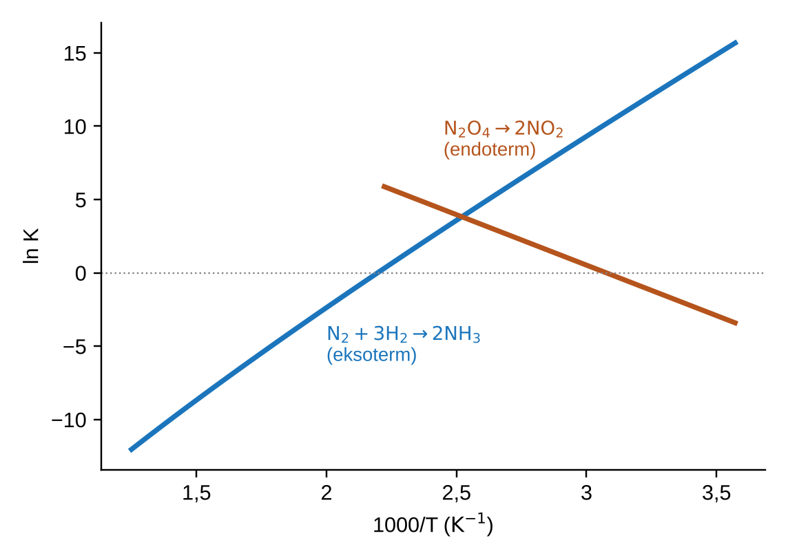
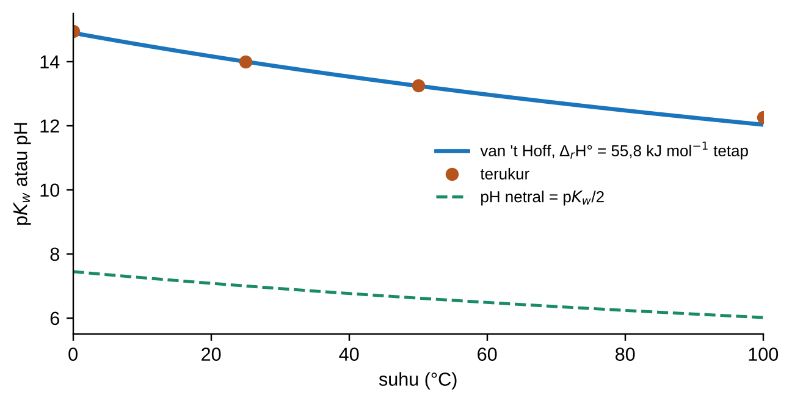

## 12.6 Pengaruh suhu: persamaan van 't Hoff

Tekanan menggeser komposisi kesetimbangan tanpa mengubah *K*. Suhu mengubah *K* itu sendiri, karena $\Delta_\text{r}G^\circ$ bergantung pada suhu. Bagaimana tepatnya?

Dari (12.3), $\ln K = -\Delta_\text{r}G^\circ/RT$. Turunkan terhadap suhu, dan pakai persamaan Gibbs–Helmholtz (7.12), $d(\Delta_\text{r}G^\circ/T)/dT = -\Delta_\text{r}H^\circ/T^2$:

::: {.inti}
$$
\frac{d\ln K}{dT} = \frac{\Delta_\text{r}H^\circ}{RT^2} \qquad\text{atau}\qquad \frac{d\ln K}{d(1/T)} = -\frac{\Delta_\text{r}H^\circ}{R} . \qquad \text{(12.5)}
$$
**Persamaan van 't Hoff.** Untuk reaksi endoterm ($\Delta_\text{r}H^\circ > 0$), *K* naik bila suhu naik; untuk reaksi eksoterm, *K* turun.
:::

Bila $\Delta_\text{r}H^\circ$ dianggap tetap dalam rentang suhu yang dipakai, integralnya:

$$
\ln\frac{K_2}{K_1} = -\frac{\Delta_\text{r}H^\circ}{R}\left(\frac{1}{T_2} - \frac{1}{T_1}\right) . \qquad \text{(12.6)}
$$

Bentuknya identik dengan persamaan Clausius–Clapeyron (8.5), dan itu bukan kebetulan: penguapan adalah "reaksi" $\text{A}(l) \rightleftharpoons \text{A}(g)$ dengan $K = p/p^\circ$, sehingga Clausius–Clapeyron adalah kasus khusus van 't Hoff. Seperti pada Bab 8, plot ln *K* terhadap 1/*T* memberi garis (hampir) lurus dengan kemiringan $-\Delta_\text{r}H^\circ/R$ (Gambar 12.2). Cara inilah yang paling sering dipakai untuk mengukur entalpi reaksi yang sukar diukur dengan kalorimeter.

{width=72%}

::: {.contoh}
**Contoh 12.11 · N₂O₄ pada hari panas**

Untuk $\text{N}_2\text{O}_4 \rightleftharpoons 2\text{NO}_2$, *K* = 0,148 pada 25 °C dan $\Delta_\text{r}H^\circ = +57{,}2$ kJ mol⁻¹. (a) Hitung *K* pada 65 °C. (b) Sebaliknya, bila *K* terukur pada 25 °C dan 65 °C berturut-turut 0,148 dan 2,27, berapa $\Delta_\text{r}H^\circ$?

**Penyelesaian.** (a) Dari (12.6):
$$
\ln\frac{K_2}{0{,}148} = -\frac{57\,200}{8{,}314}\left(\frac{1}{338{,}15} - \frac{1}{298{,}15}\right) = +2{,}730 , \qquad K_2 = 0{,}148\,e^{2{,}730} = 2{,}27 .
$$
(b) Balik (12.6): $\Delta_\text{r}H^\circ = R\ln(K_2/K_1)/(1/T_1 - 1/T_2) = (8{,}314)(2{,}730)/(3{,}968 \times 10^{-4}) = 57{,}2$ kJ mol⁻¹.

**Memahami hasil.** Kenaikan 40 °C melipatgandakan *K* lima belas kali, dan campuran berubah dari cokelat pucat menjadi cokelat tua. Percobaan sederhana ini, merendam tabung berisi NO₂ dalam air panas dan air es, adalah peragaan klasik pengaruh suhu pada kesetimbangan. Perubahan warna itu juga merupakan pengukuran $\Delta_\text{r}H^\circ$ bila intensitas warnanya diukur dengan spektrofotometer.
:::

::: {.contoh}
**Contoh 12.12 · Amonia pada 500 K**

Untuk $\text{N}_2 + 3\text{H}_2 \rightleftharpoons 2\text{NH}_3$, $K(298\ \text{K}) = 5{,}8 \times 10^5$ dan $\Delta_\text{r}H^\circ = -92{,}22$ kJ mol⁻¹. Hitung *K* pada 500 K dengan (12.6), lalu bandingkan dengan Contoh 7.14.

**Penyelesaian.**
$$
\ln\frac{K}{5{,}81 \times 10^5} = \frac{92\,220}{8{,}314}\left(\frac{1}{500} - \frac{1}{298{,}15}\right) = -15{,}02 , \qquad K = (5{,}81 \times 10^5)e^{-15{,}02} = 0{,}17 .
$$
Di Contoh 7.14, $\Delta_\text{r}G^\circ(500\ \text{K}) = +7{,}3$ kJ mol⁻¹, sehingga $K = \exp[-7260/(8{,}314 \times 500)] = 0{,}17$. Sama.

**Memahami hasil.** Kenaikan suhu dari 298 K ke 500 K menurunkan *K* tiga juta kali. Kedua cara memberi hasil yang sama karena memakai anggapan yang sama: $\Delta_\text{r}H^\circ$ tetap. Perhitungan yang lebih teliti, yang memperhitungkan perubahan $\Delta_\text{r}H^\circ$ dengan suhu lewat kapasitas kalor (kotak berikut), memberi *K* = 0,094 pada 500 K. Untuk rentang suhu yang lebar, koreksi ini penting.
:::

::: {.dalam}
**Lebih dalam: bila Δ*H*° berubah dengan suhu.** Dari hukum Kirchhoff (Bab 4), $\Delta_\text{r}H^\circ(T) = \Delta_\text{r}H^\circ(T_1) + \Delta_\text{r}C_p^\circ(T - T_1)$ bila $\Delta_\text{r}C_p^\circ$ tetap. Memasukkannya ke (12.5) dan mengintegralkan memberi
$$
\ln\frac{K_2}{K_1} = -\frac{\Delta_\text{r}H^\circ(T_1) - T_1\Delta_\text{r}C_p^\circ}{R}\left(\frac{1}{T_2} - \frac{1}{T_1}\right) + \frac{\Delta_\text{r}C_p^\circ}{R}\ln\frac{T_2}{T_1} .
$$
Untuk sintesis amonia, $\Delta_\text{r}C_p^\circ = 2(35{,}06) - 29{,}13 - 3(28{,}82) = -45{,}5$ J K⁻¹ mol⁻¹. Dengan koreksi ini, *K* pada 723 K adalah $3{,}6 \times 10^{-5}$, sedangkan tanpa koreksi $1{,}9 \times 10^{-4}$, lima kali lebih besar. Nilai yang dikoreksi dekat dengan hasil pengukuran. Gambar 12.2 dan 12.3 memakai rumus yang dikoreksi.
:::

::: {.contoh}
**Contoh 12.13 · Suhu tanur kapur**

Pada suhu berapa tekanan penguraian CaCO₃ mencapai 1 bar? Pakai $\Delta_\text{r}H^\circ = 178{,}3$ kJ mol⁻¹ dan $\Delta_\text{r}S^\circ = 160{,}6$ J K⁻¹ mol⁻¹, dianggap tetap.

**Penyelesaian.** Tekanan penguraian 1 bar berarti *K* = 1, atau $\Delta_\text{r}G^\circ = 0$: $T = \Delta_\text{r}H^\circ/\Delta_\text{r}S^\circ = 178\,300/160{,}6 = 1110$ K, atau 837 °C.

**Memahami hasil.** Nilai terukur sekitar 895 °C. Selisih 60 °C datang dari anggapan Δ*H*° dan Δ*S*° tetap pada rentang 800 K. Suhu ketika *K* = 1 adalah batas kasar antara "hampir tidak bereaksi" dan "hampir tuntas" untuk reaksi yang menghasilkan gas dari padatan; di atasnya, CO₂ keluar dengan tekanan melebihi tekanan udara, dan batu kapur terurai dengan cepat.
:::

::: {.kuis}
**Kuis cepat 12.6** Pada plot van 't Hoff, garis untuk reaksi endoterm miring ke mana? Mengapa?
:::

## 12.7 Asas Le Chatelier secara termodinamika

Henri Le Chatelier merumuskan pada 1884: bila kesetimbangan diganggu, sistem bergeser untuk melawan gangguan itu. Asas ini sangat berguna sebagai panduan, dan kini kita dapat melihat dari mana asalnya, serta di mana batasnya.

- **Suhu.** Dari van 't Hoff, menaikkan suhu menaikkan *K* reaksi endoterm. Reaksi bergeser ke arah yang menyerap kalor, "melawan" pemanasan. Ini akibat langsung persamaan Gibbs–Helmholtz.
- **Tekanan.** Dari (12.4), menaikkan tekanan menggeser kesetimbangan gas ke arah yang mengurangi jumlah mol, "melawan" kenaikan tekanan. Lebih umum, $(\partial\ln K_x/\partial p)_T = -\Delta_\text{r}V/RT$: kesetimbangan bergeser ke arah volume yang lebih kecil, berlaku juga untuk reaksi dalam larutan dan padatan.
- **Komposisi.** Menambahkan pereaksi menurunkan *Q* di bawah *K*, sehingga $\Delta_\text{r}G < 0$ dan reaksi maju.

Pada dua hal pertama, asas Le Chatelier selalu benar, karena ia hanyalah terjemahan tanda $\Delta_\text{r}H^\circ$ dan $\Delta_\text{r}V$. Tetapi pada hal ketiga, ada kejutan.

::: {.contoh}
**Contoh 12.14 · Menambah nitrogen mengurangi amonia**

Suatu campuran $\text{N}_2$, $\text{H}_2$, dan $\text{NH}_3$ berada dalam kesetimbangan pada suhu dan tekanan total tetap, dengan 3,0 mol N₂, 1,0 mol H₂, dan 1,0 mol NH₃. Ke dalamnya ditambahkan 0,10 mol N₂, sementara tekanan total dijaga tetap. Ke arah mana reaksi bergeser?

**Rencana.** Hitung bagaimana *Q* berubah. Dengan $p_\text{J} = n_\text{J}p/n$:
$$
Q = \frac{p_{\text{NH}_3}^2}{p_{\text{N}_2}p_{\text{H}_2}^3}(p^\circ)^2 = \frac{n_{\text{NH}_3}^2\,n^2}{n_{\text{N}_2}\,n_{\text{H}_2}^3}\left(\frac{p^\circ}{p}\right)^2 .
$$

**Penyelesaian.** Mula-mula *n* = 5,0 mol. Setelah penambahan, *n* = 5,1 mol dan $n_{\text{N}_2} = 3{,}1$ mol. Perbandingan *Q* baru terhadap *Q* lama (= *K*):
$$
\frac{Q_\text{baru}}{K} = \left(\frac{5{,}1}{5{,}0}\right)^2\left(\frac{3{,}0}{3{,}1}\right) = (1{,}0404)(0{,}9677) = 1{,}007 .
$$
*Q* > *K*: reaksi bergeser ke **kiri**, mengurai amonia.

**Memahami hasil.** Menambah pereaksi N₂ justru mengurangi hasil! Penambahan N₂ punya dua akibat: menaikkan tekanan parsial N₂ (mendorong reaksi maju), tetapi juga mengencerkan H₂ dan NH₃ di dalam campuran pada tekanan total tetap. Karena H₂ muncul dengan pangkat tiga di penyebut, pengenceran H₂ lebih berpengaruh. Dapat ditunjukkan bahwa ini terjadi setiap kali fraksi mol N₂ melebihi 1/2. Asas Le Chatelier gagal di sini karena "melawan gangguan" tidak terdefinisi dengan jelas ketika satu gangguan mengubah beberapa konsentrasi sekaligus.
:::

::: {.awas}
**Le Chatelier adalah panduan, bukan hukum.** Asas Le Chatelier tidak dapat diturunkan sebagai pernyataan umum, dan ia tidak memberi besaran pergeseran. Cara yang selalu benar adalah membandingkan *Q* dengan *K* setelah gangguan: bila *Q* < *K*, reaksi maju; bila *Q* > *K*, reaksi mundur. Untuk suhu, hitung *K* baru dengan van 't Hoff; untuk tekanan dan komposisi, hitung *Q* baru.
:::

::: {.kuis}
**Kuis cepat 12.7** Katalis mempercepat reaksi maju dan reaksi balik. Apakah katalis menggeser kesetimbangan? Jelaskan dengan $\Delta_\text{r}G^\circ$.
:::

## 12.8 Kesetimbangan dalam industri dan biokimia

### Proses Haber–Bosch

Kini kita dapat menjawab pertanyaan pembuka bab. Sintesis amonia eksoterm ($\Delta_\text{r}H^\circ = -92$ kJ mol⁻¹) dan mengurangi jumlah mol gas (Δν = −2). Termodinamika menghendaki suhu rendah dan tekanan tinggi. Gambar 12.3 memperlihatkan fraksi mol amonia pada kesetimbangan untuk campuran N₂ dan H₂ dengan perbandingan 1 : 3.

{width=72%}

::: {.contoh}
**Contoh 12.15 · Hasil amonia di pabrik**

Pada 450 °C (723 K), *K* sintesis amonia adalah $3{,}6 \times 10^{-5}$. Hitung fraksi mol amonia pada kesetimbangan dari campuran 1 : 3 pada 300 bar, dengan anggapan gas ideal.

**Penyelesaian.** Dengan kemajuan reaksi ξ dari 1 mol N₂ dan 3 mol H₂: N₂ 1 − ξ, H₂ 3(1 − ξ), NH₃ 2ξ, total 4 − 2ξ. Maka
$$
K = \frac{(2\xi)^2(4 - 2\xi)^2}{(1 - \xi)\cdot27(1 - \xi)^3}\left(\frac{p^\circ}{p}\right)^2 = 3{,}6 \times 10^{-5} .
$$
Dengan *p* = 300 bar dan mencoba nilai: ξ = 0,454, sehingga $x_{\text{NH}_3} = 0{,}908/3{,}092 = 0{,}29$.

**Memahami hasil.** Gambar 12.3 menunjukkan bahwa pada 300 °C dan tekanan yang sama hasilnya hampir 70%, tetapi pada suhu itu katalis besi bekerja terlalu lambat. Pabrik memilih 400–500 °C sebagai kompromi antara laju dan hasil, lalu mengambil amonia dengan mendinginkan gas keluar (amonia mencair, N₂ dan H₂ tidak) dan mengembalikan gas sisa ke reaktor. Dengan daur ulang, hampir semua N₂ dan H₂ akhirnya menjadi amonia, walaupun setiap lintasan hanya mengubah sebagian kecil. Pengukuran nyata pada 450 °C dan 300 bar memberi sekitar 35% amonia, lebih tinggi daripada perhitungan gas ideal. Contoh berikut menunjukkan dari mana selisih itu datang.
:::

::: {.contoh}
**Contoh 12.16 · Koreksi fugasitas untuk hasil amonia**

Di subbab 9.5 kita mencatat bahwa kesetimbangan bertekanan tinggi memerlukan fugasitas. Pada 723 K dan 300 bar, koefisien fugasitas menurut persamaan van der Waals (rumus kotak Lebih dalam subbab 9.5, dengan tetapan Tabel 2.1) adalah φ(N₂) = 1,099, φ(H₂) = 1,121, dan φ(NH₃) = 0,857. Anggap setiap gas di dalam campuran mempunyai koefisien fugasitas yang sama dengan bila ia murni pada tekanan total. Hitung ulang fraksi mol amonia pada Contoh 12.15.

**Rencana.** Untuk gas nyata, aktivitas adalah $f_\text{J}/p^\circ = \varphi_\text{J}p_\text{J}/p^\circ$. Tetapan kesetimbangan *K* tidak berubah, tetapi kini ia memuat hasil kali koefisien fugasitas di samping tekanan parsial.

**Penyelesaian.** Memasukkan $a_\text{J} = \varphi_\text{J}p_\text{J}/p^\circ$ ke (12.3) memisahkan *K* menjadi dua faktor, $K = K_\varphi K_p$, dengan
$$
K_\varphi = \frac{\varphi_{\text{NH}_3}^2}{\varphi_{\text{N}_2}\varphi_{\text{H}_2}^3} , \qquad K_p = \frac{(p_{\text{NH}_3}/p^\circ)^2}{(p_{\text{N}_2}/p^\circ)(p_{\text{H}_2}/p^\circ)^3} .
$$
Dengan angka di atas, $K_\varphi = (0{,}857)^2/[(1{,}099)(1{,}121)^3] = 0{,}474$. Tekanan parsial pada kesetimbangan karenanya harus memenuhi
$$
K_p = \frac{K}{K_\varphi} = \frac{3{,}6 \times 10^{-5}}{0{,}474} = 7{,}6 \times 10^{-5} ,
$$
dua kali nilai yang dipakai pada perhitungan gas ideal. Persamaan Contoh 12.15 dengan $7{,}6 \times 10^{-5}$ di ruas kanan memberi ξ = 0,523, sehingga $x_{\text{NH}_3} = 1{,}046/2{,}954 = 0{,}35$.

**Memahami hasil.** Koreksi fugasitas menaikkan hasil dari 29% menjadi 35%, sesuai dengan pengukuran. Penyumbang terbesar adalah amonia. Molekulnya polar dan saling menarik kuat (*a* van der Waals-nya terbesar di antara ketiga gas), sehingga φ < 1: amonia nyata "kurang ingin melarikan diri" daripada amonia ideal, dan lebih banyak yang dapat terbentuk sebelum potensial kimianya menyamai pereaksi. N₂ dan H₂ pada 723 K jauh di atas suhu Boyle-nya, sehingga tolakan yang dominan dan φ > 1; pereaksi yang "lebih ingin melarikan diri" juga mendorong reaksi ke kanan. Pada tekanan rendah semua φ mendekati 1, $K_\varphi$ mendekati 1, dan koreksi ini lenyap. Itulah sebabnya perhitungan gas ideal cukup untuk kebanyakan kesetimbangan di laboratorium, tetapi tidak untuk reaktor bertekanan ratusan bar.
:::

::: {.terapan}
**Kesetimbangan yang memberi makan dunia.** Proses Haber–Bosch kini menghasilkan sekitar 180 juta ton amonia per tahun, hampir seluruhnya untuk pupuk, dan menghabiskan sekitar 1–2% energi dunia. Diperkirakan separuh nitrogen dalam protein tubuh manusia saat ini pernah melewati reaktor Haber–Bosch. Indonesia mempunyai beberapa pabrik amonia–urea besar, yang memakai gas alam sebagai sumber hidrogen, lewat reaksi reformasi uap $\text{CH}_4 + \text{H}_2\text{O} \rightleftharpoons \text{CO} + 3\text{H}_2$ dan reaksi pergeseran air–gas (Contoh 12.8). Setiap tahap rantai produksi itu adalah persoalan kesetimbangan dan laju yang diselesaikan dengan prinsip-prinsip bab ini.
:::

Proses kontak untuk asam sulfat menghadapi persoalan yang sama. Oksidasi $\text{SO}_2 + \tfrac12\text{O}_2 \rightleftharpoons \text{SO}_3$ sangat menguntungkan pada suhu kamar ($K = 2{,}6 \times 10^{12}$), tetapi lambat. Pada 700 K, tempat katalis vanadium pentoksida bekerja, *K* turun menjadi sekitar 290, masih cukup besar untuk konversi di atas 95% dengan udara berlebih, dan pada 1000 K turun menjadi 1,8. Pabrik memakai beberapa lapisan katalis dengan pendinginan di antaranya, supaya gas yang sudah sebagian bereaksi kembali ke suhu tempat *K* tinggi.

### Kesetimbangan dalam sel hidup

Reaksi biokimia berlangsung dalam air pada pH sekitar 7, bukan pada keadaan standar kimia yang mengandaikan setiap zat terlarut beraktivitas 1, termasuk H⁺ (pH 0). Karena itu biokimiawan memakai **keadaan standar biokimia**: semua zat pada aktivitas 1 **kecuali** H⁺, yang ditetapkan pada pH 7. Energi Gibbs standar biokimia diberi tanda aksen, $\Delta_\text{r}G^{\circ\prime}$. Untuk reaksi yang menghasilkan ν mol H⁺:

$$
\Delta_\text{r}G^{\circ\prime} = \Delta_\text{r}G^\circ + \nu RT\ln(10^{-7}) = \Delta_\text{r}G^\circ - 39{,}95\,\nu\ \text{kJ mol}^{-1}\ (\text{pada}\ 25\ ^\circ\text{C}) . \qquad \text{(12.7)}
$$

Untuk reaksi yang tidak melibatkan H⁺, kedua nilai sama.

::: {.contoh}
**Contoh 12.17 · Dua keadaan standar**

Reaksi $\text{A} \rightarrow \text{B} + \text{H}^+$ mempunyai $\Delta_\text{r}G^\circ = +10{,}0$ kJ mol⁻¹ pada 25 °C. Hitung $\Delta_\text{r}G^{\circ\prime}$ dan tetapan kesetimbangan biokimia $K'$.

**Penyelesaian.** Dari (12.7) dengan ν = 1: $\Delta_\text{r}G^{\circ\prime} = 10{,}0 - 39{,}95 = -29{,}95$ kJ mol⁻¹. $K' = \exp(29\,950/2479) = 1{,}8 \times 10^5$.

**Memahami hasil.** Reaksi yang tidak menguntungkan pada pH 0 sangat menguntungkan pada pH 7, karena H⁺ yang dihasilkan "diserap" oleh larutan yang miskin H⁺. Tanpa membedakan kedua keadaan standar, kesimpulan tentang arah reaksi biokimia bisa terbalik.
:::

Bab 7 menyebut bahwa hidrolisis ATP, dengan $\Delta_\text{r}G^{\circ\prime} = -30{,}5$ kJ mol⁻¹, adalah "mata uang energi" sel. Tetapi konsentrasi di dalam sel jauh dari 1 mol L⁻¹, sehingga Δ*G* yang sebenarnya harus dihitung dengan (12.2).

::: {.contoh}
**Contoh 12.18 · ATP di dalam sel darah merah**

Di dalam sel darah merah, [ATP] = 2,25 mmol L⁻¹, [ADP] = 0,25 mmol L⁻¹, dan [Pᵢ] = 1,65 mmol L⁻¹. Hitung Δ*G* hidrolisis ATP ($\text{ATP} + \text{H}_2\text{O} \rightarrow \text{ADP} + \text{P}_\text{i}$) pada 37 °C, dengan $\Delta_\text{r}G^{\circ\prime} = -30{,}5$ kJ mol⁻¹ dan aktivitas air satu.

**Penyelesaian.** Dengan konsentrasi dalam mol L⁻¹ sebagai aktivitas:
$$
Q = \frac{(2{,}5 \times 10^{-4})(1{,}65 \times 10^{-3})}{2{,}25 \times 10^{-3}} = 1{,}83 \times 10^{-4} ,
$$
$$
\Delta_\text{r}G = -30{,}5 + (8{,}314 \times 10^{-3})(310{,}15)\ln(1{,}83 \times 10^{-4}) = -30{,}5 - 22{,}2 = -52{,}7\ \text{kJ mol}^{-1} .
$$

**Memahami hasil.** Di dalam sel, setiap mol ATP yang dihidrolisis memberikan sekitar 53 kJ, jauh lebih banyak daripada nilai standarnya. Sel menjaga perbandingan ATP/ADP jauh dari kesetimbangan (pada kesetimbangan, ATP praktis habis), seperti baterai yang terus diisi. "Energi" ATP sebenarnya adalah energi dari **ketidaksetimbangan** itu. Kematian, secara termodinamika, adalah ketika sel berhenti menjaga reaksi-reaksinya jauh dari kesetimbangan.
:::

Pasangan reaksi yang dibahas di Bab 7, seperti pembentukan glutamin, kini dapat dinyatakan dengan *K*. Fosforilasi glukosa, $\text{glukosa} + \text{P}_\text{i} \rightarrow \text{glukosa-6-fosfat}$, mempunyai $\Delta_\text{r}G^{\circ\prime} = +13{,}8$ kJ mol⁻¹ dan $K' = 0{,}0038$: praktis tidak berjalan. Dipasangkan dengan hidrolisis ATP oleh enzim heksokinase, reaksi bersihnya mempunyai $\Delta_\text{r}G^{\circ\prime} = -16{,}7$ kJ mol⁻¹ dan $K' = 840$ pada 25 °C. Memasangkan dengan ATP mengalikan tetapan kesetimbangan dengan sekitar $2 \times 10^5$, sebuah "pengungkit" yang dipakai sel untuk ribuan reaksi.

::: {.kuis}
**Kuis cepat 12.8** Mengapa $\Delta_\text{r}G^{\circ\prime}$ untuk reaksi yang tidak melibatkan H⁺ sama dengan $\Delta_\text{r}G^\circ$?
:::

## 12.9 Kesetimbangan dalam larutan

Sebagian besar kesetimbangan yang dikenal mahasiswa dari kimia dasar terjadi di dalam air: ionisasi asam lemah, kelarutan garam, ionisasi air sendiri. Tabel *K*$_\text{a}$ dan *K*$_\text{sp}$ di buku kimia dasar tampak seperti daftar angka yang harus dihafal. Termodinamika memperlihatkan bahwa angka-angka itu tidak berdiri sendiri: semuanya dapat dihitung dari tabel energi Gibbs pembentukan yang sama dengan yang kita pakai untuk reaksi gas, asalkan kita punya nilai Δ$_\text{f}$*G*° untuk **ion** dalam air.

### Energi Gibbs pembentukan ion

Ion tidak pernah dapat dibuat sendirian; larutan selalu netral. Karena itu, nilai Δ$_\text{f}$*G*° satu ion tidak dapat diukur langsung. Jalan keluarnya adalah konvensi: Δ$_\text{f}$*G*°, Δ$_\text{f}$*H*°, dan *S*° untuk H⁺(aq) ditetapkan **nol** pada semua suhu. Dengan acuan ini, nilai ion lain diperoleh dari reaksi yang dapat diukur. Misalnya, dari pembentukan HCl(aq) yang terukur dan acuan H⁺ = 0, kita memperoleh Δ$_\text{f}$*G*°(Cl⁻, aq) = −131,23 kJ mol⁻¹. Selama setiap reaksi yang kita hitung seimbang muatannya, konvensi ini tidak memengaruhi hasil, sama seperti pilihan unsur sebagai acuan nol untuk Δ$_\text{f}$*H*° di subbab 4.7.

| Zat | Δ$_\text{f}$*G*° (kJ mol⁻¹) | Zat | Δ$_\text{f}$*G*° (kJ mol⁻¹) |
|---|---|---|---|
| H⁺(aq) | 0 (konvensi) | Ag⁺(aq) | +77,11 |
| OH⁻(aq) | −157,24 | Cl⁻(aq) | −131,23 |
| H₂O(l) | −237,13 | AgCl(s) | −109,79 |
| CH₃COOH(aq) | −396,46 | NH₄⁺(aq) | −79,31 |
| CH₃COO⁻(aq) | −369,31 | NH₃(aq) | −26,50 |

Tabel 12.2 Energi Gibbs pembentukan standar beberapa spesies dalam air pada 25 °C (keadaan standar 1 mol kg⁻¹).

### *K*$_\text{a}$ dan *K*$_\text{sp}$ dari tabel

Dengan tabel itu, setiap tetapan kesetimbangan dalam larutan dihitung dengan dua langkah yang sudah kita kenal: hitung Δ$_\text{r}$*G*° dari Δ$_\text{f}$*G*° hasil dikurangi pereaksi, lalu pakai *K* = exp(−Δ$_\text{r}$*G*°/*RT*) dari (12.5). Karena aktivitas ion dalam larutan encer sama dengan molalitasnya (subbab 10.7), *K* itu adalah *K*$_\text{a}$ atau *K*$_\text{sp}$ yang dikenal, dinyatakan dalam molalitas.

::: {.contoh}
**Contoh 12.19 · *K*$_\text{sp}$ AgCl dan *K*$_\text{a}$ asam asetat dari energi Gibbs**

Dari Tabel 12.2, hitung (a) *K*$_\text{sp}$ AgCl pada 25 °C, (b) *K*$_\text{a}$ dan p*K*$_\text{a}$ asam asetat, (c) p*K*$_\text{a}$ ion amonium.

**Penyelesaian.** (a) Untuk $\text{AgCl}(s) \rightleftharpoons \text{Ag}^+(aq) + \text{Cl}^-(aq)$,
$$
\Delta_\text{r}G^\circ = 77{,}11 + (-131{,}23) - (-109{,}79) = +55{,}67\ \text{kJ mol}^{-1} ,
$$
$$
K_\text{sp} = \exp\left(-\frac{55\,670}{(8{,}314)(298{,}15)}\right) = 1{,}76 \times 10^{-10} .
$$
(b) Untuk $\text{CH}_3\text{COOH}(aq) \rightleftharpoons \text{H}^+(aq) + \text{CH}_3\text{COO}^-(aq)$, $\Delta_\text{r}G^\circ = 0 + (-369{,}31) - (-396{,}46) = +27{,}15$ kJ mol⁻¹, sehingga $K_\text{a} = 1{,}75 \times 10^{-5}$ dan p*K*$_\text{a}$ = 4,76.

(c) Untuk $\text{NH}_4^+ \rightleftharpoons \text{H}^+ + \text{NH}_3$, Δ$_\text{r}$*G*° = −26,50 − (−79,31) = +52,81 kJ mol⁻¹, dan p*K*$_\text{a}$ = Δ$_\text{r}$*G*°/(*RT* ln 10) = 9,25.

**Memahami hasil.** Ketiga nilai sama dengan tabel kimia dasar, padahal kita hanya memakai energi Gibbs. Rumus p*K*$_\text{a}$ = Δ$_\text{r}$*G*°/(5,708 kJ mol⁻¹) pada 25 °C memberi alat ingat yang berguna: setiap 5,7 kJ mol⁻¹ energi Gibbs standar ionisasi menaikkan p*K*$_\text{a}$ satu satuan. Selisih p*K*$_\text{a}$ asam asetat dan ion amonium (4,5 satuan) berarti selisih energi Gibbs ionisasi sekitar 26 kJ mol⁻¹, kira-kira sebesar satu ikatan hidrogen yang kuat.
:::

### Ionisasi air dan suhu

Reaksi $\text{H}_2\text{O}(l) \rightleftharpoons \text{H}^+(aq) + \text{OH}^-(aq)$ mempunyai Δ$_\text{r}$*G*° = −157,24 − (−237,13) = +79,89 kJ mol⁻¹, sehingga *K*$_\text{w}$ = 1,01 × 10⁻¹⁴ pada 25 °C, yaitu p*K*$_\text{w}$ = 14,00. Reaksi ini sangat endoterm (Δ$_\text{r}$*H*° = +55,8 kJ mol⁻¹), karena ikatan O–H harus diputus dan ion yang terbentuk harus disusun ulang oleh air di sekitarnya. Menurut van 't Hoff (subbab 12.6), *K*$_\text{w}$ naik tajam dengan suhu (Gambar 12.4).

{width=76%}

Akibat yang sering mengejutkan: **pH larutan netral bukan selalu 7**. Netral berarti [H⁺] = [OH⁻], sehingga pH netral = p*K*$_\text{w}$/2. Pada 37 °C, suhu tubuh, p*K*$_\text{w}$ ≈ 13,6, sehingga pH netral sekitar 6,8. Darah dengan pH 7,4 lebih basa daripada netral sebanyak 0,6 satuan, bukan 0,4. Pada 100 °C, air murni mempunyai pH sekitar 6,1 tetapi tetap netral.

::: {.contoh}
**Contoh 12.20 · pH air murni pada beberapa suhu**

Dari p*K*$_\text{w}$ = 14,00 pada 25 °C dan Δ$_\text{r}$*H*° = 55,84 kJ mol⁻¹, hitung pH air murni pada 0 °C, 37 °C, dan 100 °C. Nilai terukur p*K*$_\text{w}$ pada 0 °C dan 100 °C adalah 14,94 dan 12,26.

**Penyelesaian.** Dari van 't Hoff dalam bentuk logaritma basis 10,
$$
\text{p}K_\text{w}(T) = 14{,}00 + \frac{\Delta_\text{r}H^\circ}{R\ln 10}\left(\frac{1}{T} - \frac{1}{298{,}15\ \text{K}}\right) .
$$
Pada 0 °C: p*K*$_\text{w}$ = 14,89, pH = 7,45. Pada 37 °C: p*K*$_\text{w}$ = 13,62, pH = 6,81. Pada 100 °C: p*K*$_\text{w}$ = 12,03, pH = 6,02.

**Memahami hasil.** Pada 0 °C hitungan meleset hanya 0,05 satuan, tetapi pada 100 °C sudah 0,23 satuan. Penyebabnya adalah anggapan Δ$_\text{r}$*H*° tetap: reaksi ini mempunyai Δ$_\text{r}$*C*$_p$° yang besar dan negatif (sekitar −200 J K⁻¹ mol⁻¹), sehingga Δ$_\text{r}$*H*° mengecil pada suhu tinggi. Untuk rentang suhu yang lebar, koreksi Kirchhoff (subbab 4.9) harus dimasukkan ke dalam van 't Hoff, seperti pada soal van 't Hoff dengan Δ*C*$_p$ di akhir bab. Bagi biokimia, pesan pentingnya adalah bahwa pH buffer harus disebut **bersama suhunya**.
:::

::: {.kuis}
**Kuis cepat 12.9** Larutan pada 50 °C mempunyai pH 6,8. Apakah larutan itu asam, netral, atau basa? (p*K*$_\text{w}$ = 13,26 pada 50 °C.)
:::

### Menuju bab berikutnya

Bab ini mengubah seluruh termodinamika yang kita bangun menjadi alat peramal kesetimbangan. Dari tabel $\Delta_\text{f}G^\circ$, kita menghitung *K*; dari $\Delta_\text{r}H^\circ$, kita meramalkan bagaimana *K* berubah dengan suhu; dari Δν, bagaimana komposisi berubah dengan tekanan. Asas Le Chatelier, yang di Kimia Dasar dihafal, kini muncul sebagai akibat, lengkap dengan batasnya.

Bab berikutnya membawa gagasan yang sama ke sistem yang paling langsung mengukur energi Gibbs: **sel elektrokimia**. Di Bab 7 kita melihat bahwa $-\Delta_\text{r}G$ adalah kerja listrik maksimum, $\Delta_\text{r}G = -nFE$. Menggabungkannya dengan (12.2) akan menghasilkan persamaan Nernst, yang menghubungkan tegangan sel dengan komposisi, dan dengan (12.3), hubungan antara potensial sel standar dan tetapan kesetimbangan. Voltmeter ternyata adalah alat paling teliti untuk mengukur energi Gibbs reaksi.
