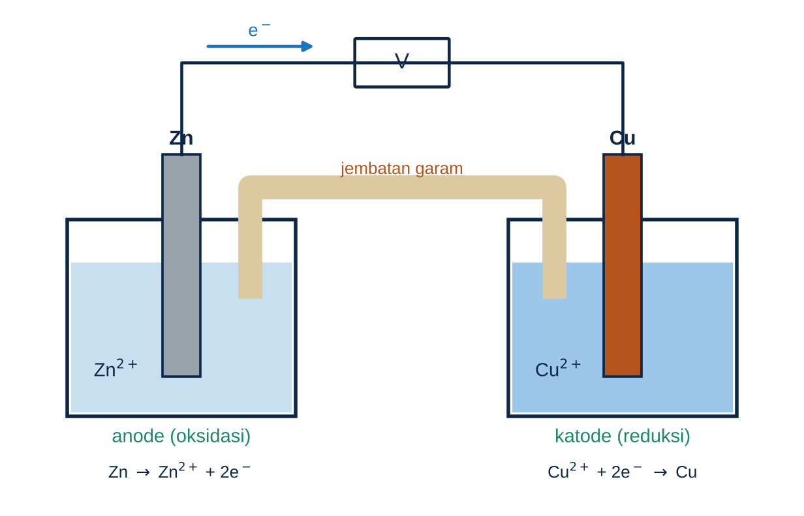

# Bab 13 Termodinamika Sel Elektrokimia

Sebatang seng dicelupkan ke dalam larutan tembaga sulfat. Dalam beberapa menit, seng tertutup lapisan tembaga merah, larutan biru memudar, dan gelas terasa sedikit hangat. Reaksinya, $\text{Zn} + \text{Cu}^{2+} \rightarrow \text{Zn}^{2+} + \text{Cu}$, melepaskan energi sebagai kalor, dan energi itu hilang ke lingkungan. Sekarang pisahkan kedua bagian reaksi itu: seng di satu gelas, tembaga di gelas lain, dihubungkan dengan kawat di luar dan jembatan garam di dalam. Reaksi yang sama berlangsung, tetapi elektron kini harus berjalan lewat kawat, dan sepanjang jalan mereka dapat menyalakan lampu. Inilah **sel elektrokimia**, penemuan yang sejak Volta pada 1800 telah mengubah energi Gibbs reaksi kimia menjadi listrik.

Bagi termodinamika, sel elektrokimia lebih dari sekadar sumber listrik. Ia adalah **alat ukur energi Gibbs yang paling teliti**. Di Bab 7 kita melihat bahwa kerja bukan-ekspansi maksimum yang dapat diperoleh dari suatu reaksi sama dengan $-\Delta_\text{r}G$. Dalam sel, kerja itu adalah kerja listrik, dan kerja listrik maksimum dapat diukur langsung dengan voltmeter: tegangan sel ketika hampir tidak ada arus mengalir. Voltmeter yang baik membaca sampai sepersejuta volt, setara dengan mengukur $\Delta_\text{r}G$ sampai sepersepuluh joule per mol, jauh lebih teliti daripada kalorimeter mana pun.

Bab ini menggabungkan seluruh alat yang telah kita bangun. Dari $\Delta_\text{r}G = -nFE$ dan $\Delta_\text{r}G = \Delta_\text{r}G^\circ + RT\ln Q$ (Bab 12) kita akan memperoleh **persamaan Nernst**. Dari $\Delta_\text{r}G^\circ = -RT\ln K$, hubungan antara potensial sel standar dan tetapan kesetimbangan. Dari $(\partial G/\partial T)_p = -S$ (Bab 7), cara mengukur entropi dan entalpi reaksi dari tegangan sel pada beberapa suhu. Dan dari semuanya, pemahaman tentang elektrode pH, potensial membran saraf, baterai, sel bahan bakar, dan korosi.

::: {.strategi}
**Pertanyaan pembuka**

1. Mengapa tegangan sel mengukur energi Gibbs reaksi?
2. Bagaimana potensial elektrode setengah sel ditetapkan, padahal hanya selisih potensial yang dapat diukur?
3. Mengapa tegangan baterai turun ketika hampir habis?
4. Bagaimana tegangan sel dapat memberi tetapan kesetimbangan, bahkan untuk reaksi pengendapan?
5. Bagaimana entropi reaksi dapat diukur dengan voltmeter dan termometer?
6. Bagaimana elektrode kaca mengukur pH, dan bagaimana sel saraf menjaga tegangan membrannya?
7. Mengapa baterai litium jauh lebih ringan daripada aki timbal untuk energi yang sama?
:::

::: {.tujuan}
**Tujuan belajar**

Setelah mempelajari bab ini, kamu mampu:

1. Menuliskan diagram sel, reaksi setengah sel, dan reaksi sel.
2. Menurunkan $\Delta_\text{r}G = -nFE$ dan memakainya dua arah.
3. Memakai tabel potensial elektrode standar dan menggabungkan potensial setengah sel dengan benar.
4. Menurunkan dan memakai persamaan Nernst, termasuk pengaruh pH.
5. Menghitung tetapan kesetimbangan dan hasil kali kelarutan dari potensial standar.
6. Menghitung $\Delta_\text{r}S$ dan $\Delta_\text{r}H$ dari ketergantungan tegangan sel pada suhu.
7. Menjelaskan sel konsentrasi, elektrode pH, dan potensial membran.
8. Menghitung energi spesifik teoretis baterai dan efisiensi sel bahan bakar.
:::

::: {.mat}
**Prasyarat**

Dari Bab 7: kerja bukan-ekspansi maksimum $-\Delta G$ dan $(\partial G/\partial T)_p = -S$. Dari Bab 10: aktivitas dan koefisien aktivitas ion (Debye–Hückel). Dari Bab 12: $\Delta_\text{r}G = \Delta_\text{r}G^\circ + RT\ln Q$ dan $\Delta_\text{r}G^\circ = -RT\ln K$. Dari Kimia Dasar: bilangan oksidasi, penyetaraan reaksi redoks, dan sel Volta. Dari Fisika Umum: potensial listrik dan kerja *qV*.
:::

## 13.1 Sel elektrokimia dan reaksi setengah sel

Setiap reaksi redoks dapat dipecah menjadi dua **reaksi setengah sel**: oksidasi, yang melepaskan elektron, dan reduksi, yang menerimanya. Dalam sel elektrokimia, keduanya berlangsung di tempat terpisah, pada dua **elektrode**. Elektrode tempat oksidasi terjadi disebut **anode**; tempat reduksi, **katode**. Elektron mengalir lewat kawat di luar dari anode ke katode, dan muatan di dalam larutan dibawa oleh ion lewat **jembatan garam** (biasanya gel berisi KCl atau KNO₃), yang menjaga kedua larutan tetap netral tanpa membiarkan keduanya bercampur.

{width=76%}

Sel ditulis dengan **diagram sel**, notasi singkat yang disepakati IUPAC. Anode ditulis di kiri, katode di kanan; garis tegak tunggal | menandai batas fasa, dan garis ganda ‖ menandai jembatan garam. Sel Daniell pada Gambar 13.1 ditulis

$$
\text{Zn}(s)\,|\,\text{ZnSO}_4(aq)\,\|\,\text{CuSO}_4(aq)\,|\,\text{Cu}(s) .
$$

**Reaksi sel** adalah reaksi yang terjadi bila elektron mengalir dari elektrode kiri ke elektrode kanan lewat kawat luar: oksidasi di kiri, reduksi di kanan. Untuk sel Daniell: $\text{Zn}(s) + \text{Cu}^{2+}(aq) \rightarrow \text{Zn}^{2+}(aq) + \text{Cu}(s)$. Konvensi ini berlaku apa pun yang sebenarnya terjadi: bila reaksi sel yang ditulis tidak spontan, tegangannya akan bernilai negatif, dan reaksi sebenarnya berjalan sebaliknya.

Elektrode tidak harus berupa logam yang ikut bereaksi. Ada beberapa jenis yang penting:

- **Logam–ion logam**, seperti Zn|Zn²⁺ dan Cu|Cu²⁺.
- **Gas**, seperti elektrode hidrogen Pt|H₂(g)|H⁺(aq), tempat gas bereaksi di permukaan platina yang hanya berperan sebagai penghantar dan katalis.
- **Logam–garam sukar larut**, seperti perak–perak klorida Ag|AgCl(s)|Cl⁻(aq), dengan reaksi $\text{AgCl}(s) + \text{e}^- \rightarrow \text{Ag}(s) + \text{Cl}^-(aq)$. Elektrode ini sangat stabil dan menjadi elektrode pembanding yang paling banyak dipakai.
- **Redoks**, seperti Pt|Fe³⁺, Fe²⁺, tempat kedua bentuk teroksidasi dan tereduksi berada dalam larutan.

::: {.contoh}
**Contoh 13.1 · Membaca diagram sel**

Untuk sel $\text{Pt}(s)\,|\,\text{H}_2(g)\,|\,\text{HCl}(aq)\,|\,\text{AgCl}(s)\,|\,\text{Ag}(s)$, tuliskan reaksi setengah sel di setiap elektrode dan reaksi sel.

**Penyelesaian.** Kiri (oksidasi): $\tfrac12\text{H}_2(g) \rightarrow \text{H}^+(aq) + \text{e}^-$. Kanan (reduksi): $\text{AgCl}(s) + \text{e}^- \rightarrow \text{Ag}(s) + \text{Cl}^-(aq)$. Reaksi sel, dengan elektron saling menghapus:
$$
\tfrac12\text{H}_2(g) + \text{AgCl}(s) \rightarrow \text{Ag}(s) + \text{H}^+(aq) + \text{Cl}^-(aq) , \qquad n = 1 .
$$

**Memahami hasil.** Sel ini tidak memerlukan jembatan garam, karena kedua elektrode memakai larutan yang sama (HCl). Sel tanpa sambungan cairan seperti ini sangat dihargai dalam pengukuran teliti, karena tidak ada potensial tambahan di batas dua larutan. Sel inilah yang dipakai untuk menentukan banyak data termodinamika ion, termasuk data yang akan kita pakai di subbab 13.6.
:::

::: {.kuis}
**Kuis cepat 13.1** Pada sel Daniell yang sedang bekerja, ke arah mana ion SO₄²⁻ di dalam jembatan garam bergerak? Mengapa?
:::

## 13.2 Kerja listrik dan ΔG = −nFE

Bayangkan reaksi sel berlangsung sebanyak *dξ* mol. Bila setiap reaksi memindahkan *n* elektron, muatan yang mengalir lewat kawat luar adalah $-nF\,d\xi$, dengan **tetapan Faraday** $F = N_\text{A}e = 96\,485$ C mol⁻¹, muatan satu mol elektron. Bila beda potensial antara kedua elektrode adalah *E*, kerja listrik yang dilakukan pada sistem (muatan × beda potensial) adalah

$$
dw_\text{listrik} = -nFE\,d\xi .
$$

Tegangan *E* yang dimaksud harus diukur ketika sel bekerja secara **reversibel**, yaitu ketika arus yang mengalir sangat kecil, sehingga tidak ada energi yang hilang karena hambatan di dalam sel atau karena penghalang reaksi di permukaan elektrode. Tegangan dalam keadaan seperti itu disebut **potensial sel** atau gaya gerak listrik (ggl). Dalam praktik, ia diukur dengan voltmeter berimpedansi sangat tinggi, yang hampir tidak menarik arus.

Pada suhu dan tekanan tetap, kerja bukan-ekspansi maksimum sama dengan perubahan energi Gibbs (subbab 7.4): $dw_\text{maks} = dG = \Delta_\text{r}G\,d\xi$. Menyamakan keduanya:

::: {.inti}
$$
\Delta_\text{r}G = -nFE . \qquad \text{(13.1)}
$$
**Hubungan dasar elektrokimia.** Potensial sel positif berarti $\Delta_\text{r}G$ negatif: reaksi sel spontan. *E* adalah besaran intensif, tidak bergantung pada cara reaksi ditulis.
:::

Pernyataan terakhir perlu dipahami. Bila reaksi sel Daniell ditulis dua kali, $2\text{Zn} + 2\text{Cu}^{2+} \rightarrow \cdots$, maka $\Delta_\text{r}G$ dua kali lipat, tetapi *n* juga dua kali lipat, sehingga *E* tetap. Tegangan adalah energi **per muatan**, dan tidak peduli berapa banyak muatan yang dihitung.

::: {.contoh}
**Contoh 13.2 · Energi Gibbs dari voltmeter**

Potensial standar sel Daniell adalah 1,102 V. (a) Hitung $\Delta_\text{r}G^\circ$. (b) Bandingkan dengan nilai dari tabel: $\Delta_\text{f}G^\circ$ Zn²⁺(aq) = −147,06 kJ mol⁻¹ dan Cu²⁺(aq) = +65,49 kJ mol⁻¹.

**Penyelesaian.** (a) Dengan *n* = 2: $\Delta_\text{r}G^\circ = -(2)(96\,485)(1{,}102)$ J mol⁻¹ $= -212{,}7$ kJ mol⁻¹.

(b) $\Delta_\text{r}G^\circ = \Delta_\text{f}G^\circ(\text{Zn}^{2+}) - \Delta_\text{f}G^\circ(\text{Cu}^{2+}) = -147{,}06 - 65{,}49 = -212{,}55$ kJ mol⁻¹, yang memberi $E^\circ = 212\,550/(2 \times 96\,485) = 1{,}101$ V.

**Memahami hasil.** Kedua cara cocok sampai sepersepuluh persen. Sebenarnya, sebagian besar nilai $\Delta_\text{f}G^\circ$ ion dalam tabel **berasal** dari pengukuran sel seperti ini. Satu milivolt pada sel dengan *n* = 2 setara dengan 0,19 kJ mol⁻¹.
:::

::: {.kuis}
**Kuis cepat 13.2** Mengapa tegangan baterai yang diukur ketika ia sedang menyalakan lampu lebih kecil daripada potensial selnya?
:::

## 13.3 Potensial elektrode standar

Voltmeter hanya dapat mengukur **selisih** potensial antara dua elektrode; potensial satu elektrode sendirian tidak dapat diukur. Karena itu ditetapkan satu elektrode acuan yang potensialnya **didefinisikan** nol: **elektrode hidrogen standar** (SHE), Pt|H₂(g, 1 bar)|H⁺(aq, *a* = 1). Potensial elektrode lain adalah potensial sel yang terdiri atas SHE di kiri dan elektrode itu di kanan. Bila semua zat dalam keadaan standar, potensial ini disebut **potensial elektrode standar** E°, selalu ditulis sebagai potensial **reduksi**.

Dengan konvensi ini, potensial standar sel adalah

$$
E^\circ_\text{sel} = E^\circ_\text{kanan} - E^\circ_\text{kiri} . \qquad \text{(13.2)}
$$

Tabel 13.1 Potensial elektrode standar (reduksi) pada 25 °C.

| Reaksi setengah sel | *E*° (V) |
|---|---|
| $\text{Li}^+ + \text{e}^- \rightarrow \text{Li}$ | −3,040 |
| $\text{Na}^+ + \text{e}^- \rightarrow \text{Na}$ | −2,714 |
| $\text{Zn}^{2+} + 2\text{e}^- \rightarrow \text{Zn}$ | −0,762 |
| $\text{Fe}^{2+} + 2\text{e}^- \rightarrow \text{Fe}$ | −0,447 |
| $\text{PbSO}_4 + 2\text{e}^- \rightarrow \text{Pb} + \text{SO}_4^{2-}$ | −0,359 |
| $2\text{H}^+ + 2\text{e}^- \rightarrow \text{H}_2$ | 0 (definisi) |
| $\text{AgCl} + \text{e}^- \rightarrow \text{Ag} + \text{Cl}^-$ | +0,222 |
| $\text{Cu}^{2+} + 2\text{e}^- \rightarrow \text{Cu}$ | +0,340 |
| $\text{Fe}^{3+} + \text{e}^- \rightarrow \text{Fe}^{2+}$ | +0,771 |
| $\text{Ag}^+ + \text{e}^- \rightarrow \text{Ag}$ | +0,800 |
| $\text{O}_2 + 4\text{H}^+ + 4\text{e}^- \rightarrow 2\text{H}_2\text{O}$ | +1,229 |
| $\text{Cl}_2 + 2\text{e}^- \rightarrow 2\text{Cl}^-$ | +1,358 |
| $\text{MnO}_4^- + 8\text{H}^+ + 5\text{e}^- \rightarrow \text{Mn}^{2+} + 4\text{H}_2\text{O}$ | +1,507 |
| $\text{PbO}_2 + 4\text{H}^+ + \text{SO}_4^{2-} + 2\text{e}^- \rightarrow \text{PbSO}_4 + 2\text{H}_2\text{O}$ | +1,691 |

Tabel ini adalah deret volta Kimia Dasar yang diberi angka. Zat di bagian atas kiri (Li⁺, Na⁺) sangat sukar direduksi, sehingga bentuk tereduksinya (Li, Na) adalah **pereduksi** kuat. Zat di bagian bawah kiri (MnO₄⁻, PbO₂, Cl₂) mudah direduksi: **pengoksidasi** kuat. Bila dua setengah sel digabung, yang *E*°-nya lebih positif menjadi katode.

Gambar 13.2 menyusun tabel yang sama sebagai tangga. Potensial sel standar dari dua pasangan mana pun adalah jarak tegak di antara kedua anak tangga, dengan pasangan yang lebih tinggi sebagai katode. Tangga ini juga memperlihatkan betapa jauhnya litium dan natrium dari pasangan lain: lebih dari 2 V di bawah hidrogen, alasan logam-logam ini bereaksi hebat dengan air dan alasan litium dipilih untuk baterai bertegangan tinggi (subbab 13.8).

{width=86%}

::: {.contoh}
**Contoh 13.3 · Logam mana yang larut dalam asam?**

Pakai Tabel 13.1 untuk menentukan apakah (a) besi dan (b) tembaga larut dalam asam klorida 1 mol L⁻¹ dengan melepaskan hidrogen.

**Penyelesaian.** Reaksinya adalah oksidasi logam oleh H⁺. Untuk besi: $\text{Fe} + 2\text{H}^+ \rightarrow \text{Fe}^{2+} + \text{H}_2$, dengan H⁺ sebagai katode: $E^\circ = 0 - (-0{,}447) = +0{,}447$ V. Positif: besi larut. Untuk tembaga: $E^\circ = 0 - 0{,}340 = -0{,}340$ V. Negatif: tembaga tidak larut.

**Memahami hasil.** Logam di atas hidrogen dalam deret (potensial negatif) larut dalam asam bukan pengoksidasi; logam di bawahnya tidak. Tembaga tetap dapat dilarutkan oleh asam nitrat, karena di sana yang mengoksidasi adalah ion nitrat ($E^\circ(\text{NO}_3^-/\text{NO}) = +0{,}96$ V), bukan H⁺.
:::

::: {.awas}
**Potensial setengah sel tidak dijumlahkan.** Kesalahan yang sangat umum adalah menjumlahkan potensial dua setengah reaksi untuk memperoleh potensial setengah reaksi ketiga. Ini **tidak** boleh, karena *E* intensif. Yang boleh dijumlahkan adalah energi Gibbs, $\Delta G^\circ = -nFE^\circ$, seperti pada contoh berikut.
:::

::: {.contoh}
**Contoh 13.4 · Menggabungkan setengah sel dengan benar**

Dari $E^\circ(\text{Fe}^{3+}/\text{Fe}^{2+}) = +0{,}771$ V dan $E^\circ(\text{Fe}^{2+}/\text{Fe}) = -0{,}447$ V, hitung $E^\circ(\text{Fe}^{3+}/\text{Fe})$.

**Penyelesaian.** Jumlahkan energi Gibbs kedua setengah reaksi:
$$
\begin{aligned}
\text{Fe}^{3+} + \text{e}^- \rightarrow \text{Fe}^{2+} :&\quad \Delta G_1^\circ = -(1)F(0{,}771)\\
\text{Fe}^{2+} + 2\text{e}^- \rightarrow \text{Fe} :&\quad \Delta G_2^\circ = -(2)F(-0{,}447)\\
\text{Fe}^{3+} + 3\text{e}^- \rightarrow \text{Fe} :&\quad \Delta G_3^\circ = -F(0{,}771 - 0{,}894) = +0{,}123F
\end{aligned}
$$
Maka $E^\circ = -\Delta G_3^\circ/3F = -0{,}041$ V.

**Memahami hasil.** Menjumlahkan potensial secara langsung akan memberi 0,771 − 0,447 = 0,324 V, salah tanda dan besarnya. Aturannya: menggabungkan dua setengah sel menjadi **sel lengkap** boleh dengan selisih *E*° (elektronnya saling menghapus), tetapi menggabungkan dua setengah reaksi menjadi **setengah reaksi baru** harus lewat Δ*G*°, dengan bobot banyaknya elektron.
:::

::: {.kuis}
**Kuis cepat 13.3** Dapatkah ion Fe³⁺ mengoksidasi logam tembaga? Pakai Tabel 13.1.
:::
