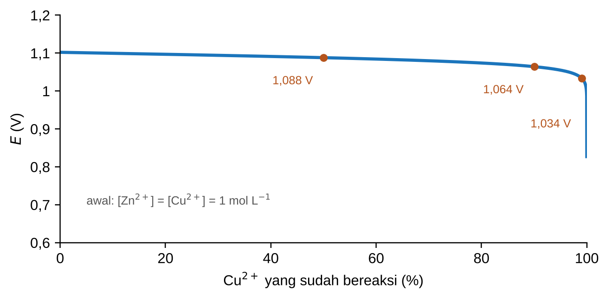

## 13.4 Persamaan Nernst

Potensial standar berlaku bila semua zat dalam keadaan standar. Sel nyata hampir tidak pernah begitu: konsentrasi berubah ketika sel bekerja, dan tegangannya ikut berubah. Bagaimana?

Jawabannya sudah tersedia. Dari Bab 12, $\Delta_\text{r}G = \Delta_\text{r}G^\circ + RT\ln Q$. Bagi kedua ruas dengan −*nF* dan pakai (13.1):

::: {.inti}
$$
E = E^\circ - \frac{RT}{nF}\ln Q . \qquad \text{(13.3)}
$$
**Persamaan Nernst.** Pada 25 °C, $RT/F = 25{,}69$ mV, dan dalam logaritma basis sepuluh: $E = E^\circ - (0{,}059\,16\ \text{V}/n)\log Q$.
:::

Setiap kenaikan *Q* sepuluh kali menurunkan tegangan sel sebesar 59,16 mV dibagi *n*. Ketergantungan logaritmik ini membuat tegangan sel cukup stabil: konsentrasi harus berubah seratus kali agar tegangan sel dengan *n* = 2 berubah 59 mV. Itulah sebabnya baterai memberikan tegangan yang hampir tetap sepanjang sebagian besar umurnya, lalu jatuh tajam ketika pereaksinya hampir habis (*Q* menuju tak hingga).

::: {.contoh}
**Contoh 13.5 · Sel Daniell yang sudah dipakai**

Sel Daniell bekerja sampai [Zn²⁺] = 1,0 mol L⁻¹ dan [Cu²⁺] = 0,010 mol L⁻¹. Anggap aktivitas sama dengan konsentrasi. Hitung potensial selnya pada 25 °C.

**Penyelesaian.** $Q = [\text{Zn}^{2+}]/[\text{Cu}^{2+}] = 100$ (logam padat beraktivitas 1). Dari (13.3):
$$
E = 1{,}102 - \frac{0{,}059\,16}{2}\log100 = 1{,}102 - 0{,}059 = 1{,}043\ \text{V} .
$$

**Memahami hasil.** Setelah 99% ion tembaga habis, tegangan hanya turun 5%. Tegangan baru jatuh berarti ketika [Cu²⁺] mencapai sekitar 10⁻¹⁰ mol L⁻¹ atau kurang; tetapi pada saat itu sel praktis sudah kosong. Tegangan yang hampir tetap ini adalah ciri khas semua sel elektrokimia, dan alasan mengapa indikator baterai yang hanya membaca tegangan tidak dapat menaksir sisa isi dengan teliti.
:::

Gambar 13.3 memperlihatkan seluruh riwayat pengosongan sel Daniell yang dimulai dari [Zn²⁺] = [Cu²⁺] = 1 mol L⁻¹. Karena *E* bergantung pada **logaritma** *Q*, tegangan hampir datar selama sebagian besar umur sel: setelah separuh Cu²⁺ bereaksi tegangan baru turun 14 mV, setelah 99 persen turun 68 mV. Penurunan tajam hanya terjadi pada persen-persen terakhir, ketika [Cu²⁺] mendekati nol dan logaritmanya menuju minus tak hingga.

{width=80%}

Persamaan Nernst juga berlaku untuk setiap setengah sel terhadap SHE. Untuk setengah reaksi $\text{Ox} + n\text{e}^- \rightarrow \text{Red}$:

$$
E = E^\circ - \frac{RT}{nF}\ln\frac{a_\text{Red}}{a_\text{Ox}} . \qquad \text{(13.4)}
$$

Bentuk ini paling berguna untuk setengah reaksi yang melibatkan H⁺, karena potensialnya bergantung pada pH. Untuk elektrode hidrogen pada tekanan H₂ 1 bar, $E = -(RT/F)\ln(1/a_{\text{H}^+}) = -0{,}059\,16\ \text{pH}$. Untuk elektrode oksigen, $E = 1{,}229 - 0{,}059\,16\ \text{pH}$. Kedua garis sejajar dan berjarak 1,229 V pada setiap pH. Gambar 13.4 memperlihatkan maknanya.

{width=72%}

::: {.contoh}
**Contoh 13.6 · Permanganat pada pH berbeda**

Hitung potensial setengah sel $\text{MnO}_4^- + 8\text{H}^+ + 5\text{e}^- \rightarrow \text{Mn}^{2+} + 4\text{H}_2\text{O}$ pada pH 0 dan pH 3, dengan $[\text{MnO}_4^-] = [\text{Mn}^{2+}]$. Apakah permanganat dapat mengoksidasi ion klorida pada kedua pH itu?

**Penyelesaian.** Dari (13.4), dengan $a_\text{Ox}$ memuat $a_{\text{H}^+}^8$:
$$
E = 1{,}507 - \frac{0{,}059\,16}{5}\log\frac{1}{(10^{-\text{pH}})^8} = 1{,}507 - \frac{8}{5}(0{,}059\,16)\,\text{pH} .
$$
Pada pH 0: 1,507 V. Pada pH 3: 1,507 − 0,284 = 1,223 V.

Klorida dioksidasi bila potensial pengoksidasi melebihi $E^\circ(\text{Cl}_2/\text{Cl}^-) = 1{,}358$ V. Pada pH 0 bisa (1,507 > 1,358); pada pH 3 tidak.

**Memahami hasil.** Daya oksidasi permanganat sangat bergantung pada keasaman, karena delapan ion H⁺ ikut dalam reaksinya. Inilah alasan titrasi permanganometri selalu dilakukan dalam asam sulfat, bukan asam klorida: dalam HCl pekat, permanganat ikut mengoksidasi klorida dan hasil titrasi menjadi terlalu tinggi.
:::

Selama ini kita menganggap aktivitas ion sama dengan konsentrasinya. Seberapa besar kesalahan anggapan itu? Bab 10 sudah memberi alatnya: koefisien aktivitas ion dari hukum Debye–Hückel.

::: {.contoh}
**Contoh 13.7 · Koreksi aktivitas pada persamaan Nernst**

Sel tanpa sambungan cairan dari Contoh 13.1, $\text{Pt}\,|\,\text{H}_2(g, 1\ \text{bar})\,|\,\text{HCl}(aq, 0{,}0100\ \text{mol kg}^{-1})\,|\,\text{AgCl}\,|\,\text{Ag}$, mempunyai *E*° = 0,2223 V. Hitung potensial selnya pada 25 °C (a) dengan menganggap aktivitas sama dengan molalitas; (b) dengan koefisien aktivitas dari hukum pembatas Debye–Hückel (10.17); (c) dengan koefisien aktivitas terukur, $\gamma_\pm = 0{,}904$.

**Rencana.** Untuk reaksi sel $\tfrac12\text{H}_2 + \text{AgCl} \rightarrow \text{Ag} + \text{H}^+ + \text{Cl}^-$, padatan beraktivitas 1 dan H₂ pada 1 bar juga beraktivitas 1, sehingga $Q = a_{\text{H}^+}a_{\text{Cl}^-} = (\gamma_\pm b/b^\circ)^2$. Persamaan Nernst dengan *n* = 1 menjadi $E = E^\circ - 2(0{,}059\,16\ \text{V})\log(\gamma_\pm b/b^\circ)$.

**Penyelesaian.** (a) Dengan $\gamma_\pm = 1$: $E = 0{,}2223 - (0{,}118\,32)\log0{,}0100 = 0{,}2223 + 0{,}2366 = 0{,}4589$ V.

(b) Kekuatan ion $I = \tfrac12[(1)^2(0{,}0100) + (1)^2(0{,}0100)] = 0{,}0100$. Dari (10.17), $\log\gamma_\pm = -(0{,}509)(1)\sqrt{0{,}0100} = -0{,}0509$, sehingga $\gamma_\pm = 0{,}889$ dan
$$
E = 0{,}2223 - (0{,}118\,32)\log(0{,}889 \times 0{,}0100) = 0{,}4650\ \text{V} .
$$
(c) Dengan $\gamma_\pm = 0{,}904$: $E = 0{,}4641$ V.

**Memahami hasil.** Mengabaikan aktivitas membuat tegangan meleset 5 mV. Angka itu tampak kecil, tetapi setara dengan kesalahan sekitar 11% pada aktivitas ion, padahal voltmeter laboratorium membaca sampai 0,1 mV. Hukum pembatas sudah menutup sebagian besar selisih itu; sisanya, 0,8 mV, berasal dari ukuran ion yang diabaikan hukum pembatas. Arah koreksinya masuk akal. Setiap ion terselubungi atmosfer ionik yang menstabilkannya, sehingga H⁺ dan Cl⁻ hasil reaksi sel "kurang aktif" daripada konsentrasinya. *Q* menjadi lebih kecil, dan sel mendorong reaksinya sedikit lebih kuat.

Hubungan ini juga dapat dibalik untuk **mengukur**. Menyusun ulang persamaan Nernst sel ini memberi $E + 2(0{,}059\,16\ \text{V})\log(b/b^\circ) = E^\circ - 2(0{,}059\,16\ \text{V})\log\gamma_\pm$. Dalam larutan encer, $\log\gamma_\pm$ sebanding dengan $\sqrt{b}$, sehingga ruas kiri yang digambarkan terhadap $\sqrt{b}$ memberi garis lurus yang memotong sumbu tegak di *E*°. Dengan cara inilah *E*° elektrode perak–perak klorida ditentukan, dan begitu *E*° diketahui, setiap pengukuran *E* memberi $\gamma_\pm$ pada molalitas itu.
:::

::: {.kuis}
**Kuis cepat 13.4** Logam natrium (*E*° = −2,714 V) bereaksi hebat dengan air. Pakai Gambar 13.4 untuk menjelaskan mengapa.
:::

## 13.5 Potensial standar dan tetapan kesetimbangan

Ketika sel bekerja sampai habis, reaksi sel mencapai kesetimbangan, dan tegangannya nol: tidak ada lagi dorongan untuk memindahkan elektron. Pada saat itu *Q* = *K*. Dari (13.3) dengan *E* = 0:

::: {.inti}
$$
\ln K = \frac{nFE^\circ}{RT} , \qquad \log K = \frac{nE^\circ}{0{,}059\,16\ \text{V}}\quad(25\ ^\circ\text{C}) . \qquad \text{(13.5)}
$$
**Potensial standar dan tetapan kesetimbangan.** Setiap 59 mV pada *E*° (dibagi *n*) berarti faktor sepuluh pada *K*.
:::

Persamaan ini adalah gabungan $\Delta_\text{r}G^\circ = -nFE^\circ$ dan $\Delta_\text{r}G^\circ = -RT\ln K$, dan ia memberi cara yang sangat kuat untuk mengukur tetapan kesetimbangan, termasuk yang terlalu besar atau terlalu kecil untuk diukur dengan analisis komposisi.

::: {.contoh}
**Contoh 13.8 · Tetapan kesetimbangan sel Daniell**

Hitung *K* untuk $\text{Zn} + \text{Cu}^{2+} \rightleftharpoons \text{Zn}^{2+} + \text{Cu}$ pada 25 °C.

**Penyelesaian.** $\log K = (2)(1{,}102)/0{,}059\,16 = 37{,}26$, sehingga $K = 1{,}8 \times 10^{37}$.

**Memahami hasil.** Pada kesetimbangan, $[\text{Cu}^{2+}]/[\text{Zn}^{2+}] = 5{,}5 \times 10^{-38}$. Bila [Zn²⁺] = 1 mol L⁻¹, sisa ion tembaga kira-kira satu ion dalam $3 \times 10^{13}$ liter, setara dengan satu ion dalam air sebuah danau besar. Konsentrasi sekecil itu tidak dapat diukur dengan cara apa pun, tetapi tegangan sel mengukurnya secara tidak langsung dengan mudah. Reaksi ini praktis berjalan tuntas, dan itulah sebabnya serbuk seng dipakai untuk mengendapkan tembaga dan logam mulia dari larutan.
:::

Cara yang sama memberi hasil kali kelarutan. Trik yang dipakai: susun dua setengah sel yang reaksi selnya adalah reaksi pelarutan, walaupun reaksi itu bukan redoks.

::: {.contoh}
**Contoh 13.9 · Kelarutan perak klorida dari voltmeter**

Gabungkan setengah reaksi $\text{AgCl} + \text{e}^- \rightarrow \text{Ag} + \text{Cl}^-$ ($E^\circ = 0{,}2223$ V) dan $\text{Ag}^+ + \text{e}^- \rightarrow \text{Ag}$ ($E^\circ = 0{,}7996$ V) untuk menghitung $K_\text{sp}$ AgCl pada 25 °C.

**Penyelesaian.** Kurangkan setengah reaksi kedua dari yang pertama: $\text{AgCl}(s) \rightarrow \text{Ag}^+(aq) + \text{Cl}^-(aq)$, dengan *n* = 1 dan $E^\circ = 0{,}2223 - 0{,}7996 = -0{,}5773$ V. Dari (13.5):
$$
\ln K_\text{sp} = \frac{(96\,485)(-0{,}5773)}{(8{,}314)(298{,}15)} = -22{,}47 , \qquad K_\text{sp} = 1{,}7 \times 10^{-10} .
$$

**Memahami hasil.** Nilai ini sama dengan hasil pengukuran kelarutan langsung, $1{,}8 \times 10^{-10}$. Untuk garam yang jauh lebih sukar larut, seperti AgI ($K_\text{sp} \approx 10^{-16}$) atau HgS ($10^{-52}$), cara elektrokimia adalah satu-satunya yang praktis. Perhatikan bahwa reaksi sel yang dihitung tidak pernah benar-benar dijalankan dalam satu sel; kita cukup menggabungkan dua potensial dari tabel, karena keduanya diukur terhadap acuan yang sama.
:::

::: {.contoh}
**Contoh 13.10 · Mengapa titrasi redoks tajam**

Dalam titrasi Fe²⁺ dengan Ce⁴⁺ dalam asam sulfat, $E^\circ(\text{Ce}^{4+}/\text{Ce}^{3+}) = 1{,}61$ V dan $E^\circ(\text{Fe}^{3+}/\text{Fe}^{2+}) = 0{,}771$ V. Hitung *K* reaksi titrasi $\text{Ce}^{4+} + \text{Fe}^{2+} \rightleftharpoons \text{Ce}^{3+} + \text{Fe}^{3+}$.

**Penyelesaian.** $E^\circ = 1{,}61 - 0{,}771 = 0{,}839$ V, *n* = 1. $\log K = 0{,}839/0{,}059\,16 = 14{,}2$, sehingga $K = 1{,}5 \times 10^{14}$.

**Memahami hasil.** Pada titik ekivalen, perbandingan [Fe²⁺]/[Fe³⁺] sekitar $1/\sqrt{K} \approx 10^{-7}$: reaksi tuntas sampai sepersepuluh juta. Potensial larutan melompat hampir 0,8 V di sekitar titik ekivalen (Gambar 13.5), karena yang menentukan potensial berpindah dari pasangan besi ke pasangan cerium. Lompatan inilah yang dideteksi oleh indikator redoks atau elektrode platina. Reaksi titrasi yang baik memerlukan selisih *E*° paling sedikit sekitar 0,3–0,4 V.
:::

{width=80%}

::: {.kuis}
**Kuis cepat 13.5** Suatu reaksi sel mempunyai *E*° = 0 V. Berapa tetapan kesetimbangannya? Apakah sel ini dapat menghasilkan listrik?
:::
