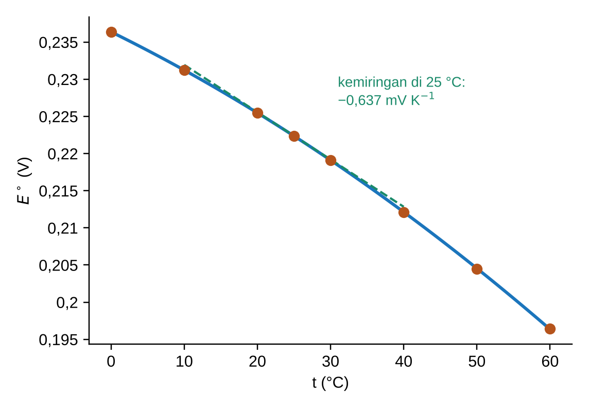

## 13.6 Ketergantungan *E* pada suhu: ΔS dan ΔH dari pengukuran sel

Karena $\Delta_\text{r}G = -nFE$, semua sifat energi Gibbs dapat diterjemahkan menjadi sifat tegangan sel. Yang paling berguna adalah turunan terhadap suhu. Dari (7.9), $(\partial\Delta_\text{r}G/\partial T)_p = -\Delta_\text{r}S$. Dengan $\Delta_\text{r}G = -nFE$:

::: {.inti}
$$
\Delta_\text{r}S = nF\left(\frac{\partial E}{\partial T}\right)_p , \qquad \Delta_\text{r}H = \Delta_\text{r}G + T\Delta_\text{r}S = -nF\left[E - T\left(\frac{\partial E}{\partial T}\right)_p\right] . \qquad \text{(13.6)}
$$
**Entropi dan entalpi reaksi dari tegangan sel.** Cukup mengukur *E* pada beberapa suhu: kemiringannya memberi Δ*S*, dan bersama *E* sendiri memberi Δ*H*.
:::

Ini cara yang sangat elegan: tiga besaran termodinamika utama sebuah reaksi, $\Delta_\text{r}G$, $\Delta_\text{r}S$, dan $\Delta_\text{r}H$, diperoleh dari voltmeter dan termometer saja, tanpa kalorimeter. Dan karena tegangan dapat diukur sangat teliti, hasilnya sering lebih baik daripada pengukuran kalorimetri langsung.

{width=70%}

::: {.contoh}
**Contoh 13.11 · Termodinamika lengkap dari satu sel**

Untuk sel Pt|H₂|HCl|AgCl|Ag (reaksi $\tfrac12\text{H}_2 + \text{AgCl} \rightarrow \text{Ag} + \text{H}^+ + \text{Cl}^-$, *n* = 1), $E^\circ = 0{,}2224$ V dan $dE^\circ/dT = -0{,}637$ mV K⁻¹ pada 25 °C (Gambar 13.6). Hitung $\Delta_\text{r}G^\circ$, $\Delta_\text{r}S^\circ$, dan $\Delta_\text{r}H^\circ$, lalu bandingkan dengan tabel: $\Delta_\text{f}H^\circ$ AgCl(s) = −127,07 dan HCl(aq) = −167,16 kJ mol⁻¹.

**Penyelesaian.**
$$
\Delta_\text{r}G^\circ = -(96\,485)(0{,}2224) = -21{,}46\ \text{kJ mol}^{-1} ,
$$
$$
\Delta_\text{r}S^\circ = (96\,485)(-6{,}37 \times 10^{-4}) = -61{,}5\ \text{J K}^{-1}\text{mol}^{-1} ,
$$
$$
\Delta_\text{r}H^\circ = -21{,}46 + (298{,}15)(-0{,}0615) = -39{,}8\ \text{kJ mol}^{-1} .
$$
Dari tabel: $\Delta_\text{r}H^\circ = -167{,}16 - (-127{,}07) = -40{,}1$ kJ mol⁻¹.

**Memahami hasil.** Selisihnya hanya 0,3 kJ mol⁻¹, kurang dari 1%. Entropi reaksi negatif: setengah mol gas H₂ hilang dan ion-ion yang terbentuk menata molekul air di sekitarnya. Karena tegangan turun ketika suhu naik, sel ini memberi kerja listrik sedikit lebih kecil pada hari panas.
:::

Ada akibat menarik dari (13.6). Bila sel bekerja secara reversibel, kerja listrik yang diberikannya adalah $-\Delta_\text{r}G$, dan kalor yang dipertukarkannya dengan lingkungan adalah $q_\text{rev} = T\Delta_\text{r}S$. Untuk sel dengan $dE/dT$ negatif, seperti di atas, sel melepaskan kalor walaupun bekerja sempurna. Untuk sel dengan $dE/dT$ positif, sel menyerap kalor dari lingkungan dan mengubahnya menjadi listrik, sehingga kerja listriknya **melebihi** $-\Delta_\text{r}H$, seperti pembakaran glukosa di Bab 7.

::: {.contoh}
**Contoh 13.12 · Kalor dari sel yang bekerja sempurna dan yang dihubung pendek**

Untuk sel pada Contoh 13.11, hitung kalor yang dilepaskan per mol reaksi bila sel (a) bekerja secara reversibel, (b) dihubung pendek sehingga tidak ada kerja listrik yang dilakukan.

**Penyelesaian.** (a) $q_\text{rev} = T\Delta_\text{r}S^\circ = (298{,}15)(-61{,}5) = -18{,}3$ kJ mol⁻¹: sel melepaskan 18,3 kJ kalor sambil memberikan 21,5 kJ kerja listrik.

(b) Tanpa kerja listrik, seluruh perubahan entalpi keluar sebagai kalor: $q = \Delta_\text{r}H^\circ = -39{,}8$ kJ mol⁻¹.

**Memahami hasil.** Jumlah kerja dan kalor pada (a), 21,5 + 18,3 = 39,8 kJ, sama dengan kalor pada (b): hukum pertama terpenuhi. Hubung pendek "membuang" 21,5 kJ yang seharusnya dapat menjadi kerja, dan mengubahnya menjadi kalor. Baterai yang dihubung pendek menjadi panas karena alasan ini, dan pada baterai litium yang besar, panas itu dapat memicu kebakaran.
:::

::: {.kuis}
**Kuis cepat 13.6** Bila potensial suatu sel tidak bergantung pada suhu, berapa $\Delta_\text{r}S$-nya? Apa hubungan $\Delta_\text{r}G$ dan $\Delta_\text{r}H$-nya?
:::

## 13.7 Sel konsentrasi dan pengukuran pH

Sel tidak harus memakai dua zat yang berbeda. Dua elektrode yang sama dalam larutan dengan konsentrasi berbeda juga menghasilkan tegangan, karena zat cenderung berpindah dari konsentrasi tinggi ke rendah. Sel seperti ini disebut **sel konsentrasi**. Untuk $\text{Ag}\,|\,\text{Ag}^+(a_1)\,\|\,\text{Ag}^+(a_2)\,|\,\text{Ag}$, reaksi selnya adalah $\text{Ag}^+(a_2) \rightarrow \text{Ag}^+(a_1)$, dengan *E*° = 0, sehingga

$$
E = -\frac{RT}{F}\ln\frac{a_1}{a_2} = \frac{RT}{F}\ln\frac{a_2}{a_1} . \qquad \text{(13.7)}
$$

Tegangan sel konsentrasi berasal sepenuhnya dari entropi pencampuran: dorongan untuk menyamakan konsentrasi diubah menjadi kerja listrik. Inilah jawaban Kuis 13.5: sel dengan *E*° = 0 tetap dapat menghasilkan listrik bila *Q* ≠ 1.

::: {.contoh}
**Contoh 13.13 · Sel konsentrasi perak**

Hitung potensial sel $\text{Ag}\,|\,\text{AgNO}_3(0{,}010\ \text{mol L}^{-1})\,\|\,\text{AgNO}_3(1{,}0\ \text{mol L}^{-1})\,|\,\text{Ag}$ pada 25 °C, dengan anggapan aktivitas sama dengan konsentrasi.

**Penyelesaian.** $E = (0{,}059\,16)\log(1{,}0/0{,}010) = 0{,}118$ V. Elektrode dalam larutan encer adalah anode: perak larut di sana dan mengendap di elektrode dalam larutan pekat.

**Memahami hasil.** Perbedaan konsentrasi seratus kali hanya memberi 0,12 V. Dalam pengukuran teliti, aktivitas harus dipakai: koefisien aktivitas AgNO₃ 1 mol L⁻¹ jauh di bawah satu, sehingga tegangan terukur lebih kecil (bandingkan Contoh 13.7). Sebaliknya, sel konsentrasi adalah cara klasik **mengukur** koefisien aktivitas ion, dengan membandingkan tegangan terukur dengan ramalan (13.7).
:::

Di dalam tubuh, sel konsentrasi bekerja di setiap sel saraf. Membran sel saraf lebih mudah dilewati ion K⁺ daripada ion lain, dan di dalam sel [K⁺] sekitar 140 mmol L⁻¹, sedangkan di luar sekitar 5 mmol L⁻¹. Ion K⁺ cenderung keluar menuruni gradien konsentrasinya, tetapi setiap ion yang keluar meninggalkan muatan negatif di dalam, sehingga terbentuk beda potensial yang menahan keluarnya K⁺ berikutnya. Kesetimbangan tercapai ketika beda potensial listrik tepat mengimbangi selisih potensial kimia: inilah **potensial Nernst**.

::: {.contoh}
**Contoh 13.14 · Tegangan sel saraf**

Hitung potensial Nernst untuk K⁺ di membran sel saraf pada 37 °C, dengan $[\text{K}^+]_\text{dalam} = 140$ dan $[\text{K}^+]_\text{luar} = 5{,}0$ mmol L⁻¹. Lakukan hal yang sama untuk Na⁺, dengan $[\text{Na}^+]_\text{dalam} = 12$ dan $[\text{Na}^+]_\text{luar} = 145$ mmol L⁻¹.

**Penyelesaian.** Potensial bagian dalam terhadap luar pada kesetimbangan untuk ion bermuatan +1: $E = (RT/F)\ln([\text{luar}]/[\text{dalam}])$, dengan $RT/F = 26{,}73$ mV pada 310 K.

K⁺: $E = (26{,}73)\ln(5{,}0/140) = -89$ mV. Na⁺: $E = (26{,}73)\ln(145/12) = +67$ mV.

**Memahami hasil.** Potensial istirahat sel saraf terukur sekitar −70 mV, dekat potensial Nernst K⁺, karena dalam keadaan istirahat membran terutama terbuka bagi K⁺. Ketika impuls saraf datang, saluran Na⁺ tiba-tiba terbuka, dan potensial membran melompat menuju +67 mV, potensial Nernst Na⁺. Lompatan itu, yang merambat sepanjang akson, adalah sinyal saraf. Pompa natrium–kalium, yang memakai ATP (Bab 12), terus mengembalikan perbedaan konsentrasi itu. Setiap pikiran kita adalah sel konsentrasi yang dinyalakan dan dimatikan.
:::

### Mengukur pH

Elektrode hidrogen memberi potensial yang bergantung langsung pada pH: $E = -0{,}059\,16\ \text{pH}$ pada 25 °C. Tetapi elektrode hidrogen merepotkan: memerlukan gas H₂ dan permukaan platina yang mudah teracuni. Dalam praktik dipakai **elektrode kaca**: membran kaca tipis khusus yang permukaannya menukar ion H⁺ dengan larutan. Beda aktivitas H⁺ di kedua sisi membran menghasilkan potensial seperti sel konsentrasi. Elektrode kaca dipasangkan dengan elektrode pembanding (biasanya Ag|AgCl), dan potensial selnya

$$
E = \text{tetapan} - 0{,}059\,16\ \text{V} \times \text{pH} \quad (25\ ^\circ\text{C}) . \qquad \text{(13.8)}
$$

Tetapan itu berbeda untuk setiap elektrode dan berubah perlahan, sehingga pH meter harus **dikalibrasi** dengan larutan penyangga yang pH-nya diketahui, biasanya dua penyangga (misalnya pH 4,01 dan 7,00) untuk menetapkan tetapan dan kemiringannya.

::: {.contoh}
**Contoh 13.15 · Membaca pH meter**

Pada 25 °C, sebuah pH meter menunjukkan 0,4120 V dalam penyangga pH 7,00. Dalam sampel, tegangannya 0,5890 V. Berapa pH sampel?

**Penyelesaian.** Dari (13.8), selisih tegangan $0{,}5890 - 0{,}4120 = 0{,}1770$ V. Karena *E* naik ketika pH turun: $\Delta\text{pH} = -0{,}1770/0{,}059\,16 = -2{,}99$. pH sampel = 7,00 − 2,99 = 4,01.

**Memahami hasil.** Satu satuan pH setara 59 mV. Untuk mengukur pH sampai 0,01, tegangan harus diukur sampai 0,6 mV, dan suhu harus diperhatikan, karena kemiringan $RT\ln10/F$ berubah 0,2 mV per derajat per satuan pH. pH meter yang baik menyertakan sensor suhu untuk mengoreksinya secara otomatis (Gambar 13.7).
:::

{width=80%}

::: {.kuis}
**Kuis cepat 13.7** Mengapa pH meter yang dikalibrasi pada 25 °C memberi pembacaan yang salah bila sampelnya pada 40 °C, walaupun tetapannya tidak berubah?
:::

## 13.8 Baterai dan sel bahan bakar

Baterai adalah sel elektrokimia yang dikemas. Termodinamika menentukan dua angka terpentingnya: **tegangan** (dari *E*° dan Nernst) dan **energi spesifik** maksimum, yaitu $-\Delta_\text{r}G$ dibagi massa pereaksi. Kimia bahan, teknik, dan laju reaksi menentukan seberapa dekat baterai nyata mendekati batas itu.

::: {.contoh}
**Contoh 13.16 · Aki timbal dan baterai litium**

(a) Aki kendaraan memakai reaksi $\text{Pb} + \text{PbO}_2 + 2\text{H}_2\text{SO}_4 \rightarrow 2\text{PbSO}_4 + 2\text{H}_2\text{O}$. Hitung *E*° dari Tabel 13.1 dan energi spesifik teoretisnya dalam Wh kg⁻¹, dihitung terhadap massa pereaksi. (b) Baterai litium-ion memakai reaksi $\text{LiC}_6 + \text{CoO}_2 \rightarrow \text{C}_6 + \text{LiCoO}_2$ dengan tegangan sekitar 3,7 V. Hitung energi spesifik teoretisnya dengan cara yang sama.

**Penyelesaian.** (a) $E^\circ = 1{,}691 - (-0{,}359) = 2{,}050$ V, *n* = 2. $-\Delta_\text{r}G^\circ = (2)(96\,485)(2{,}050) = 395{,}6$ kJ per mol reaksi. Massa pereaksi: $207{,}2 + 239{,}2 + 2(98{,}08) = 642{,}6$ g. Energi spesifik: $395{,}6/0{,}6426 = 615{,}6$ kJ kg⁻¹ $= 171$ Wh kg⁻¹ (1 Wh = 3,6 kJ).

(b) *n* = 1: $(96\,485)(3{,}7) = 357$ kJ per mol. Massa pereaksi: $72{,}06 + 6{,}94 + 90{,}93 = 169{,}9$ g. Energi spesifik: $357/0{,}1699 = 2101$ kJ kg⁻¹ $= 584$ Wh kg⁻¹.

**Memahami hasil.** Baterai litium unggul karena dua alasan sekaligus: litium adalah logam paling ringan dan paling elektropositif (*E*° paling negatif), sehingga tegangannya hampir dua kali aki timbal, sementara massa per elektron yang dipindahkan jauh lebih kecil. Aki timbal nyata hanya mencapai 30–40 Wh kg⁻¹ dan baterai litium-ion 150–270 Wh kg⁻¹, karena massa wadah, elektrolit, dan penghantar, serta karena tidak seluruh bahan aktif dapat dipakai tanpa merusak elektrode.
:::

**Sel bahan bakar** berbeda dari baterai karena pereaksinya dipasok terus dari luar. Sel bahan bakar hidrogen memakai reaksi $\text{H}_2 + \tfrac12\text{O}_2 \rightarrow \text{H}_2\text{O}(l)$ dengan *E*° = 1,229 V, yang di Bab 7 kita lihat terbatas pada 83% dari entalpi pembakaran. Di sini kita dapat melihat batas itu dari sisi tegangan. Entalpi pembakaran hidrogen, 285,83 kJ mol⁻¹, dinyatakan sebagai tegangan disebut **tegangan termonetral**: $\Delta_\text{r}H/nF = 285\,830/(2 \times 96\,485) = 1{,}481$ V. Efisiensi sel bahan bakar yang bekerja pada tegangan *V* terhadap entalpi bahan bakarnya adalah *V*/1,481.

::: {.contoh}
**Contoh 13.17 · Sel bahan bakar dan elektroliser**

(a) Sel bahan bakar hidrogen kendaraan bekerja pada sekitar 0,70 V per sel ketika menarik arus besar. Hitung efisiensinya terhadap entalpi pembakaran dan terhadap $\Delta_\text{r}G$. (b) Untuk membuat hidrogen dengan elektrolisis air, elektroliser industri bekerja pada sekitar 1,8 V. Hitung energi listrik per kilogram hidrogen, dan bandingkan dengan batas minimum termodinamika (1,229 V).

**Penyelesaian.** (a) Terhadap entalpi: 0,70/1,481 = 47%. Terhadap energi Gibbs: 0,70/1,229 = 57%.

(b) Per mol H₂ diperlukan muatan 2*F*. Pada 1,8 V: $(2)(96\,485)(1{,}8) = 347$ kJ per mol, atau per kilogram $347/0{,}002\,016 = 1{,}72 \times 10^5$ kJ = 47,9 kWh. Pada batas 1,229 V: 32,7 kWh kg⁻¹.

**Memahami hasil.** Sel bahan bakar kehilangan hampir separuh energinya sebagai kalor, karena reaksi di elektrode memerlukan "dorongan" tegangan tambahan supaya berjalan cukup cepat (disebut **overpotensial**), dan karena hambatan di dalam sel. Hal yang sama terjadi terbalik di elektroliser. Bila hidrogen dibuat dengan elektrolisis lalu dipakai di sel bahan bakar, hanya sekitar $0{,}70/1{,}8 = 39\%$ listrik awal yang kembali. Kehilangan ini, bukan batas termodinamika, adalah tantangan utama teknologi "hidrogen hijau". Termodinamika memberi batasnya; elektrokatalisis menentukan seberapa dekat kita mencapainya.
:::

::: {.terapan}
**Korosi dan perlindungan katodik.** Korosi besi adalah sel elektrokimia yang tidak kita inginkan. Di satu bagian permukaan, besi teroksidasi ($\text{Fe} \rightarrow \text{Fe}^{2+} + 2\text{e}^-$); di bagian lain, oksigen terlarut tereduksi ($\text{O}_2 + 2\text{H}_2\text{O} + 4\text{e}^- \rightarrow 4\text{OH}^-$). Pada pH 7, potensial setengah sel oksigen adalah 1,229 − 0,414 = 0,815 V, sehingga tegangan "sel korosi" sekitar 0,815 − (−0,447) = 1,26 V: sangat spontan. Air laut mempercepatnya karena ion-ionnya menghantarkan listrik dengan baik. Seng dapat melindungi besi karena *E*°-nya lebih negatif: bila keduanya bersentuhan, seng yang teroksidasi lebih dulu dan besi menjadi katode yang terlindung. Itulah prinsip besi galvanis (seng tetap melindungi walaupun lapisannya tergores) dan **anode korban**, blok seng atau magnesium yang dipasang di lambung kapal, tiang dermaga, dan pipa bawah tanah, lalu diganti ketika habis.
:::

::: {.kuis}
**Kuis cepat 13.8** Mengapa lapisan timah pada kaleng melindungi besi selama utuh, tetapi mempercepat karat bila tergores, sedangkan lapisan seng tidak?
:::

## 13.9 Diagram Pourbaix dan korosi

Jembatan besi, kerangka kapal, dan pipa air semuanya berkarat, tetapi tidak dengan laju yang sama. Besi di air laut berkarat jauh lebih cepat daripada di air sungai; besi di dalam beton yang basa hampir tidak berkarat; dan besi yang disambungkan ke sepotong seng bertahan bertahun-tahun di laut. Semua pengamatan itu dapat dibaca dari satu peta yang menggabungkan persamaan Nernst dengan kesetimbangan asam–basa dan kelarutan: **diagram Pourbaix**, atau diagram potensial–pH.

### Membangun peta

Gambar 13.4 sudah memperlihatkan contoh paling sederhana: jendela kestabilan air, dibatasi dua garis miring $E = 1{,}229 - 0{,}059\,16\,\text{pH}$ (O₂/H₂O) dan $E = -0{,}059\,16\,\text{pH}$ (H₂O/H₂). Untuk suatu logam, kita menambahkan garis untuk setiap kesetimbangan antara spesiesnya. Ada tiga jenis garis:

* **Garis mendatar**: reaksi redoks tanpa H⁺ atau OH⁻, misalnya $\text{Fe}^{2+} + 2e^- \rightleftharpoons \text{Fe}$. Potensialnya tidak bergantung pada pH.
* **Garis tegak**: reaksi asam–basa atau pengendapan tanpa elektron, misalnya $\text{Fe}^{3+} + 3\text{OH}^- \rightleftharpoons \text{Fe(OH)}_3$. Batasnya hanya bergantung pada pH.
* **Garis miring**: reaksi yang melibatkan elektron dan H⁺ sekaligus, misalnya $\text{Fe(OH)}_3 + 3\text{H}^+ + e^- \rightleftharpoons \text{Fe}^{2+} + 3\text{H}_2\text{O}$. Menurut persamaan Nernst, kemiringannya $-0{,}059\,16\,m/n$ V per satuan pH, dengan *m* jumlah H⁺ dan *n* jumlah elektron.

Untuk ion terlarut kita harus memilih satu aktivitas sebagai batas. Ahli korosi biasanya memakai 10⁻⁶: di bawah kadar itu, logam dianggap "tidak berkarat" untuk keperluan praktis.

::: {.contoh}
**Contoh 13.18 · Tiga garis batas untuk besi**

Pakai $E^\circ(\text{Fe}^{2+}/\text{Fe}) = -0{,}447$ V, $E^\circ(\text{Fe}^{3+}/\text{Fe}^{2+}) = +0{,}771$ V, $K_\text{sp}(\text{Fe(OH)}_3) = 2{,}79 \times 10^{-39}$, $K_\text{sp}(\text{Fe(OH)}_2) = 4{,}87 \times 10^{-17}$, dan aktivitas ion terlarut 10⁻⁶. Hitung (a) potensial batas Fe/Fe²⁺, (b) pH tempat Fe(OH)₃ mulai mengendap dari Fe³⁺, (c) pH tempat Fe(OH)₂ mulai mengendap dari Fe²⁺.

**Penyelesaian.** (a) Dari persamaan Nernst untuk $\text{Fe}^{2+} + 2e^- \to \text{Fe}$,
$$
E = -0{,}447 + \frac{0{,}059\,16}{2}\log(10^{-6}) = -0{,}624\ \text{V} .
$$
(b) Pengendapan dimulai bila $[\text{OH}^-]^3 = K_\text{sp}/[\text{Fe}^{3+}] = 2{,}79 \times 10^{-33}$, yaitu $[\text{OH}^-] = 1{,}41 \times 10^{-11}$, pOH = 10,85, **pH = 3,15**.

(c) $[\text{OH}^-]^2 = 4{,}87 \times 10^{-17}/10^{-6}$, sehingga $[\text{OH}^-] = 6{,}98 \times 10^{-6}$ dan **pH = 8,84**.

**Memahami hasil.** Fe(OH)₃ sudah mengendap pada larutan yang cukup asam (pH 3), karena *K*$_\text{sp}$-nya luar biasa kecil, sedangkan Fe(OH)₂ baru mengendap pada larutan basa. Garis miring Fe(OH)₃/Fe²⁺ menghubungkan kedua batas itu dengan kemiringan $-3(0{,}059\,16) = -0{,}177$ V per pH, karena reaksinya memakai tiga H⁺ untuk satu elektron.
:::

Bila semua garis digambar, peta besi terbagi menjadi tiga jenis daerah (Gambar 13.8):

* **kekebalan**: di bawah −0,62 V, besi logam adalah bentuk yang stabil, dan besi tidak dapat berkarat;
* **korosi**: daerah Fe²⁺ dan Fe³⁺ terlarut, tempat besi larut terus-menerus;
* **pasivasi**: daerah Fe(OH)₃ (yang mengering menjadi Fe₂O₃) dan Fe(OH)₂. Di sini besi tetap teroksidasi, tetapi hasilnya padatan yang dapat menutup permukaan.

{width=82%}

### Membaca peta: mengapa besi berkarat, dan bagaimana mencegahnya

Di air netral yang jenuh udara, oksigen dapat menarik potensial permukaan logam sampai mendekati garis O₂/H₂O, sekitar +0,8 V pada pH 7 (titik pada Gambar 13.8). Seluruh rentang antara −0,62 V dan +0,8 V berada di atas daerah kekebalan, sehingga besi **pasti** teroksidasi; termodinamika tidak memberi jalan keluar. Yang menentukan nasibnya adalah hasil oksidasinya. Pada pH 7, garis Fe(OH)₃/Fe²⁺ melintas di sekitar +0,1 V, sehingga besi yang potensialnya di bawah nilai itu larut sebagai Fe²⁺ dan baru mengendap sebagai karat setelah teroksidasi lebih lanjut di larutan. Karat yang terbentuk jauh dari logam itu berpori dan tidak melindungi.

Diagram ini langsung memberi tiga strategi perlindungan:

1. **Menaikkan pH.** Beton mempunyai pH sekitar 12,5. Pada pH itu besi berada di daerah pasivasi pada hampir semua potensial yang mungkin, sehingga tulangan baja di dalam beton tetap utuh. Bila beton terkarbonasi oleh CO₂ udara dan pH-nya turun di bawah sekitar 9, tulangan mulai berkarat.
2. **Menurunkan potensial (proteksi katodik).** Bila besi disambungkan ke logam yang lebih aktif, misalnya seng ($E^\circ = -0{,}762$ V) atau magnesium, logam itu yang teroksidasi dan memasok elektron ke besi, sehingga potensial besi ditarik ke daerah kekebalan. Seng "dikorbankan" dan harus diganti berkala. Lambung kapal dan pipa bawah tanah dilindungi dengan cara ini, juga dengan arus listrik dari luar.
3. **Menaikkan potensial ke daerah pasif.** Pada baja tahan karat, kromium membentuk lapisan Cr₂O₃ yang sangat rapat dan pasif dalam rentang potensial dan pH yang jauh lebih lebar daripada besi.

::: {.contoh}
**Contoh 13.19 · Proteksi katodik dengan seng**

Lambung kapal besi di air laut (pH ≈ 8) disambungkan ke balok seng. (a) Dengan [Zn²⁺] = 10⁻⁶, berapa potensial Zn²⁺/Zn? (b) Apakah potensial itu cukup rendah untuk membawa besi ke daerah kekebalan? (c) Berapa massa seng yang habis per tahun bila arus perlindungan rata-rata 2,0 A?

**Penyelesaian.** (a) $E = -0{,}762 + (0{,}059\,16/2)\log(10^{-6}) = -0{,}939$ V.

(b) Batas kekebalan besi adalah −0,624 V (Contoh 13.18). Potensial seng 0,32 V lebih negatif, sehingga besi yang tersambung baik ke seng berada di daerah kekebalan.

(c) Muatan per tahun $Q = (2{,}0\ \text{A})(3{,}156 \times 10^7\ \text{s}) = 6{,}31 \times 10^7$ C. Seng melepas dua elektron per atom, sehingga $n = Q/2F = 327$ mol, dan massanya $(327)(65{,}38) = 21$ kg.

**Memahami hasil.** Termodinamika menjamin perlindungan selama seng masih ada dan tersambung baik; laju habisnya seng ditentukan oleh arus, yaitu oleh kinetika reaksi di permukaan dan luas lambung yang harus dilindungi. Pada potensial serendah −0,94 V, air pun dapat tereduksi menjadi H₂ (garis bawah Gambar 13.8 terletak di sekitar −0,47 V pada pH 8), sehingga sebagian arus terbuang untuk membentuk gas hidrogen. Perlindungan yang berlebihan juga merugikan, karena hidrogen dapat masuk ke baja dan membuatnya getas.
:::

::: {.kuis}
**Kuis cepat 13.9** Menurut Gambar 13.8, apakah besi lebih tahan karat di air pH 3 yang jenuh udara atau di air pH 11 yang jenuh udara? Jelaskan dengan daerah pada diagram.
:::

### Menuju bab berikutnya

Dengan bab ini, bangunan termodinamika klasik selesai. Hukum pertama dan kedua, energi Gibbs, dan potensial kimia telah membawa kita dari gas ideal sampai baterai dan korosi, dan semuanya dapat diukur: kalor dengan kalorimeter, tekanan dengan manometer, energi Gibbs dengan voltmeter. Tetapi ada satu pertanyaan yang tidak pernah dijawab oleh termodinamika klasik: **dari mana** angka-angka dalam tabel itu berasal? Mengapa entropi argon 154,84 J K⁻¹ mol⁻¹ dan bukan angka lain? Mengapa kapasitas kalor klorin lebih besar daripada nitrogen?

Bab berikutnya menjawabnya dengan turun ke tingkat molekul. **Termodinamika statistik** menghitung energi dalam, entropi, energi Gibbs, dan tetapan kesetimbangan dari tingkat-tingkat energi molekul yang dibaca dari spektrum. Alat utamanya hanya satu: sebaran Boltzmann, $e^{-\varepsilon/kT}$, dan fungsi partisi yang merangkumnya.
