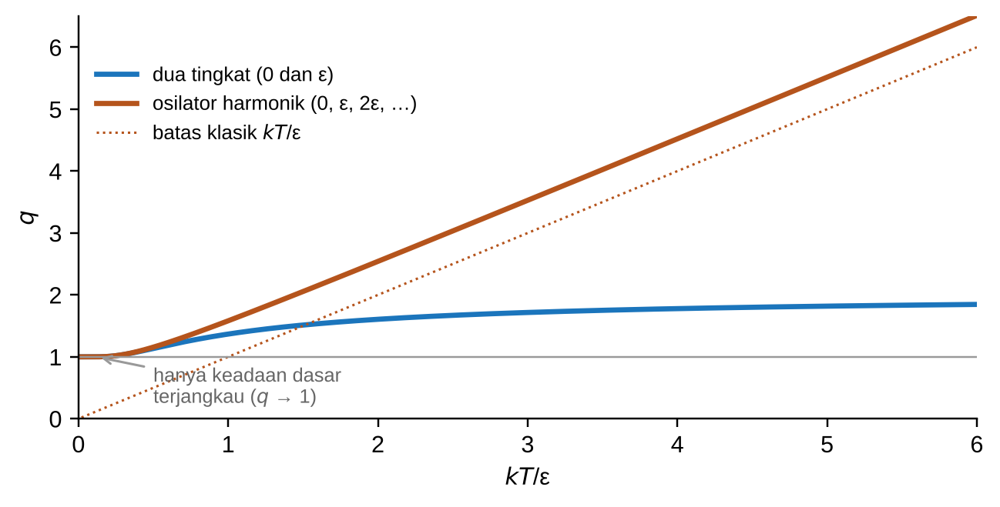

# Bab 14 Termodinamika Statistik

Buka Tabel 6.1 dan lihat entropi molar standar argon: 154,84 J K⁻¹ mol⁻¹. Angka itu diperoleh dengan kerja yang melelahkan: argon didinginkan sampai mendekati nol mutlak, kapasitas kalornya diukur titik demi titik sambil dipanaskan kembali, entalpi peleburan dan penguapannya diukur, lalu semua dijumlahkan sebagai $\int C_p\,dT/T$ ditambah entropi perubahan fasa. Sekarang ambil kertas dan tuliskan hanya tiga angka: massa satu atom argon, suhu 298,15 K, dan tekanan 1 bar. Dengan tetapan Planck dan tetapan Boltzmann, satu rumus yang akan kita turunkan di bab ini memberi 154,85 J K⁻¹ mol⁻¹. Tanpa kalorimeter, tanpa pendinginan, tanpa pengukuran kalor sama sekali.

Bagaimana mungkin? Karena entropi, energi dalam, kapasitas kalor, dan energi Gibbs bukanlah sifat yang turun dari langit. Semuanya adalah **rata-rata** atas perilaku molekul yang jumlahnya sangat banyak, dan bila kita tahu tingkat-tingkat energi yang boleh ditempati satu molekul, kita dapat menghitung rata-rata itu. Cabang ilmu yang menghubungkan tingkat energi molekul dengan besaran termodinamika disebut **termodinamika statistik** (atau mekanika statistik). Ia adalah jembatan antara dua buku: *Kimia Kuantum* memberi tingkat energi, buku ini memberi fungsi keadaan, dan termodinamika statistik menyambung keduanya.

Kita sudah dua kali menyentuh jembatan ini. Di subbab 3.9, ekuipartisi energi menjelaskan mengapa $C_{V,\text{m}}$ gas monoatomik $\tfrac32 R$, tetapi tidak dapat menjelaskan mengapa getaran molekul "tidur" pada suhu kamar (Gambar 3.7). Di subbab 5.8, rumus Boltzmann $S = k\ln W$ menafsirkan entropi sebagai banyaknya cara, tetapi kita belum pernah menghitung *W* untuk zat yang sebenarnya. Bab ini menyelesaikan keduanya. Gagasan pokoknya hanya satu: pada kesetimbangan termal, peluang molekul menempati keadaan berenergi ε sebanding dengan $e^{-\varepsilon/kT}$. Seluruh isi bab adalah akibat dari kalimat itu.

Peta jalannya begini. Subbab 14.1 menghitung keadaan mikro dan menunjukkan mengapa satu susunan mendominasi. Subbab 14.2 menurunkan sebaran Boltzmann dari susunan dominan itu. Subbab 14.3 memperkenalkan **fungsi partisi**, besaran tunggal yang menyimpan semua informasi termodinamika. Subbab 14.4 dan 14.5 menghitung fungsi partisi translasi, rotasi, dan getaran. Subbab 14.6 sampai 14.8 menurunkan energi dalam, kapasitas kalor, entropi, energi Gibbs, dan tetapan kesetimbangan dari fungsi partisi, dan membandingkan hasilnya dengan tabel termodinamika. Subbab 14.9 menutup dengan sebaran Boltzmann dalam kehidupan sehari-hari kimiawan: atmosfer, spektroskopi, dan laju reaksi.

::: {.strategi}
**Pertanyaan pembuka**

1. Mengapa dari sekian banyak cara membagi energi, satu sebaran saja yang teramati?
2. Apa arti suhu bagi satu molekul?
3. Apa yang "dihitung" oleh fungsi partisi?
4. Mengapa getaran N₂ tidak menyumbang kapasitas kalor pada suhu kamar, padahal getaran I₂ menyumbang hampir penuh?
5. Bagaimana entropi gas dapat dihitung dari massa molekul saja?
6. Mengapa entropi CO dari kalorimetri lebih kecil daripada dari spektroskopi?
7. Bagaimana tetapan kesetimbangan dapat dihitung dari spektrum molekul?
:::

::: {.tujuan}
**Tujuan belajar**

Setelah mempelajari bab ini, kamu mampu:

1. Menghitung bobot konfigurasi *W* dan menjelaskan mengapa konfigurasi dominan menentukan sifat sistem besar.
2. Menurunkan dan memakai sebaran Boltzmann untuk menghitung populasi tingkat energi.
3. Menghitung fungsi partisi molekul dan menafsirkannya sebagai banyaknya keadaan yang terjangkau.
4. Menghitung fungsi partisi translasi, rotasi, getaran, dan elektronik dari data spektroskopi.
5. Menurunkan energi dalam dan kapasitas kalor dari fungsi partisi, termasuk fungsi Einstein.
6. Menghitung entropi molar standar gas dengan rumus Sackur–Tetrode dan sumbangan rotasi, lalu menjelaskan entropi residu.
7. Menghitung energi Gibbs dan tetapan kesetimbangan dari fungsi partisi.
8. Memakai faktor Boltzmann untuk atmosfer, intensitas spektrum, dan laju reaksi.
:::

::: {.mat}
**Prasyarat**

Dari Bab 3: ekuipartisi energi (subbab 3.9). Dari Bab 5: rumus Boltzmann $S = k\ln W$ (subbab 5.8). Dari Bab 6: hukum ketiga dan entropi mutlak (subbab 6.6). Dari Bab 7: $A = U - TS$ dan $G = A + pV$. Dari Bab 12: $\Delta_\text{r}G^\circ = -RT\ln K$. Dari *Kimia Kuantum*: tingkat energi partikel dalam kotak, rotor tegar, dan osilator harmonik. Dari matematika: deret geometri $\sum_{n=0}^\infty x^n = 1/(1-x)$ untuk $|x| < 1$, dan pendekatan Stirling.
:::

## 14.1 Keadaan mikro dan konfigurasi dominan

Bayangkan sistem yang terdiri atas *N* molekul identik yang tidak saling berinteraksi, misalnya gas ideal. Setiap molekul boleh menempati tingkat-tingkat energi $\varepsilon_0, \varepsilon_1, \varepsilon_2, \ldots$, yang dihitung dari mekanika kuantum. Energi total sistem adalah *E*, tetap, karena sistem terisolasi. Molekul terus bertumbukan dan bertukar energi, sehingga dari waktu ke waktu energi berpindah dari satu molekul ke molekul lain, tetapi jumlahnya tetap *E*.

Ada dua cara memerikan keadaan sistem ini. **Keadaan mikro** menyebut tingkat yang ditempati **setiap** molekul: molekul pertama di $\varepsilon_3$, molekul kedua di $\varepsilon_0$, dan seterusnya. **Konfigurasi** hanya menyebut **berapa banyak** molekul di setiap tingkat: $n_0$ molekul di $\varepsilon_0$, $n_1$ di $\varepsilon_1$, dan seterusnya, tanpa peduli molekul mana. Satu konfigurasi biasanya dapat diwujudkan oleh banyak keadaan mikro, karena molekul-molekul di tingkat berbeda dapat saling bertukar tempat. Banyaknya keadaan mikro untuk satu konfigurasi disebut **bobot** konfigurasi itu:

$$
W = \frac{N!}{n_0!\,n_1!\,n_2!\cdots} . \qquad \text{(14.1)}
$$

Rumus ini sama dengan banyaknya cara membagi *N* benda berbeda ke dalam kotak-kotak berisi $n_0, n_1, \ldots$ benda. Pembilang *N*! menghitung semua urutan; penyebut membuang urutan di dalam setiap kotak, yang tidak menghasilkan keadaan mikro baru.

Asumsi dasar termodinamika statistik adalah **asas peluang a priori sama**: untuk sistem terisolasi pada kesetimbangan, setiap keadaan mikro dengan energi *E* sama mungkinnya. Kita tidak mempunyai alasan untuk menyukai satu keadaan mikro di atas yang lain, dan ternyata asumsi ini memberi ramalan yang cocok dengan semua percobaan. Akibatnya, peluang suatu konfigurasi sebanding dengan bobotnya *W*.

::: {.contoh}
**Contoh 14.1 · Membagi empat kuantum di antara empat molekul**

Empat molekul (A, B, C, D) masing-masing mempunyai tingkat energi $0, \varepsilon, 2\varepsilon, 3\varepsilon, \ldots$, dan energi totalnya $4\varepsilon$. Daftarkan semua konfigurasi dan bobotnya. Berapa rata-rata banyaknya molekul di setiap tingkat?

**Rencana.** Konfigurasi adalah cara menulis 4 sebagai jumlah empat bilangan bulat tak negatif, tanpa peduli urutan. Bobotnya dari persamaan (14.1).

**Penyelesaian.** Ada lima konfigurasi. Ditulis sebagai kuantum yang dipegang keempat molekul:

| Konfigurasi | $n_0, n_1, n_2, n_3, n_4$ | *W* |
|---|---|---|
| (4, 0, 0, 0) | 3, 0, 0, 0, 1 | 4!/(3! 1!) = 4 |
| (3, 1, 0, 0) | 2, 1, 0, 1, 0 | 4!/(2! 1! 1!) = 12 |
| (2, 2, 0, 0) | 2, 0, 2, 0, 0 | 4!/(2! 2!) = 6 |
| (2, 1, 1, 0) | 1, 2, 1, 0, 0 | 4!/(1! 2! 1!) = 12 |
| (1, 1, 1, 1) | 0, 4, 0, 0, 0 | 4!/4! = 1 |

Totalnya 35 keadaan mikro. Rata-rata banyaknya molekul di tingkat 0 adalah $(3 \cdot 4 + 2 \cdot 12 + 2 \cdot 6 + 1 \cdot 12 + 0)/35 = 60/35$, sehingga fraksinya $60/140 = 0{,}429$. Dengan cara yang sama untuk tingkat lain, fraksi molekul di tingkat 0, 1, 2, 3, 4 adalah

$$
0{,}429 ,\quad 0{,}286 ,\quad 0{,}171 ,\quad 0{,}086 ,\quad 0{,}029 .
$$

**Memahami hasil.** Konfigurasi yang "adil", (1, 1, 1, 1), justru paling jarang: hanya satu keadaan mikro. Rata-rata populasi turun dengan teratur ketika energi naik; perbandingan dua tingkat berurutan kira-kira tetap (0,67; 0,60; 0,50), ciri khas penurunan eksponensial. Dengan empat molekul polanya masih kasar. Gambar 14.1 (kanan) menunjukkan hasil hitungan yang sama untuk 20 molekul yang berbagi 20 kuantum: batang-batangnya sudah hampir tepat mengikuti kurva eksponensial.
:::

{width=96%}

### Mengapa satu konfigurasi mendominasi

Untuk empat molekul, beberapa konfigurasi bersaing. Untuk sistem makroskopik dengan $10^{23}$ molekul, persaingan itu lenyap: satu konfigurasi, dan konfigurasi-konfigurasi yang sangat mirip dengannya, mempunyai bobot yang jauh melampaui semua yang lain. Contoh paling sederhana adalah melempar koin. Untuk *N* koin, banyaknya cara memperoleh *n* kepala adalah $W = N!/[n!(N-n)!]$, dan Gambar 14.2 menunjukkan *W* sebagai fungsi fraksi kepala. Ketika *N* membesar, puncaknya makin runcing. Lebar relatif puncak sebanding dengan $1/\sqrt N$, sehingga untuk $N = 10^{24}$ lebarnya sekitar $10^{-12}$: fraksi kepala praktis selalu tepat 0,5.

{width=80%}

::: {.contoh}
**Contoh 14.2 · Seberapa tajam puncaknya?**

(a) Untuk 100 koin, hitung bobot konfigurasi 50 kepala dan perbandingannya terhadap konfigurasi 60 kepala. (b) Berapa peluang memperoleh antara 45 dan 55 kepala? (c) Ulangi (b) untuk 1000 koin dengan 450 sampai 550 kepala.

**Penyelesaian.** (a) $W(50) = 100!/(50!\,50!) = 1{,}01 \times 10^{29}$ dan $W(50)/W(60) = 7{,}34$. Banyaknya seluruh keadaan mikro adalah $2^{100} = 1{,}27 \times 10^{30}$, sehingga konfigurasi 50 kepala tepat hanya mempunyai peluang 0,080.

(b) Menjumlahkan $W(n)$ dari *n* = 45 sampai 55 dan membaginya dengan $2^{100}$ memberi 0,729.

(c) Untuk 1000 koin, rentang 450–550 (fraksi yang sama, 0,45–0,55) mencakup 0,9986 dari semua keadaan mikro.

**Memahami hasil.** Konfigurasi puncak sendirian tidak pernah menang mutlak; yang mendominasi adalah **sekelompok** konfigurasi di sekitarnya, yang semuanya mempunyai sifat makroskopik hampir sama. Dengan 1000 koin, penyimpangan 5 persen saja sudah hampir mustahil. Dengan $10^{23}$ molekul, penyimpangan sepersejuta persen pun tidak akan teramati seumur alam semesta. Inilah alasan statistik di balik hukum kedua: sistem bergerak ke konfigurasi dominan bukan karena dipaksa, tetapi karena hampir semua keadaan mikro termasuk di sana.
:::

### Pendekatan Stirling

Untuk *N* besar, faktorial terlalu besar untuk dihitung langsung, dan yang kita perlukan adalah logaritmanya. **Pendekatan Stirling**

$$
\ln N! \approx N\ln N - N \qquad \text{(14.2)}
$$

makin teliti ketika *N* membesar. Untuk *N* = 100, ruas kiri 363,7 dan ruas kanan 360,5, selisih hanya 0,9 persen; untuk $N = 10^{23}$ selisihnya tidak berarti. Dengan pendekatan ini, logaritma persamaan (14.1) menjadi

$$
\ln W = N\ln N - \sum_i n_i\ln n_i = -N\sum_i p_i\ln p_i , \qquad p_i = \frac{n_i}{N} , \qquad \text{(14.3)}
$$

dengan $p_i$ fraksi molekul di tingkat *i* (suku $-N$ dan $+\sum n_i$ saling menghapus karena $\sum n_i = N$). Bentuk $-\sum p_i\ln p_i$ akan muncul lagi di subbab 14.7 sebagai rumus entropi yang paling umum.

::: {.contoh}
**Contoh 14.3 · Entropi pencampuran dari menghitung cara**

Sebuah kisi berisi $2N_\text{A}$ tempat. Satu mol atom A dan satu mol atom B, yang ukurannya sama dan tidak saling menyukai atau membenci, disusun di atas kisi itu. Hitung entropi pencampuran dengan $S = k\ln W$, dan bandingkan dengan rumus $\Delta S_\text{campur} = -nR\sum x_J\ln x_J$ dari subbab 6.3.

**Penyelesaian.** Sebelum dicampur, A dan B terpisah: hanya ada satu cara (atom sejenis tidak dapat dibedakan), sehingga $W = 1$ dan $S = 0$. Setelah dicampur, banyaknya cara memilih $N_\text{A}$ tempat untuk atom A dari $2N_\text{A}$ tempat adalah $W = (2N_\text{A})!/(N_\text{A}!\,N_\text{A}!)$. Dengan persamaan (14.3) dan $p_\text{A} = p_\text{B} = \tfrac12$:

$$
\Delta S = k\ln W = -k(2N_\text{A})\left(\tfrac12\ln\tfrac12 + \tfrac12\ln\tfrac12\right) = 2R\ln2 = 11{,}53\ \text{J K}^{-1} .
$$

Rumus subbab 6.3 dengan *n* = 2 mol dan $x_\text{A} = x_\text{B} = \tfrac12$ memberi $-2R(\tfrac12\ln\tfrac12 + \tfrac12\ln\tfrac12) = 2R\ln2$, hasil yang sama.

**Memahami hasil.** Di Bab 6 rumus ini diperoleh dari ekspansi isotermal gas; di sini dari menghitung susunan, dan hasilnya identik. Persamaan (14.3) bahkan menunjukkan mengapa bentuk $x\ln x$ muncul dalam termodinamika larutan (Bab 10): ia adalah logaritma faktorial yang disederhanakan dengan Stirling.
:::

::: {.kuis}
**Kuis cepat 14.1** Dalam Contoh 14.1, konfigurasi mana yang paling mungkin? Mengapa konfigurasi (1, 1, 1, 1), yang paling "rata", justru paling jarang?
:::

## 14.2 Sebaran Boltzmann

Kita ingin mencari konfigurasi dengan *W* terbesar, dengan dua syarat: banyaknya molekul tetap, $\sum n_i = N$, dan energi total tetap, $\sum n_i\varepsilon_i = E$. Karena logaritma naik bersama bilangannya, memaksimumkan *W* sama dengan memaksimumkan ln *W*, yang lebih mudah ditangani.

### Penurunan dengan pengali Lagrange

Bila populasi diubah sedikit sebesar $dn_i$, perubahan ln *W* dari persamaan (14.3) adalah $d\ln W = -\sum_i \ln(n_i/N)\,dn_i$. Di puncak, $d\ln W = 0$, tetapi $dn_i$ tidak bebas: kedua syarat menuntut $\sum dn_i = 0$ dan $\sum \varepsilon_i\,dn_i = 0$. Cara baku menangani syarat seperti ini adalah **pengali Lagrange**: tambahkan kedua syarat, masing-masing dikalikan tetapan yang belum diketahui, α dan −β,

$$
\sum_i \left[-\ln\frac{n_i}{N} + \alpha - \beta\varepsilon_i\right] dn_i = 0 .
$$

Sekarang setiap $dn_i$ boleh dianggap bebas, karena α dan β dapat dipilih sehingga kedua syarat terpenuhi. Agar jumlah ini nol untuk sembarang $dn_i$, setiap kurung harus nol: $\ln(n_i/N) = \alpha - \beta\varepsilon_i$, atau $n_i/N = e^{\alpha}e^{-\beta\varepsilon_i}$. Syarat $\sum n_i = N$ menentukan $e^{\alpha}$: $e^{-\alpha} = \sum_i e^{-\beta\varepsilon_i}$. Hasilnya adalah **sebaran Boltzmann**:

::: {.inti}
$$
p_i = \frac{n_i}{N} = \frac{e^{-\beta\varepsilon_i}}{q} , \qquad q = \sum_i e^{-\beta\varepsilon_i} , \qquad \beta = \frac{1}{kT} . \qquad \text{(14.4)}
$$

Pada kesetimbangan termal, fraksi molekul di keadaan berenergi $\varepsilon_i$ sebanding dengan **faktor Boltzmann** $e^{-\varepsilon_i/kT}$. Penyebut *q* disebut **fungsi partisi molekul**.
:::

Tetapan β ternyata adalah $1/kT$, dengan $k = 1{,}380\,649 \times 10^{-23}$ J K⁻¹ tetapan Boltzmann. Identifikasi ini dapat dibuktikan dengan beberapa cara; yang paling langsung adalah menghitung energi rata-rata gas monoatomik dengan sebaran ini dan mencocokkannya dengan $\tfrac32 kT$ dari teori kinetik (kita akan melakukannya di subbab 14.6). Cara lain, lewat $S = k\ln W$ dan $dS = dq_\text{rev}/T$, diberikan di subbab 14.7. Jadi suhu mendapat arti baru: **suhu adalah parameter yang menentukan bagaimana molekul tersebar di antara tingkat-tingkat energi**. Molekul tunggal tidak mempunyai suhu; suhu adalah sifat sebaran.

Bila beberapa keadaan mempunyai energi sama (tingkat **terdegenerasi**), keadaan-keadaan itu masing-masing mendapat faktor Boltzmann yang sama. Untuk tingkat dengan degenerasi $g_j$,

$$
\frac{N_j}{N} = \frac{g_j e^{-\varepsilon_j/kT}}{q} , \qquad q = \sum_{\text{tingkat } j} g_j e^{-\varepsilon_j/kT} , \qquad \frac{N_j}{N_{j'}} = \frac{g_j}{g_{j'}}\, e^{-(\varepsilon_j - \varepsilon_{j'})/kT} . \qquad \text{(14.5)}
$$

Perbandingan populasi dua tingkat hanya memerlukan selisih energinya, tanpa perlu menghitung *q*. Bila energi dinyatakan per mol, $kT$ diganti $RT$.

{width=94%}

Gambar 14.3 menunjukkan tiga ciri sebaran Boltzmann. Pertama, tingkat dasar selalu yang paling padat (untuk tingkat tanpa degenerasi), pada suhu berapa pun. Kedua, populasi turun eksponensial dengan energi, dan **skala** penurunannya adalah *kT*: tingkat yang berjarak jauh lebih kecil daripada *kT* hampir sama padatnya, sedangkan tingkat yang berjarak jauh lebih besar daripada *kT* hampir kosong. Ketiga, ketika $T \to \infty$, semua tingkat menjadi sama padat, tetapi tidak pernah terbalik; populasi terbalik (tingkat atas lebih padat) hanya dapat dibuat dengan cara bukan-termal, seperti dalam laser.

Karena itu, *kT* adalah tolok ukur energi yang paling penting dalam kimia. Pada 298,15 K,

$$
kT = 4{,}12 \times 10^{-21}\ \text{J} = 25{,}7\ \text{meV} , \qquad RT = 2{,}48\ \text{kJ mol}^{-1} , \qquad kT/hc = 207\ \text{cm}^{-1} .
$$

Tingkat rotasi molekul biasanya berjarak beberapa cm⁻¹ (jauh di bawah 207 cm⁻¹, banyak yang terisi), getaran 500–4000 cm⁻¹ (di atas, hampir semua di tingkat dasar), dan tingkat elektronik puluhan ribu cm⁻¹ (praktis kosong). Pengamatan sederhana ini sudah menjelaskan Gambar 3.7.

::: {.contoh}
**Contoh 14.4 · Tiga celah energi pada suhu kamar**

Hitung perbandingan populasi dua tingkat tanpa degenerasi pada 298,15 K bila selisih energinya (a) 1 kJ mol⁻¹, (b) 10 kJ mol⁻¹, (c) 50 kJ mol⁻¹.

**Penyelesaian.** Dengan $RT = 2{,}479$ kJ mol⁻¹: (a) $e^{-1/2{,}479} = 0{,}668$; (b) $e^{-10/2{,}479} = 0{,}0177$; (c) $e^{-50/2{,}479} = 1{,}74 \times 10^{-9}$.

**Memahami hasil.** Celah yang lebih kecil daripada *RT* hampir tidak membedakan populasi; celah beberapa kali *RT* sudah membuat tingkat atas jarang terisi; celah 20 kali *RT* membuatnya praktis kosong. Angka (c) adalah fraksi molekul yang mempunyai energi tambahan 50 kJ mol⁻¹, besarnya energi aktivasi reaksi kimia yang khas. Kita akan kembali ke angka ini di subbab 14.9 untuk menjelaskan mengapa laju reaksi sangat peka terhadap suhu.
:::

::: {.contoh}
**Contoh 14.5 · Atom natrium yang tereksitasi dalam nyala**

Dalam spektroskopi emisi nyala, cahaya kuning natrium (λ = 589 nm) dipancarkan oleh atom di keadaan 3p, yang mempunyai degenerasi 6, sedangkan keadaan dasar 3s mempunyai degenerasi 2. Hitung fraksi atom di keadaan 3p terhadap keadaan dasar pada 2000 K, 2500 K, dan 3000 K. Berapa persen perubahan intensitas emisi bila suhu nyala 2500 K naik 10 K?

**Gambaran fisis.** Intensitas emisi sebanding dengan banyaknya atom tereksitasi, yang ditentukan oleh faktor Boltzmann.

**Penyelesaian.** Energi foton $\varepsilon = hc/\lambda = (6{,}626 \times 10^{-34})(2{,}998 \times 10^8)/(589 \times 10^{-9}) = 3{,}37 \times 10^{-19}$ J. Dengan persamaan (14.5), $N_\text{3p}/N_\text{3s} = 3e^{-\varepsilon/kT}$:

| *T* (K) | 2000 | 2500 | 3000 |
|---|---|---|---|
| $N_\text{3p}/N_\text{3s}$ | $1{,}49 \times 10^{-5}$ | $1{,}71 \times 10^{-4}$ | $8{,}73 \times 10^{-4}$ |

Pada 2510 K perbandingannya 1,040 kali nilai pada 2500 K, jadi intensitas naik 4,0 persen.

**Memahami hasil.** Kurang dari satu atom per seribu yang tereksitasi, sehingga hampir semua atom tetap di keadaan dasar dan dapat **menyerap** cahaya 589 nm. Inilah alasan spektroskopi serapan atom (AAS) lebih peka dan lebih stabil daripada emisi nyala: serapan bergantung pada populasi keadaan dasar yang hampir tidak terpengaruh suhu, sedangkan emisi bergantung pada faktor Boltzmann yang berubah 4 persen untuk setiap 10 K.
:::

::: {.kuis}
**Kuis cepat 14.2** Pada suhu yang sangat tinggi, apakah populasi tingkat tereksitasi dapat melebihi populasi tingkat dasar (keduanya tanpa degenerasi)? Bagaimana jawabannya bila tingkat tereksitasi berdegenerasi 3?
:::

## 14.3 Fungsi partisi molekul

Penyebut sebaran Boltzmann,

$$
q = \sum_{\text{keadaan } i} e^{-\varepsilon_i/kT} = \sum_{\text{tingkat } j} g_j e^{-\varepsilon_j/kT} , \qquad \text{(14.6)}
$$

tampaknya hanya faktor normalisasi. Ternyata ia jauh lebih penting: setelah *q* diketahui sebagai fungsi suhu (dan volume), **semua** besaran termodinamika dapat dihitung darinya. Sebelum sampai ke sana, kita perlu memahami artinya.

### Arti fisis: banyaknya keadaan yang terjangkau

Ukur semua energi dari tingkat dasar, sehingga $\varepsilon_0 = 0$. Pada $T \to 0$, semua faktor Boltzmann kecuali milik keadaan dasar menuju nol, sehingga $q \to g_0$, degenerasi tingkat dasar (biasanya 1). Pada $T \to \infty$, semua faktor Boltzmann menuju 1, sehingga *q* menuju banyaknya seluruh keadaan, yang bisa tak berhingga. Di antara kedua batas itu, *q* kira-kira menghitung **banyaknya keadaan yang terjangkau secara termal**, yaitu yang energinya tidak jauh di atas *kT*. Bila *q* = 1, molekul praktis hanya mengenal keadaan dasar; bila *q* = $10^7$, ada sekitar sepuluh juta keadaan yang ikut terisi.

**Sistem dua tingkat.** Contoh paling sederhana adalah molekul dengan dua keadaan, berenergi 0 dan ε:

$$
q = 1 + e^{-\varepsilon/kT} . \qquad \text{(14.7)}
$$

Untuk $\varepsilon/kT$ = 10, 1, dan 0,1, nilai *q* adalah 1,000 05; 1,368; dan 1,905. Batas atasnya 2: dua keadaan, keduanya sama padat. **Osilator harmonik** dengan tingkat $0, \varepsilon, 2\varepsilon, \ldots$ memberi deret geometri

$$
q = 1 + e^{-\varepsilon/kT} + e^{-2\varepsilon/kT} + \cdots = \frac{1}{1 - e^{-\varepsilon/kT}} , \qquad \text{(14.8)}
$$

yang terus naik tanpa batas, dan untuk $kT \gg \varepsilon$ mendekati $kT/\varepsilon$: banyaknya anak tangga di bawah *kT*. Gambar 14.4 membandingkan keduanya.

{width=80%}

### Energi rata-rata dari *q*

Energi rata-rata satu molekul adalah $\langle\varepsilon\rangle = \sum_i \varepsilon_i p_i = (1/q)\sum_i \varepsilon_i e^{-\beta\varepsilon_i}$. Jumlah di pembilang adalah turunan *q* terhadap β dengan tanda minus, karena $d(e^{-\beta\varepsilon_i})/d\beta = -\varepsilon_i e^{-\beta\varepsilon_i}$. Jadi

::: {.inti}
$$
\langle\varepsilon\rangle = -\frac{1}{q}\frac{\partial q}{\partial\beta} = -\frac{\partial\ln q}{\partial\beta} = kT^2\frac{\partial\ln q}{\partial T} . \qquad \text{(14.9)}
$$
:::

Rumus ini adalah contoh pertama bagaimana *q* menyimpan informasi termodinamika: cukup turunkan logaritmanya. Untuk sistem dua tingkat, $\langle\varepsilon\rangle = \varepsilon e^{-\beta\varepsilon}/(1 + e^{-\beta\varepsilon}) = \varepsilon/(e^{\beta\varepsilon} + 1)$, yang naik dari 0 ke ε/2.

### Molekul yang energinya terpisah

Energi molekul dapat dipisahkan, dengan pendekatan yang baik, menjadi bagian-bagian yang bebas satu sama lain: $\varepsilon = \varepsilon^\text{T} + \varepsilon^\text{R} + \varepsilon^\text{V} + \varepsilon^\text{E}$ (translasi, rotasi, getaran, elektronik). Karena eksponen sebuah jumlah adalah hasil kali eksponen, dan setiap bagian dijumlah atas bilangan kuantumnya sendiri, fungsi partisinya menjadi **hasil kali**:

$$
q = q^\text{T}\,q^\text{R}\,q^\text{V}\,q^\text{E} , \qquad \ln q = \ln q^\text{T} + \ln q^\text{R} + \ln q^\text{V} + \ln q^\text{E} . \qquad \text{(14.10)}
$$

Karena besaran termodinamika bergantung pada ln *q*, setiap jenis gerak menyumbang **secara terpisah** pada *U*, *C*$_V$, dan *S*. Inilah alasan kita dapat membicarakan "sumbangan getaran pada kapasitas kalor" seolah-olah getaran adalah zat tersendiri.

Fungsi partisi **elektronik** biasanya paling sederhana. Tingkat elektronik tereksitasi umumnya berjarak puluhan ribu cm⁻¹, jauh di atas *kT*, sehingga $q^\text{E} = g_0$, degenerasi keadaan dasar: 1 untuk kebanyakan molekul, 3 untuk O₂ (keadaan triplet), 2 untuk atom halogen dengan subtingkat lain yang jauh. Beberapa molekul mempunyai tingkat tereksitasi yang dekat, dan untuk mereka $q^\text{E}$ bergantung pada suhu, seperti dalam contoh berikut.

::: {.contoh}
**Contoh 14.6 · Fungsi partisi elektronik NO**

Keadaan dasar elektronik nitrogen monoksida terbelah menjadi dua tingkat, masing-masing berdegenerasi 2, yang berjarak 121,1 cm⁻¹. Hitung $q^\text{E}$ dan fraksi molekul di tingkat atas pada 50 K, 298,15 K, dan 1000 K.

**Penyelesaian.** $q^\text{E} = 2 + 2e^{-\varepsilon/kT}$, dengan $\varepsilon/k = hc\tilde\nu/k = (1{,}4388\ \text{cm K})(121{,}1\ \text{cm}^{-1}) = 174{,}2$ K. Fraksi di tingkat atas $= 2e^{-\varepsilon/kT}/q^\text{E}$:

| *T* (K) | 50 | 298,15 | 1000 |
|---|---|---|---|
| $q^\text{E}$ | 2,061 | 3,115 | 3,680 |
| fraksi tingkat atas | 0,030 | 0,358 | 0,457 |

**Memahami hasil.** Pada 50 K hampir semua molekul di tingkat bawah; pada suhu kamar lebih dari sepertiga di tingkat atas; pada suhu tinggi fraksinya mendekati 1/2 tetapi tidak pernah melewatinya. Perubahan populasi ini menyerap energi, sehingga NO mempunyai kapasitas kalor tambahan yang memuncak di sekitar 73 K (puncak Schottky, Soal {{schottky}}). Sumbangan elektronik ini juga harus diperhitungkan bila entropi NO dihitung dari spektroskopi.
:::

### Dari satu molekul ke seluruh sistem

Fungsi partisi molekul *q* menyangkut satu molekul. Untuk *N* molekul yang tidak berinteraksi, energi sistem adalah jumlah energi molekul, sehingga dengan alasan yang sama seperti persamaan (14.10), fungsi partisi sistem (disebut **fungsi partisi kanonik** *Q*) adalah hasil kali *N* buah *q*, dengan satu koreksi penting:

$$
Q = q^N \quad (\text{molekul terbedakan}) , \qquad Q = \frac{q^N}{N!} \quad (\text{molekul tak terbedakan}) . \qquad \text{(14.11)}
$$

Molekul di dalam kristal **terbedakan** oleh tempatnya di kisi: menukar energi atom di pojok kiri dan pojok kanan menghasilkan keadaan mikro baru. Molekul gas **tak terbedakan**: menukar dua molekul identik yang bebas bergerak tidak menghasilkan keadaan baru, sehingga hitungan $q^N$ terlalu besar sebanyak *N*! kali. Faktor *N*! ini, yang tampak seperti detail, ternyata menentukan apakah entropi gas bersifat ekstensif, dan tanpanya kita akan memperoleh paradoks Gibbs (Soal {{gibbs}}).

Energi dalam sistem *N* molekul adalah *N* kali energi rata-rata, dan dari persamaan (14.9) dan (14.11), keduanya dapat ditulis dengan *Q*: $U - U(0) = -(\partial\ln Q/\partial\beta)_V$. Di sini *U*(0) adalah energi dalam pada *T* = 0, ketika semua molekul di keadaan dasar. Faktor *N*! tidak bergantung pada β, sehingga tidak mempengaruhi energi; ia hanya mempengaruhi entropi dan energi bebas.

::: {.kuis}
**Kuis cepat 14.3** Fungsi partisi suatu molekul pada 300 K adalah 1,0001. Apa artinya secara fisis? Kira-kira berapa besar sumbangan molekul itu pada kapasitas kalor?
:::
