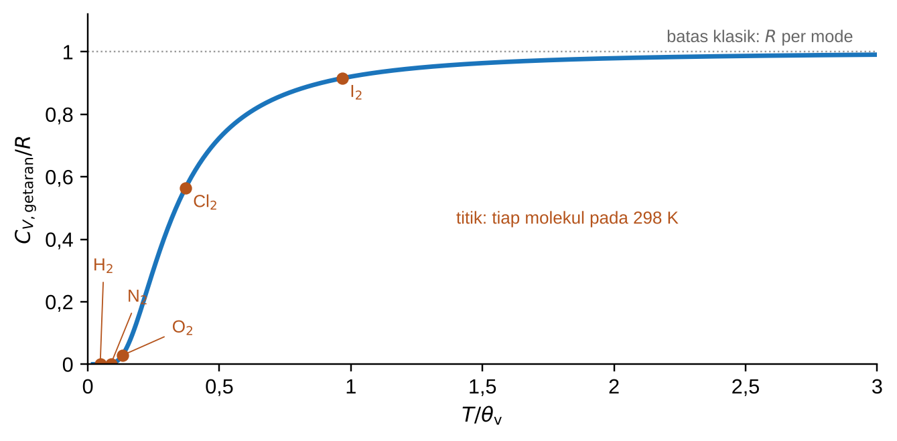

## 14.4 Fungsi partisi translasi

Gerak translasi adalah gerak seluruh molekul di dalam wadah. Dari *Kimia Kuantum*, partikel bermassa *m* di dalam kotak satu dimensi sepanjang *L* mempunyai tingkat energi $\varepsilon_n = n^2h^2/(8mL^2)$, dengan *n* = 1, 2, 3, …. Untuk molekul di wadah ukuran laboratorium, jarak antartingkat ini luar biasa kecil: untuk H₂ dalam kotak 1 cm, tingkat terendah setara dengan $4 \times 10^{-14}$ K. Karena itu, pada suhu berapa pun yang dapat dicapai di laboratorium, sangat banyak tingkat yang terisi, dan jumlah atas *n* dapat diganti integral:

$$
q_x = \sum_{n=1}^\infty e^{-n^2h^2/8mL^2kT} \approx \int_0^\infty e^{-n^2h^2/8mL^2kT}\,dn = \left(\frac{2\pi mkT}{h^2}\right)^{1/2}L .
$$

(Integralnya adalah integral Gauss, $\int_0^\infty e^{-an^2}dn = \tfrac12\sqrt{\pi/a}$.) Gerak dalam tiga arah bebas satu sama lain, sehingga $q^\text{T} = q_xq_yq_z$, dan $L_xL_yL_z = V$:

::: {.inti}
$$
q^\text{T} = \frac{V}{\Lambda^3} , \qquad \Lambda = \frac{h}{(2\pi mkT)^{1/2}} . \qquad \text{(14.12)}
$$

Panjang Λ disebut **panjang gelombang termal**. Fungsi partisi translasi adalah banyaknya kubus bersisi Λ yang muat di dalam wadah.
:::

Panjang gelombang termal kira-kira sama dengan panjang gelombang de Broglie molekul yang bergerak dengan kecepatan termal khas. Ia mengecil bila molekul makin berat atau suhu makin tinggi. Rumus (14.12) mempunyai tafsiran yang indah: molekul dapat dibayangkan sebagai "gumpalan gelombang" berukuran Λ, dan banyaknya keadaan translasi yang terjangkau adalah banyaknya cara meletakkan gumpalan itu di dalam wadah.

::: {.contoh}
**Contoh 14.7 · Panjang gelombang termal dan fungsi partisi argon**

Hitung Λ dan $q^\text{T}$ untuk atom argon (*M* = 39,948 g mol⁻¹) pada 298,15 K (a) di dalam wadah 1 cm³, dan (b) per atom dalam gas bertekanan 1 bar.

**Penyelesaian.** Massa satu atom $m = (39{,}948)(1{,}6605 \times 10^{-27}\ \text{kg}) = 6{,}634 \times 10^{-26}$ kg. Maka $2\pi mkT = 1{,}716 \times 10^{-45}$ kg J dan

$$
\Lambda = \frac{6{,}626 \times 10^{-34}}{(1{,}716 \times 10^{-45})^{1/2}} = 1{,}600 \times 10^{-11}\ \text{m} = 16{,}0\ \text{pm} .
$$

(a) $q^\text{T} = (1{,}00 \times 10^{-6}\ \text{m}^3)/(1{,}600 \times 10^{-11}\ \text{m})^3 = 2{,}44 \times 10^{26}$.

(b) Pada 1 bar, volume rata-rata per atom adalah $V/N = kT/p = 4{,}12 \times 10^{-26}$ m³, sehingga $q^\text{T}/N = (4{,}12 \times 10^{-26})/(4{,}09 \times 10^{-33}) = 1{,}01 \times 10^7$.

**Memahami hasil.** Setiap atom argon mempunyai sekitar sepuluh juta keadaan translasi terjangkau "untuk dirinya sendiri". Peluang dua atom memperebutkan keadaan yang sama sangat kecil, dan inilah syarat agar pembagian dengan *N*! dalam persamaan (14.11) sah: kita dapat menghitung semua susunan lalu membagi dengan banyaknya cara menukar atom, tanpa khawatir ada dua atom di keadaan yang sama. Panjang gelombang termal 16 pm juga jauh lebih kecil daripada jarak rata-rata antaratom, $(kT/p)^{1/3} = 3{,}45$ nm, sehingga atom berperilaku seperti bola klasik.
:::

Syarat $q^\text{T}/N \gg 1$, atau $\Lambda \ll (V/N)^{1/3}$, adalah batas keberlakuan fisika klasik untuk gas. Ia gagal bila gas sangat dingin, sangat rapat, atau partikelnya sangat ringan. Helium cair pada 4,2 K mempunyai $\Lambda = 0{,}43$ nm, sedikit lebih besar daripada jarak antaratomnya (0,38 nm): gelombang atom-atomnya saling tumpang-tindih, dan helium di bawah 2,2 K memperlihatkan sifat kuantum yang aneh seperti superfluiditas. Elektron di dalam logam pada suhu kamar mempunyai $\Lambda = 4{,}3$ nm, sekitar dua puluh kali jarak antaratom tembaga, sehingga "gas elektron" di dalam logam sama sekali tidak klasik (Soal 31). Untuk semua gas molekul pada suhu dan tekanan biasa, syarat klasik terpenuhi dengan sangat baik.

::: {.kuis}
**Kuis cepat 14.4** Bagaimana $q^\text{T}$ berubah bila (a) volume dilipatduakan, (b) suhu dilipatduakan, (c) argon diganti helium pada suhu dan volume yang sama?
:::

## 14.5 Fungsi partisi rotasi, getaran, dan elektronik

### Rotasi

Molekul diatomik dapat dibayangkan sebagai **rotor tegar**. Dari *Kimia Kuantum*, tingkat energinya $\varepsilon_J = hcBJ(J+1)$, dengan *J* = 0, 1, 2, … dan degenerasi $2J + 1$; *B* adalah tetapan rotasi (dalam cm⁻¹) yang dibaca dari spektrum gelombang mikro atau inframerah. Fungsi partisinya

$$
q^\text{R} = \sum_{J=0}^\infty (2J+1)e^{-hcBJ(J+1)/kT} .
$$

Kita definisikan **suhu rotasi karakteristik** $\theta_\text{R} = hcB/k$. Untuk hampir semua molekul kecuali yang mengandung hidrogen, $\theta_\text{R}$ hanya beberapa kelvin atau kurang, sehingga pada suhu kamar banyak tingkat yang terisi dan jumlah dapat diganti integral. Dengan substitusi $x = J(J+1)$, $dx = (2J+1)\,dJ$, integralnya langsung:

::: {.inti}
$$
q^\text{R} = \frac{kT}{\sigma hcB} = \frac{T}{\sigma\theta_\text{R}} \qquad (T \gg \theta_\text{R}) . \qquad \text{(14.13)}
$$

**Bilangan simetri** σ adalah 1 untuk molekul diatomik heteronuklir (HCl, CO) dan 2 untuk homonuklir (N₂, O₂, Cl₂).
:::

Mengapa σ? Memutar molekul homonuklir 180° menghasilkan susunan yang tidak dapat dibedakan dari semula. Mekanika kuantum (lewat aturan simetri inti identik yang dibahas di *Kimia Kuantum*) menyatakan bahwa hanya separuh tingkat rotasi yang benar-benar ada untuk molekul seperti itu, sehingga jumlah atas semua *J* menghitung dua kali terlalu banyak. Untuk molekul non-linear berlaku rumus serupa dengan tiga tetapan rotasi *A*, *B*, *C*:

$$
q^\text{R} = \frac{\sqrt\pi}{\sigma}\left(\frac{kT}{hc}\right)^{3/2}\frac{1}{\sqrt{ABC}} , \qquad \text{(14.14)}
$$

dengan σ banyaknya rotasi yang menghasilkan susunan tak terbedakan: 2 untuk H₂O, 3 untuk NH₃, 12 untuk CH₄ dan benzena. Untuk H₂O pada 298 K ($A = 27{,}88$, $B = 14{,}51$, $C = 9{,}28$ cm⁻¹), $q^\text{R} = 43{,}1$.

{width=82%}

::: {.contoh}
**Contoh 14.8 · Populasi rotasi HCl**

Untuk HCl, *B* = 10,59 cm⁻¹. Hitung $\theta_\text{R}$, $q^\text{R}$ pada 298,15 K, dan fraksi molekul di tingkat *J* = 0 sampai 5. Tingkat mana yang paling padat?

**Penyelesaian.** $\theta_\text{R} = (1{,}4388\ \text{cm K})(10{,}59\ \text{cm}^{-1}) = 15{,}24$ K, sehingga dengan σ = 1, $q^\text{R} = 298{,}15/15{,}24 = 19{,}6$. (Penjumlahan langsung memberi 19,9; selisihnya hilang bila ditambah koreksi kecil $+\tfrac13$, yang muncul dari perbedaan jumlah dan integral.) Fraksi di setiap tingkat adalah $(2J+1)e^{-J(J+1)\theta_\text{R}/T}/q^\text{R}$:

| *J* | 0 | 1 | 2 | 3 | 4 | 5 |
|---|---|---|---|---|---|---|
| fraksi | 0,050 | 0,136 | 0,185 | 0,190 | 0,163 | 0,119 |

Tingkat paling padat adalah *J* = 3. Secara umum, dengan menurunkan $(2J+1)e^{-J(J+1)\theta_\text{R}/T}$ terhadap *J* dan menyamakannya dengan nol, $J_\text{maks} = (T/2\theta_\text{R})^{1/2} - \tfrac12 = 2{,}6$.

**Memahami hasil.** Tingkat dasar *J* = 0 justru hanya berisi 5 persen molekul, karena degenerasinya hanya 1, sedangkan *J* = 3 mempunyai tujuh keadaan. Sebaran ini terlihat langsung dalam spektrum inframerah HCl: garis-garis cabang P dan R paling kuat di sekitar *J* = 3, dan melemah ke kedua arah (Gambar 14.5). Dari letak garis terkuat, suhu gas dapat ditaksir, cara yang dipakai untuk mengukur suhu nyala dan atmosfer planet.
:::

### Getaran

Getaran molekul diatomik didekati dengan **osilator harmonik** berbilangan gelombang $\tilde\nu$. Tingkat energinya $(v + \tfrac12)hc\tilde\nu$; bila energi diukur dari tingkat dasar (energi titik nol $\tfrac12 hc\tilde\nu$ dimasukkan ke *U*(0)), tingkatnya $0, hc\tilde\nu, 2hc\tilde\nu, \ldots$, dan fungsi partisinya adalah deret geometri (14.8):

::: {.inti}
$$
q^\text{V} = \frac{1}{1 - e^{-\theta_\text{V}/T}} , \qquad \theta_\text{V} = \frac{hc\tilde\nu}{k} . \qquad \text{(14.15)}
$$
:::

Suhu getaran karakteristik $\theta_\text{V}$ biasanya ribuan kelvin: 6332 K untuk H₂, 4303 K untuk HCl, 3393 K untuk N₂, 2273 K untuk O₂. Untuk molekul-molekul ini $q^\text{V}$ pada suhu kamar hampir tepat 1: getaran "membeku" di tingkat dasar. Hanya molekul dengan atom berat dan ikatan lemah, seperti Cl₂ (805 K), Br₂ (468 K), dan I₂ (309 K), yang getarannya cukup terisi pada suhu kamar. Molekul poliatomik mempunyai beberapa mode getaran (3*N* − 5 untuk molekul linear, 3*N* − 6 untuk non-linear), dan $q^\text{V}$ adalah hasil kali fungsi partisi semua mode.

::: {.contoh}
**Contoh 14.9 · Getaran I₂ dan N₂ pada suhu kamar**

Hitung $q^\text{V}$ dan fraksi molekul di tingkat getaran *v* = 0, 1, 2 untuk I₂ ($\tilde\nu$ = 214,5 cm⁻¹) dan N₂ ($\tilde\nu$ = 2358,6 cm⁻¹) pada 298,15 K.

**Penyelesaian.** Untuk I₂, $\theta_\text{V} = (1{,}4388)(214{,}5) = 308{,}6$ K, $e^{-\theta_\text{V}/T} = 0{,}355$, dan $q^\text{V} = 1/(1 - 0{,}355) = 1{,}551$. Fraksi di tingkat *v* adalah $(1 - e^{-\theta_\text{V}/T})e^{-v\theta_\text{V}/T}$: 0,645; 0,229; 0,081.

Untuk N₂, $\theta_\text{V} = 3393$ K, $e^{-\theta_\text{V}/T} = 1{,}14 \times 10^{-5}$, dan $q^\text{V} = 1{,}000\,011$. Fraksi di *v* = 1 hanya $1{,}1 \times 10^{-5}$, satu dari hampir sembilan puluh ribu molekul.

**Memahami hasil.** Sepertiga molekul iodin bergetar di tingkat tereksitasi pada suhu kamar, sedangkan nitrogen praktis tidak. Perbedaan ini terlihat dalam spektrum serapan I₂ yang dipanaskan: muncul "pita panas" dari molekul yang berangkat dari *v* = 1. Ia juga akan menentukan kapasitas kalor kedua gas di subbab 14.6.
:::

### Elektronik dan rangkuman

Seperti dibahas di subbab 14.3, $q^\text{E}$ biasanya sama dengan degenerasi keadaan dasar. Dengan semua bagian ini, fungsi partisi molekul diatomik pada suhu biasa adalah

$$
q = \frac{V}{\Lambda^3}\cdot\frac{T}{\sigma\theta_\text{R}}\cdot\frac{1}{1 - e^{-\theta_\text{V}/T}}\cdot g_0 . \qquad \text{(14.16)}
$$

Semua parameternya, massa, *B*, $\tilde\nu$, dan $g_0$, diperoleh dari spektroskopi. Inilah arti pernyataan bahwa termodinamika statistik menghitung sifat termodinamika **dari spektrum**.

Tabel 14.1 merangkum besaran-besaran untuk beberapa molekul. Perhatikan urutan besarnya: *q*$^\text{T}$/*N* jutaan, *q*$^\text{R}$ puluhan sampai ribuan, *q*$^\text{V}$ hampir 1 kecuali untuk molekul berat.

Tabel 14.1 Suhu karakteristik dan fungsi partisi pada 298,15 K dan 1 bar.

| Molekul | $\theta_\text{R}$ (K) | $\theta_\text{V}$ (K) | $q^\text{T}/N$ | $q^\text{R}$ | $q^\text{V}$ |
|---|---|---|---|---|---|
| H₂ | 87,6 | 6332 | $1{,}14 \times 10^5$ | 1,7* | 1,000 |
| HCl | 15,24 | 4303 | $8{,}77 \times 10^6$ | 19,6 | 1,000 |
| N₂ | 2,875 | 3393 | $5{,}91 \times 10^6$ | 51,9 | 1,000 |
| CO | 2,778 | 3122 | $5{,}90 \times 10^6$ | 107,3 | 1,000 |
| O₂ | 2,080 | 2273 | $7{,}21 \times 10^6$ | 71,7 | 1,000 |
| Cl₂ | 0,351 | 805 | $2{,}38 \times 10^7$ | 425 | 1,072 |
| I₂ | 0,054 | 309 | $1{,}61 \times 10^8$ | 2773 | 1,551 |

*Untuk H₂, $T/\theta_\text{R}$ hanya 3,4, sehingga rumus suhu tinggi (14.13) kurang teliti; penjumlahan langsung memberi 1,88.

::: {.kuis}
**Kuis cepat 14.5** Mengapa $q^\text{R}$ CO (107) kira-kira dua kali $q^\text{R}$ N₂ (52), padahal kedua molekul mempunyai massa dan panjang ikatan yang hampir sama?
:::

## 14.6 Energi dalam dan kapasitas kalor

Dengan fungsi partisi di tangan, kita dapat menghitung besaran termodinamika pertama. Untuk satu mol molekul ($N = N_\text{A}$), dari persamaan (14.9),

::: {.inti}
$$
U_\text{m} - U_\text{m}(0) = N_\text{A}\langle\varepsilon\rangle = -N_\text{A}\left(\frac{\partial\ln q}{\partial\beta}\right)_V , \qquad C_{V,\text{m}} = \left(\frac{\partial U_\text{m}}{\partial T}\right)_V . \qquad \text{(14.17)}
$$
:::

Karena ln *q* adalah jumlah sumbangan translasi, rotasi, getaran, dan elektronik, energi dalam dan kapasitas kalor juga.

**Translasi.** Dari (14.12), $q^\text{T} = V(2\pi m/h^2\beta)^{3/2}$, sehingga $\ln q^\text{T} = -\tfrac32\ln\beta + (\text{suku tanpa }\beta)$ dan

$$
\langle\varepsilon^\text{T}\rangle = \frac{3}{2\beta} , \qquad U^\text{T}_\text{m} = \tfrac32 RT , \qquad C^\text{T}_{V,\text{m}} = \tfrac32 R .
$$

Teori kinetik gas (Bab 1 dan subbab 3.9) memberi $\langle\varepsilon^\text{T}\rangle = \tfrac32 kT$. Kedua hasil hanya cocok bila $\beta = 1/kT$: inilah bukti identifikasi β yang dijanjikan di subbab 14.2.

**Rotasi.** Dari (14.13), $q^\text{R} \propto 1/\beta$ untuk molekul linear, sehingga $\langle\varepsilon^\text{R}\rangle = kT$ dan $C^\text{R}_{V,\text{m}} = R$. Untuk molekul non-linear, $q^\text{R} \propto \beta^{-3/2}$, sehingga $C^\text{R}_{V,\text{m}} = \tfrac32 R$. Keduanya adalah nilai ekuipartisi: $\tfrac12 R$ untuk setiap sumbu putar.

**Getaran.** Dari (14.15), $\ln q^\text{V} = -\ln(1 - e^{-\beta hc\tilde\nu})$, sehingga

$$
U^\text{V}_\text{m} = \frac{R\theta_\text{V}}{e^{\theta_\text{V}/T} - 1} , \qquad C^\text{V}_{V,\text{m}} = R\left(\frac{\theta_\text{V}}{T}\right)^2\frac{e^{\theta_\text{V}/T}}{(e^{\theta_\text{V}/T} - 1)^2} . \qquad \text{(14.18)}
$$

Bentuk terakhir disebut **fungsi Einstein**. Pada suhu tinggi ($T \gg \theta_\text{V}$) ia mendekati *R*, nilai ekuipartisi untuk satu mode getaran (energi kinetik ditambah energi potensial). Pada suhu rendah ia turun ke nol secara eksponensial. Gambar 14.6 menempatkan beberapa molekul pada kurva ini.

{width=82%}

Kini Gambar 3.7 terjelaskan sepenuhnya. Ekuipartisi menganggap setiap derajat kebebasan menyumbang tanpa syarat, karena ia adalah batas klasik ketika jarak antartingkat jauh lebih kecil daripada *kT*. Mekanika kuantum menambahkan syaratnya: suatu gerak hanya menyumbang bila tingkat-tingkat energinya terjangkau. Rotasi H₂ "bangun" di sekitar $\theta_\text{R} = 88$ K, getaran di sekitar beberapa ribu kelvin. Kegagalan ekuipartisi untuk kapasitas kalor gas, yang membingungkan fisikawan akhir abad ke-19, adalah salah satu petunjuk pertama bahwa energi terkuantisasi.

::: {.contoh}
**Contoh 14.10 · Kapasitas kalor gas klorin**

Hitung $C_{V,\text{m}}$ dan $C_{p,\text{m}}$ Cl₂ ($\tilde\nu$ = 559,7 cm⁻¹) pada 298,15 K, dan bandingkan dengan nilai terukur $C_{p,\text{m}} = 33{,}91$ J K⁻¹ mol⁻¹.

**Penyelesaian.** $\theta_\text{V} = (1{,}4388)(559{,}7) = 805{,}3$ K, sehingga $\theta_\text{V}/T = 2{,}701$. Fungsi Einstein: $(2{,}701)^2 e^{2{,}701}/(e^{2{,}701} - 1)^2 = 0{,}563$. Jadi

$$
C_{V,\text{m}} = \tfrac32 R + R + 0{,}563R = (12{,}47 + 8{,}31 + 4{,}68)\ \text{J K}^{-1}\,\text{mol}^{-1} = 25{,}47\ \text{J K}^{-1}\,\text{mol}^{-1} ,
$$

dan $C_{p,\text{m}} = C_{V,\text{m}} + R = 33{,}78$ J K⁻¹ mol⁻¹, berbeda 0,4 persen dari nilai terukur.

**Memahami hasil.** Getaran Cl₂ menyumbang lebih dari separuh nilai klasiknya, sehingga $C_{V,\text{m}}$ jatuh di antara $\tfrac52 R = 20{,}8$ (tanpa getaran) dan $\tfrac72 R = 29{,}1$ (getaran penuh). Sisa selisih kecil berasal dari anharmonisitas getaran. Cara yang sama untuk H₂O (tiga mode: 3657, 1595, 3756 cm⁻¹) memberi $C_{p,\text{m}} = 33{,}48$ J K⁻¹ mol⁻¹ (terukur 33,58), dan untuk CO₂ (empat mode: 1333, 667 dua kali, 2349 cm⁻¹) memberi 37,15 (terukur 37,11).
:::

### Padatan Einstein

Pada 1907, Einstein memakai gagasan yang sama untuk padatan. Ia membayangkan setiap atom dalam kristal sebagai osilator yang bergetar di sekitar tempatnya, dalam tiga arah, dengan satu frekuensi yang sama. Satu mol atom berarti $3N_\text{A}$ osilator, sehingga

$$
C_{V,\text{m}} = 3R\left(\frac{\theta_\text{E}}{T}\right)^2\frac{e^{\theta_\text{E}/T}}{(e^{\theta_\text{E}/T} - 1)^2} , \qquad \text{(14.19)}
$$

dengan $\theta_\text{E}$ suhu Einstein padatan itu. Pada suhu tinggi, $C_{V,\text{m}} \to 3R = 24{,}9$ J K⁻¹ mol⁻¹, **hukum Dulong–Petit** yang sudah dikenal sejak 1819. Pada suhu rendah, kapasitas kalor turun ke nol, sesuai pengamatan dan sesuai hukum ketiga (subbab 6.6).

::: {.contoh}
**Contoh 14.11 · Tembaga dan intan**

Tembaga dapat didekati dengan $\theta_\text{E} = 240$ K, intan dengan $\theta_\text{E} = 1320$ K. Hitung $C_{V,\text{m}}$ tembaga pada 298 K, 100 K, 50 K, dan 20 K, serta intan pada 298 K.

**Penyelesaian.** Dengan persamaan (14.19):

| Zat, *T* | Cu, 298 K | Cu, 100 K | Cu, 50 K | Cu, 20 K | intan, 298 K |
|---|---|---|---|---|---|
| $C_{V,\text{m}}$ (J K⁻¹ mol⁻¹) | 23,6 | 15,8 | 4,81 | 0,022 | 5,98 |

**Memahami hasil.** Tembaga pada suhu kamar hampir mencapai Dulong–Petit (terukur $C_{p,\text{m}} = 24{,}4$). Intan, dengan atom ringan dan ikatan sangat kaku, mempunyai $\theta_\text{E}$ jauh di atas suhu kamar, sehingga kapasitas kalornya hanya seperempat nilai klasik (terukur 6,1). Inilah anomali yang dijelaskan Einstein. Pada suhu sangat rendah, model Einstein meramalkan penurunan yang terlalu cepat (0,022 pada 20 K, padahal terukur sekitar 0,46), karena kristal sebenarnya mempunyai getaran berfrekuensi rendah yang tetap terisi. Model Debye (1912), yang memakai sebaran frekuensi, memperbaikinya dan memberi hukum $C_V \propto T^3$ yang dipakai untuk ekstrapolasi entropi ke 0 K di subbab 6.6.
:::

::: {.kuis}
**Kuis cepat 14.6** Gas mana yang $C_{V,\text{m}}$-nya pada suhu kamar paling dekat dengan $\tfrac52 R$: H₂, Cl₂, atau I₂? Mana yang paling jauh? Jelaskan dengan Gambar 14.6.
:::
