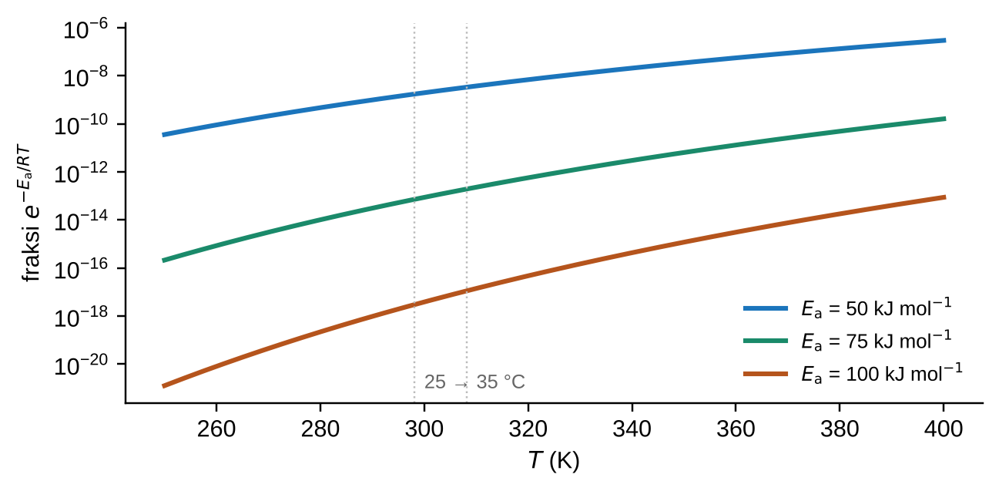

## 14.7 Entropi statistik

Rumus Boltzmann $S = k\ln W$ menghubungkan entropi dengan bobot konfigurasi dominan. Dengan persamaan (14.3) dan sebaran Boltzmann, kita dapat menuliskannya dengan fungsi partisi. Untuk molekul terbedakan, $S = k\ln W = -Nk\sum_i p_i\ln p_i$. Dari (14.4), $-\ln p_i = \beta\varepsilon_i + \ln q$, sehingga $-\sum p_i\ln p_i = \beta\langle\varepsilon\rangle + \ln q$ dan

$$
S = \frac{U - U(0)}{T} + Nk\ln q \qquad (\text{terbedakan}) .
$$

Untuk molekul tak terbedakan, ln *q*$^N$ diganti ln($q^N/N!$), dan dengan Stirling $\ln N! = N\ln N - N$:

::: {.inti}
$$
S = \frac{U - U(0)}{T} + k\ln Q = \frac{U - U(0)}{T} + Nk\ln\frac{q}{N} + Nk \qquad (\text{gas}) . \qquad \text{(14.20)}
$$

Entropi terdiri atas dua bagian: energi termal dibagi suhu, dan logaritma banyaknya keadaan terjangkau per molekul.
:::

Rumus ini sekaligus membuktikan hukum ketiga dari sisi molekul. Pada $T \to 0$, semua molekul di keadaan dasar: $U = U(0)$ dan $q = g_0$. Bila keadaan dasar tidak terdegenerasi, $g_0 = 1$ dan $S = 0$ (untuk kristal, dengan rumus terbedakan). Bila keadaan dasar terdegenerasi, atau bila molekul membeku dalam susunan acak, entropi tidak nol pada 0 K, dan kita akan bertemu kasus ini sebentar lagi.

Rumus (14.20) juga memberi bukti kedua bahwa $\beta = 1/kT$. Bila sistem menyerap kalor reversibel $dq_\text{rev}$ pada volume tetap, populasi bergeser dan dari rumus ini $dS = k\beta\,dU = k\beta\,dq_\text{rev}$. Termodinamika klasik menuntut $dS = dq_\text{rev}/T$; keduanya cocok hanya bila $k\beta = 1/T$.

### Rumus Sackur–Tetrode

Untuk gas monoatomik, hanya translasi yang berperan. Dengan $U - U(0) = \tfrac32 NkT$ dan $q = V/\Lambda^3$, persamaan (14.20) untuk satu mol menjadi

::: {.inti}
$$
S_\text{m} = R\ln\left(\frac{e^{5/2}\,V_\text{m}}{N_\text{A}\Lambda^3}\right) = R\left[\ln\frac{kT}{p\Lambda^3} + \frac52\right] . \qquad \text{(14.21)}
$$

Inilah **rumus Sackur–Tetrode** (1912), yang memberi entropi mutlak gas monoatomik ideal dari massa atom, suhu, dan tekanan saja.
:::

Rumus ini memuat semua yang sudah kita ketahui tentang entropi gas ideal dari Bab 6. Karena $\Lambda^3 \propto T^{-3/2}$, entropi naik sebesar $\tfrac52 R\ln(T_2/T_1) = C_{p,\text{m}}\ln(T_2/T_1)$ bila gas dipanaskan pada tekanan tetap, dan naik sebesar $R\ln(p_1/p_2)$ bila tekanannya diturunkan, persis seperti subbab 6.2. Yang baru adalah **tetapan** di dalamnya, yang memuat tetapan Planck: entropi mutlak tidak dapat dihitung dengan fisika klasik.

::: {.contoh}
**Contoh 14.12 · Entropi mutlak argon dan helium**

Hitung entropi molar standar argon dan helium pada 298,15 K dan 1 bar, dan bandingkan dengan nilai kalorimetri 154,84 dan 126,15 J K⁻¹ mol⁻¹.

**Penyelesaian.** Untuk argon, dari Contoh 14.7, $kT/p\Lambda^3 = q^\text{T}/N = 1{,}006 \times 10^7$. Maka

$$
S^\circ_\text{m} = (8{,}3145)[\ln(1{,}006 \times 10^7) + 2{,}5] = (8{,}3145)(16{,}124 + 2{,}5) = 154{,}85\ \text{J K}^{-1}\,\text{mol}^{-1} .
$$

Untuk helium, $\Lambda = 50{,}5$ pm, $q^\text{T}/N = 3{,}19 \times 10^5$, dan $S^\circ_\text{m} = 126{,}15$ J K⁻¹ mol⁻¹.

**Memahami hasil.** Kecocokannya sampai seperseratus satuan, dan itu bukan kebetulan: kedua cara mengukur besaran yang sama. Nilai kalorimetri memerlukan pengukuran kapasitas kalor dari dekat 0 K, entalpi peleburan, dan entalpi penguapan (subbab 6.6); nilai statistik hanya memerlukan massa atom. Kecocokan ini adalah salah satu bukti terkuat bahwa hukum ketiga benar dan bahwa tetapan dalam rumus entropi memang ditentukan oleh tetapan Planck. Argon lebih berat, sehingga Λ-nya lebih kecil, lebih banyak keadaan translasi muat di dalam volume yang sama, dan entropinya lebih besar.
:::

### Entropi rotasi, getaran, dan elektronik

Untuk molekul, setiap jenis gerak menambah sumbangannya sendiri. Dari (14.20) dengan *U* dan *q* masing-masing (tanpa suku *Nk*, yang sudah masuk ke bagian translasi):

$$
S^\text{R}_\text{m} = R\left(\ln\frac{T}{\sigma\theta_\text{R}} + 1\right) , \qquad S^\text{V}_\text{m} = R\left[\frac{\theta_\text{V}/T}{e^{\theta_\text{V}/T} - 1} - \ln\left(1 - e^{-\theta_\text{V}/T}\right)\right] , \qquad S^\text{E}_\text{m} = R\ln g_0 . \qquad \text{(14.22)}
$$

{width=78%}

::: {.contoh}
**Contoh 14.13 · Entropi nitrogen dan oksigen dari spektroskopi**

Hitung $S^\circ_\text{m}$ N₂ dan O₂ pada 298,15 K dari data Tabel 14.1. Keadaan dasar elektronik O₂ adalah triplet ($g_0 = 3$). Nilai tabel: 191,61 dan 205,15 J K⁻¹ mol⁻¹.

**Penyelesaian.** Untuk N₂ (*M* = 28,014 g mol⁻¹), Sackur–Tetrode memberi $S^\text{T}_\text{m} = 150{,}42$. Rotasi: $q^\text{R} = 51{,}86$, sehingga $S^\text{R}_\text{m} = R(\ln 51{,}86 + 1) = 41{,}14$. Getaran: $\theta_\text{V}/T = 11{,}38$, sehingga $S^\text{V}_\text{m} = 0{,}001$. Jumlahnya 191,57 J K⁻¹ mol⁻¹.

Untuk O₂ (*M* = 31,998): $S^\text{T}_\text{m} = 152{,}08$, $S^\text{R}_\text{m} = R(\ln 71{,}67 + 1) = 43{,}83$, $S^\text{V}_\text{m} = 0{,}04$, dan $S^\text{E}_\text{m} = R\ln3 = 9{,}13$. Jumlahnya 205,08 J K⁻¹ mol⁻¹.

**Memahami hasil.** Selisih dengan tabel hanya 0,04 dan 0,07 J K⁻¹ mol⁻¹, sebagian besar karena anharmonisitas dan interaksi rotasi–getaran yang kita abaikan. Tanpa suku $R\ln3$, entropi O₂ akan meleset 9 J K⁻¹ mol⁻¹: elektron tak berpasangan O₂, yang membuatnya bersifat paramagnetik, juga tercatat dalam entropinya. Sebagian besar nilai $S^\circ$ gas dalam tabel termodinamika modern sebenarnya dihitung dengan cara ini, bukan dari kalorimetri, karena lebih teliti.
:::

### Entropi residu

Untuk beberapa zat, kedua cara tidak cocok, dan selisihnya justru mengajarkan sesuatu. Karbon monoksida adalah contoh terkenal: Tabel 6.1 (nilai spektroskopi) memberi 197,67 J K⁻¹ mol⁻¹, dan perhitungan kita dengan Tabel 14.1 memberi 197,61, tetapi pengukuran kalorimetri dari dekat 0 K hanya memberi sekitar 193,3. Kalorimetri kehilangan sekitar 4,3 J K⁻¹ mol⁻¹.

Penjelasannya diberikan di subbab 5.8: molekul CO hampir simetris (dipolnya sangat kecil), sehingga dalam kristal ia dapat menghadap ke dua arah, CO atau OC, dengan energi yang hampir sama. Ketika kristal didinginkan, molekul-molekul membeku dalam arah acak sebelum sempat tersusun rapi, sehingga pada 0 K masih ada $W = 2^{N_\text{A}}$ susunan dan **entropi residu** $R\ln2 = 5{,}76$ J K⁻¹ mol⁻¹. Kalorimetri, yang mulai dari "nol" pada 0 K, tidak pernah melihat entropi ini. Nilai terukur 4,3 sedikit lebih kecil daripada 5,76, tanda bahwa sebagian molekul sempat tersusun sebelum membeku. Es mempunyai entropi residu yang serupa, sekitar 3,4 J K⁻¹ mol⁻¹, yang dijelaskan Pauling sebagai $R\ln\tfrac32 = 3{,}37$ dari banyaknya cara menempatkan atom hidrogen di antara atom oksigen (Soal 61).

::: {.strategi}
**Strategi: menghitung entropi gas dari spektroskopi**

1. Translasi: hitung Λ dari massa molekul, lalu Sackur–Tetrode (14.21) pada suhu dan tekanan yang diminta.
2. Rotasi: $\theta_\text{R} = hcB/k$; tentukan σ; pakai (14.22). Untuk molekul non-linear pakai $S^\text{R}_\text{m} = R(\ln q^\text{R} + \tfrac32)$ dengan $q^\text{R}$ dari (14.14).
3. Getaran: untuk setiap mode, hitung $\theta_\text{V}/T$; bila lebih dari sekitar 10, sumbangannya dapat diabaikan.
4. Elektronik: $R\ln g_0$ (3 untuk O₂, 2 untuk NO pada suhu tinggi, 4 untuk atom halogen).
5. Jumlahkan, dan periksa urutan besarnya: translasi 110–170, rotasi 10–80, getaran 0–20 J K⁻¹ mol⁻¹.
:::

::: {.kuis}
**Kuis cepat 14.7** Entropi molar standar HCl hasil hitungan adalah 186,75 J K⁻¹ mol⁻¹ dan nilai tabelnya 186,91. Apakah HCl padat diharapkan mempunyai entropi residu yang berarti? Bandingkan dengan CO.
:::

## 14.8 Energi Gibbs dan tetapan kesetimbangan

Dengan *U* dan *S* di tangan, fungsi-fungsi lain menyusul. Energi Helmholtz $A = U - TS$, dan dari (14.20), $A - A(0) = -kT\ln Q$. Rumus sangat ringkas ini sering dianggap sebagai jembatan utama termodinamika statistik: fungsi partisi sistem langsung memberi energi bebas. Untuk gas ideal, $G = A + pV = A + NkT$, sehingga dengan $Q = q^N/N!$:

::: {.inti}
$$
G - G(0) = -NkT\ln\frac{q}{N} , \qquad G^\circ_\text{m} - G_\text{m}(0) = -RT\ln\frac{q^\circ_\text{m}}{N_\text{A}} . \qquad \text{(14.23)}
$$

$q^\circ_\text{m}$ adalah fungsi partisi molekul dengan volume molar standar $V^\circ_\text{m} = RT/p^\circ$ (hanya bagian translasi yang bergantung pada volume). $G_\text{m}(0) = U_\text{m}(0)$ adalah energi molar pada 0 K.
:::

Untuk argon pada 298,15 K, $q^\circ_\text{m}/N_\text{A} = 1{,}006 \times 10^7$ dan $G^\circ_\text{m} - G_\text{m}(0) = -40{,}0$ kJ mol⁻¹. Energi Gibbs turun jauh di bawah energi pada 0 K karena banyaknya keadaan yang tersedia, sumbangan entropi yang sangat besar.

### Tetapan kesetimbangan dari fungsi partisi

Untuk reaksi gas $\sum_J \nu_J J = 0$, $\Delta_\text{r}G^\circ = \sum_J \nu_J G^\circ_\text{m}(J)$. Dengan (14.23), suku-suku $G_\text{m}(0)$ dari semua zat bergabung menjadi $\Delta_\text{r}E_0 = \sum_J \nu_J U_\text{m}(0, J)$, selisih energi keadaan dasar produk dan pereaksi (termasuk energi titik nol). Dengan $\Delta_\text{r}G^\circ = -RT\ln K$ (Bab 12):

::: {.inti}
$$
K = \prod_J\left(\frac{q^\circ_{\text{m},J}}{N_\text{A}}\right)^{\nu_J} e^{-\Delta_\text{r}E_0/RT} . \qquad \text{(14.24)}
$$
:::

Rumus ini memperlihatkan dengan sangat jelas dua kekuatan yang bersaing dalam setiap kesetimbangan. Faktor eksponensial menyukai zat dengan energi keadaan dasar lebih rendah: inilah sisi **energi** (entalpi). Perbandingan fungsi partisi menyukai zat yang mempunyai lebih banyak keadaan terjangkau: inilah sisi **entropi**. Gambar 14.8 memperagakannya dengan dua zat khayal. Zat A mempunyai tingkat dasar lebih rendah tetapi tingkat-tingkatnya renggang; zat B lebih tinggi tetapi tingkatnya rapat. Pada suhu rendah, hanya tingkat dasar yang penting, dan A menang. Pada suhu tinggi, molekul tersebar ke semua tingkat yang terjangkau, dan B, dengan tingkat jauh lebih banyak dalam rentang energi yang sama, menang. Kesetimbangan kimia tidak lain adalah sebaran Boltzmann atas **seluruh** tingkat energi pereaksi dan produk sekaligus.

{width=94%}

::: {.contoh}
**Contoh 14.14 · Reaksi pertukaran isotop H₂ + D₂ ⇌ 2HD**

Hitung *K* pada 298,15 K. Data: bilangan gelombang getaran H₂, D₂, HD = 4401, 3115, 3813 cm⁻¹; tetapan rotasi 60,85; 30,44; 45,66 cm⁻¹; massa molekul 2,016; 4,028; 3,022 g mol⁻¹. Nilai terukur sekitar 3,3.

**Gambaran fisis.** Ketiga molekul mempunyai kurva energi potensial yang sama (isotop tidak mengubah ikatan kimia), sehingga $\Delta_\text{r}E_0$ hanya berasal dari perbedaan energi titik nol. Bila semua faktor kuantum diabaikan, *K* hanya ditentukan oleh simetri: HD tidak simetris, sehingga dalam campuran acak H dan D, peluang membentuk HD dua kali lebih besar daripada H₂ atau D₂, dan $K = 4$.

**Rencana.** Pecah *K* menjadi faktor translasi, rotasi, dan energi titik nol. Getaran tereksitasi dapat diabaikan ($q^\text{V} = 1$).

**Penyelesaian.** Karena $\Delta\nu = 0$, volume standar saling menghapus.

*Translasi:* $q^\text{T} \propto m^{3/2}$, sehingga faktornya $[m_\text{HD}^2/(m_{\text{H}_2}m_{\text{D}_2})]^{3/2} = [(3{,}022)^2/(2{,}016 \times 4{,}028)]^{3/2} = 1{,}193$.

*Rotasi:* $q^\text{R} = kT/\sigma hcB$, dengan σ = 2, 2, 1. Faktornya $[\sigma_{\text{H}_2}\sigma_{\text{D}_2}/\sigma_\text{HD}^2][B_{\text{H}_2}B_{\text{D}_2}/B_\text{HD}^2] = 4 \times (60{,}85 \times 30{,}44)/(45{,}66)^2 = 4 \times 0{,}888 = 3{,}554$.

*Energi titik nol:* $\Delta_\text{r}E_0/hc = \tfrac12[2(3813) - 4401 - 3115] = +55$ cm⁻¹, sehingga faktornya $e^{-(1{,}4388)(55)/298{,}15} = 0{,}767$.

Jadi $K = 1{,}193 \times 3{,}554 \times 0{,}767 = 3{,}25$.

**Memahami hasil.** Faktor terbesar, 4, berasal dari simetri, sebuah efek entropi murni: ada dua cara menyusun HD (H–D dan D–H) tetapi hanya satu cara untuk H₂. Efek kuantum menurunkannya ke 3,25, cocok dengan pengukuran. Ketika suhu naik, faktor energi titik nol mendekati 1, sehingga *K* naik ke 3,92 pada 1000 K dan mendekati batas klasik. Perbedaan energi titik nol inilah dasar **efek isotop** dalam kimia: ikatan dengan isotop yang lebih berat mempunyai energi titik nol lebih rendah, sehingga isotop berat cenderung terkumpul di tempat yang ikatannya paling kuat.
:::

::: {.contoh}
**Contoh 14.15 · Disosiasi iodin pada 1000 K**

Hitung *K* untuk $\text{I}_2(g) \rightleftharpoons 2\text{I}(g)$ pada 1000 K. Data: energi disosiasi I₂ dari tingkat dasarnya $D_0 = 148{,}8$ kJ mol⁻¹; *B* = 0,037 37 cm⁻¹; $\tilde\nu$ = 214,5 cm⁻¹; atom I mempunyai keadaan dasar berdegenerasi 4. Bandingkan dengan nilai dari data termokimia.

**Penyelesaian.** Pada 1000 K dan 1 bar:

- Atom I: $q^\text{T}/N = 1{,}173 \times 10^9$; dikalikan $g_0 = 4$: $q^\circ_\text{m}/N_\text{A} = 4{,}69 \times 10^9$.
- Molekul I₂: $q^\text{T}/N = 3{,}318 \times 10^9$, $q^\text{R} = 1000/(2 \times 0{,}0538) = 9299$, $q^\text{V} = 3{,}766$; hasil kalinya $q^\circ_\text{m}/N_\text{A} = 1{,}162 \times 10^{14}$.
- Faktor energi: $e^{-D_0/RT} = e^{-17{,}89} = 1{,}70 \times 10^{-8}$.

Maka

$$
K = \frac{(4{,}69 \times 10^9)^2}{1{,}162 \times 10^{14}} \times 1{,}70 \times 10^{-8} = (1{,}89 \times 10^5)(1{,}70 \times 10^{-8}) = 3{,}22 \times 10^{-3} .
$$

Sebagai pembanding, dari data termokimia 298 K ($\Delta_\text{r}H^\circ = 151{,}1$ kJ mol⁻¹, $\Delta_\text{r}S^\circ = 100{,}9$ J K⁻¹ mol⁻¹) yang dikoreksi ke 1000 K dengan $\Delta_\text{r}C_p^\circ = 4{,}7$ J K⁻¹ mol⁻¹ (subbab 12.6), diperoleh $\Delta_\text{r}G^\circ = 47{,}8$ kJ mol⁻¹ dan $K = 3{,}17 \times 10^{-3}$.

**Memahami hasil.** Kedua cara cocok dalam 2 persen. Faktor energi sangat kecil ($10^{-8}$) karena memutus ikatan memerlukan energi besar; faktor fungsi partisi sangat besar ($10^5$) karena dua atom bebas mempunyai jauh lebih banyak keadaan translasi daripada satu molekul. Pada 1000 K kedua faktor hampir seimbang, dan sekitar 3 persen I₂ terdisosiasi bila tekanan awalnya 1 bar. Ketika suhu naik, faktor energi tumbuh sangat cepat, dan pada suhu nyala hampir semua molekul diatomik terurai menjadi atom.
:::

::: {.kuis}
**Kuis cepat 14.8** Dalam persamaan (14.24), faktor mana yang menjelaskan mengapa disosiasi I₂ makin besar ketika tekanan diturunkan? (Petunjuk: bagian mana dari *q* yang bergantung pada volume?)
:::

## 14.9 Faktor Boltzmann dalam kimia

Faktor Boltzmann muncul jauh di luar perhitungan fungsi partisi. Kita tutup bab ini dengan tiga penerapan yang sering dijumpai kimiawan.

### Atmosfer: rumus barometrik

Molekul gas di atmosfer mempunyai energi potensial *mgh* pada ketinggian *h*. Pada suhu seragam, sebaran Boltzmann memberi kerapatan, dan karena itu tekanan, yang turun eksponensial dengan ketinggian:

$$
p(h) = p(0)\,e^{-mgh/kT} = p(0)\,e^{-h/H} , \qquad H = \frac{RT}{Mg} . \qquad \text{(14.25)}
$$

Tinggi skala *H* adalah ketinggian tempat tekanan turun menjadi 1/*e* kali. Untuk udara (*M* = 28,96 g mol⁻¹) pada 288 K, $H = 8{,}43$ km. Rumus yang sama dapat diturunkan dari keseimbangan gaya pada lapisan udara (Soal 74), tetapi sudut pandang Boltzmann menunjukkan bahwa ia hanyalah persaingan antara energi potensial dan energi termal.

::: {.contoh}
**Contoh 14.16 · Tekanan di puncak Everest**

Taksir tekanan udara di puncak Everest (8849 m) bila atmosfer dianggap isotermal pada 288 K dan tekanan di permukaan laut 101,3 kPa. Tekanan terukur sekitar 34 kPa. Pada ketinggian berapa tekanan tinggal separuh?

**Penyelesaian.** $p = (101{,}3)e^{-8849/8429} = (101{,}3)(0{,}350) = 35{,}5$ kPa. Tekanan separuh dicapai pada $h = H\ln2 = 5{,}84$ km.

**Memahami hasil.** Taksiran isotermal sedikit terlalu tinggi karena udara sebenarnya makin dingin ke atas (sekitar −40 °C di ketinggian Everest), sehingga tinggi skalanya mengecil. Pada tekanan sepertiga atmosfer, tekanan parsial oksigen hanya sekitar 7 kPa, itulah sebabnya pendaki memerlukan tabung oksigen dan air mendidih pada sekitar 71 °C (subbab 8.4). Molekul yang lebih ringan mempunyai *H* lebih besar: untuk helium pada 250 K, *H* sekitar 53 km, sehingga di lapisan atmosfer atas, tempat pengadukan berhenti, gas ringan menjadi makin dominan.
:::

### Spektroskopi: mengapa NMR kurang peka

Intensitas garis spektrum serapan sebanding dengan **selisih** populasi tingkat bawah dan tingkat atas, karena tingkat atas memancarkan kembali (emisi terangsang) dengan peluang yang sama dengan penyerapan oleh tingkat bawah. Untuk dua tingkat berjarak $\Delta\varepsilon \ll kT$, selisih populasi relatifnya kira-kira $\Delta\varepsilon/2kT$.

::: {.contoh}
**Contoh 14.17 · Selisih populasi dalam NMR**

Pada spektrometer NMR 400 MHz, inti ¹H di dalam medan magnet mempunyai dua tingkat yang berjarak $h\nu$ dengan ν = 400 MHz. Hitung selisih populasi relatif pada 298 K. Ulangi untuk spektrometer 900 MHz.

**Penyelesaian.** $h\nu/kT = (6{,}626 \times 10^{-34})(4{,}00 \times 10^8)/[(1{,}381 \times 10^{-23})(298{,}15)] = 6{,}44 \times 10^{-5}$. Selisih relatif $(N_\text{bawah} - N_\text{atas})/N = \tanh(h\nu/2kT) \approx h\nu/2kT = 3{,}2 \times 10^{-5}$. Untuk 900 MHz, $7{,}2 \times 10^{-5}$.

**Memahami hasil.** Dari setiap seratus ribu proton, hanya sekitar tiga yang "berlebih" di tingkat bawah dan benar-benar menghasilkan sinyal. Bandingkan dengan spektroskopi inframerah atau UV–tampak, yang celah energinya jauh di atas *kT* sehingga hampir semua molekul di tingkat bawah. Inilah alasan NMR memerlukan sampel miligram sedangkan UV–tampak cukup mikrogram, dan alasan magnet NMR terus dibuat lebih kuat: selisih populasi, dan karena itu sinyal, sebanding dengan kuat medan.
:::

### Laju reaksi: berapa banyak molekul yang cukup bertenaga

Reaksi kimia hanya terjadi bila molekul yang bertumbukan membawa energi paling sedikit sebesar energi aktivasi $E_\text{a}$. Sebaran Boltzmann memberi fraksi tumbukan semacam itu, yang untuk tumbukan dua molekul dalam gas sebanding dengan $e^{-E_\text{a}/RT}$. Faktor ini adalah inti persamaan Arrhenius, $k = Ae^{-E_\text{a}/RT}$, yang akan dibahas tuntas di *Kimia Fisika 2*.

{width=80%}

::: {.contoh}
**Contoh 14.18 · Aturan "naik 10 derajat, laju berlipat dua"**

Hitung fraksi $e^{-E_\text{a}/RT}$ pada 25 °C dan 35 °C untuk $E_\text{a}$ = 50, 75, dan 100 kJ mol⁻¹, dan perbandingan keduanya. Berapa $E_\text{a}$ yang membuat laju tepat berlipat dua?

**Penyelesaian.**

| $E_\text{a}$ (kJ mol⁻¹) | 50 | 75 | 100 |
|---|---|---|---|
| fraksi pada 298,15 K | $1{,}74 \times 10^{-9}$ | $7{,}25 \times 10^{-14}$ | $3{,}03 \times 10^{-18}$ |
| fraksi pada 308,15 K | $3{,}35 \times 10^{-9}$ | $1{,}94 \times 10^{-13}$ | $1{,}12 \times 10^{-17}$ |
| perbandingan | 1,92 | 2,67 | 3,70 |

Perbandingan tepat 2 bila $E_\text{a} = R\ln2/(1/298{,}15 - 1/308{,}15) = 52{,}9$ kJ mol⁻¹.

**Memahami hasil.** Kenaikan suhu 3 persen (dari 298 ke 308 K) hampir melipatduakan banyaknya molekul yang cukup bertenaga, karena kita berada jauh di ekor sebaran Boltzmann, tempat perubahan kecil pada *kT* berdampak besar. Aturan praktis "naik 10 °C, laju berlipat dua" berlaku untuk reaksi dengan energi aktivasi sekitar 50 kJ mol⁻¹, yang memang khas banyak reaksi dalam larutan dan reaksi biokimia. Inilah alasan makanan disimpan di lemari es, dan alasan demam beberapa derajat sudah mengubah laju metabolisme secara berarti.
:::

::: {.kuis}
**Kuis cepat 14.9** Spektrometer NMR didinginkan tidak hanya magnetnya tetapi kadang-kadang juga kumparan penerimanya. Bila sampel itu sendiri yang didinginkan dari 298 K ke 77 K, berapa kali selisih populasi naik?
:::

### Menuju bab berikutnya

Teka-teki pembuka bab ini terjawab: entropi argon dapat dihitung dari massa atomnya saja, karena entropi adalah logaritma banyaknya keadaan terjangkau, dan banyaknya keadaan translasi ditentukan oleh panjang gelombang termal. Dengan fungsi partisi, setiap besaran dalam tabel termodinamika, *U*, *C*$_V$, *S*, *G*, dan *K*, kini mempunyai asal-usul molekul.

Selama empat belas bab kita memperlakukan setiap fase sebagai benda yang seragam sampai ke tepinya, dan mengabaikan molekul-molekul di batas antara dua fase. Untuk segelas air, pengabaian itu sah. Tetapi tetes kabut, gelembung, pori silika gel, misel sabun, dan permukaan katalis adalah sistem yang sebagian besar molekulnya berada di dekat permukaan. Bab terakhir menambahkan satu suku ke persamaan fundamental, $\gamma\,dA$, dan dengan suku itu menjelaskan mengapa tetes membulat, air naik di pipa kapiler, awan memerlukan debu, sabun membersihkan, dan luas permukaan satu gram arang dapat diukur dengan nitrogen.
