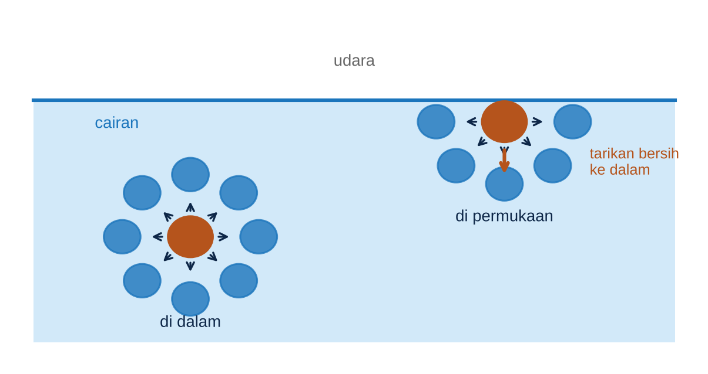
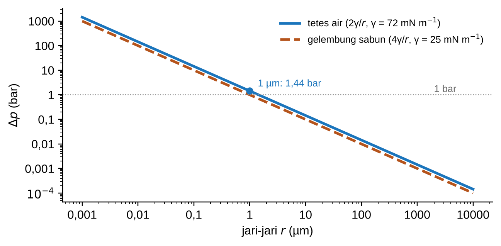
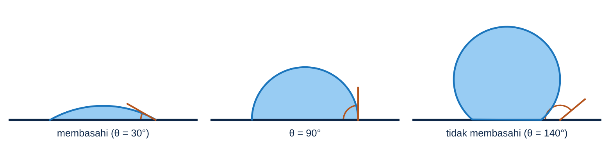
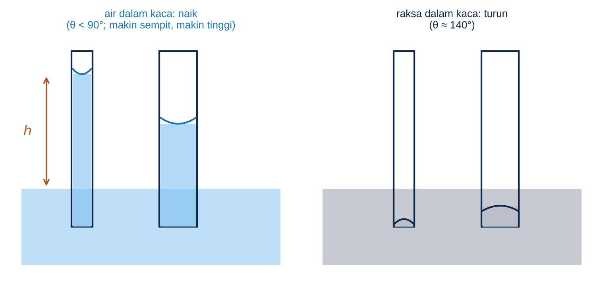

# Bab 15 Termodinamika Permukaan

Seekor serangga anggang-anggang berdiri di atas permukaan kolam tanpa tenggelam, padahal tubuhnya lebih rapat daripada air. Setetes air di atas daun talas membulat seperti mutiara, sedangkan di atas kaca yang bersih ia melebar menjadi lapisan tipis. Air naik sendiri di dalam pipa kaca sempit, melawan gravitasi. Awan tidak terbentuk di udara yang sangat bersih walaupun uap airnya sudah jenuh, tetapi langsung terbentuk begitu ada debu. Dan sedikit sabun membuat air dapat membasahi kain berminyak yang tadinya menolaknya.

Semua gejala ini mempunyai satu sebab: molekul di **permukaan** suatu fase berbeda dari molekul di dalamnya. Di dalam cairan, setiap molekul ditarik oleh tetangga ke segala arah sama kuat. Di permukaan, tetangga di satu sisi hilang, sehingga molekul permukaan mempunyai energi lebih tinggi. Membuat permukaan baru berarti membayar energi itu, dan karena itu setiap sistem cenderung memperkecil luas permukaannya. Selama ini kita mengabaikan sumbangan permukaan, dan untuk satu liter air di dalam gelas, pengabaian itu memang sah: dari sekitar $3 \times 10^{25}$ molekul, hanya sekitar $10^{19}$ yang berada di permukaan. Tetapi bila zat dipecah menjadi tetes, butir, atau pori berukuran nanometer, fraksi molekul permukaan menjadi besar, dan termodinamika permukaan menentukan segalanya.

Bab terakhir ini membawa alat yang sudah kita bangun, energi Gibbs, potensial kimia, dan kesetimbangan fase, ke sistem yang permukaannya penting. Subbab 15.1 mendefinisikan **tegangan permukaan** sebagai energi Gibbs per satuan luas. Subbab 15.2 dan 15.3 menunjukkan bahwa permukaan melengkung menimbulkan beda tekanan (persamaan Young–Laplace), yang menjelaskan kapilaritas dan sudut kontak. Subbab 15.4 dan 15.5 menunjukkan bahwa tekanan tambahan itu mengubah potensial kimia, sehingga tetes kecil lebih mudah menguap (persamaan Kelvin), dan bahwa fase baru sulit lahir (nukleasi). Subbab 15.6 dan 15.7 membahas zat yang berkumpul di permukaan larutan: persamaan adsorpsi Gibbs, surfaktan, dan misel. Subbab 15.8 dan 15.9 membahas gas yang menempel pada permukaan padatan: isoterm Langmuir dan BET, dasar katalisis heterogen dan pengukuran luas permukaan.

::: {.strategi}
**Pertanyaan pembuka**

1. Mengapa tetes air berbentuk bola?
2. Mengapa tekanan di dalam gelembung kecil lebih besar daripada di dalam gelembung besar?
3. Mengapa air naik di pipa kapiler kaca, sedangkan raksa turun?
4. Mengapa tetes kecil menguap lebih cepat daripada tetes besar, dan mengapa awan memerlukan debu?
5. Bagaimana sabun bekerja, dan mengapa ada konsentrasi tertentu ketika tiba-tiba terbentuk misel?
6. Bagaimana luas permukaan satu gram arang aktif dapat diukur dengan gas nitrogen?
:::

::: {.tujuan}
**Tujuan belajar**

Setelah mempelajari bab ini, kamu mampu:

1. Menafsirkan tegangan permukaan sebagai energi Gibbs permukaan dan menghitung entropi serta entalpi permukaan dari ketergantungannya pada suhu.
2. Menurunkan dan memakai persamaan Young–Laplace untuk tetes, gelembung, dan alveolus.
3. Memakai persamaan Young untuk sudut kontak dan menghitung kenaikan kapiler.
4. Menurunkan dan memakai persamaan Kelvin untuk tetes, pori, dan kristal kecil.
5. Menghitung jari-jari kritis dan penghalang energi nukleasi homogen.
6. Memakai persamaan adsorpsi Gibbs untuk menghitung kelebihan permukaan dan luas per molekul.
7. Menjelaskan pembentukan misel dan menghitung energi Gibbs misellisasi dari CMC.
8. Memakai isoterm Langmuir dan BET untuk menganalisis data adsorpsi dan menghitung luas permukaan.
:::

::: {.mat}
**Prasyarat**

Dari Bab 7: energi Gibbs, kerja bukan-ekspansi, dan $(\partial G/\partial p)_T = V$. Dari Bab 8: kesetimbangan fase, persamaan Clapeyron dan Clausius–Clapeyron, keadaan lewat jenuh dan lewat dingin. Dari Bab 9: potensial kimia dan persamaan Gibbs–Duhem. Dari Bab 10: aktivitas larutan encer. Dari Bab 12: tetapan kesetimbangan dan van 't Hoff. Dari Bab 14: sebaran Boltzmann (untuk memahami laju nukleasi). Dari matematika: luas dan volume bola, turunan.
:::

## 15.1 Tegangan permukaan dan energi permukaan

Gambar 15.1 memperlihatkan sumber semua gejala permukaan. Molekul di dalam cairan dikelilingi tetangga di segala arah, sehingga tarikan dari semua arah saling meniadakan. Molekul di permukaan kehilangan tetangga di sisi atas; tarikan bersihnya mengarah ke dalam, dan energinya lebih tinggi daripada molekul di dalam karena sebagian ikatannya hilang. Untuk memindahkan molekul dari dalam ke permukaan, yaitu untuk memperluas permukaan, kita harus melakukan kerja.

{width=70%}

### Definisi termodinamika

Kerja yang diperlukan untuk memperluas permukaan sebesar *dA* sebanding dengan *dA*. Tetapan perbandingannya adalah **tegangan permukaan** γ: $dw = \gamma\,dA$. Ini adalah kerja bukan-ekspansi, dan menurut subbab 7.4, kerja bukan-ekspansi reversibel pada suhu dan tekanan tetap sama dengan perubahan energi Gibbs. Persamaan fundamental untuk sistem yang luas permukaannya dapat berubah menjadi $dG = -S\,dT + V\,dp + \gamma\,dA$, sehingga

::: {.inti}
$$
\gamma = \left(\frac{\partial G}{\partial A}\right)_{T,p,n} . \qquad \text{(15.1)}
$$

Tegangan permukaan adalah energi Gibbs per satuan luas permukaan, dengan satuan J m⁻² = N m⁻¹ (biasanya dinyatakan dalam mN m⁻¹ atau mJ m⁻²).
:::

Karena γ positif, energi Gibbs turun bila luas permukaan berkurang, dan setiap cairan yang bebas akan mengambil bentuk dengan luas permukaan terkecil untuk volumenya: bola. Inilah sebabnya tetes air, gelembung sabun, dan tetes hujan kecil berbentuk bola; gravitasi hanya memipihkan tetes yang besar.

Satuan N m⁻¹ memberi tafsiran kedua: γ adalah **gaya per satuan panjang** yang bekerja sepanjang tepi permukaan, seolah-olah permukaan adalah selaput tegang. Kedua tafsiran setara, karena menarik tepi sepanjang *l* sejauh *dx* memperluas permukaan sebesar *l dx* dan memerlukan kerja *γl dx*.

{width=94%}

Gambar 15.2 memperlihatkan bahwa γ mencerminkan kekuatan gaya antarmolekul. Heksana, yang molekulnya hanya terikat oleh gaya London, mempunyai γ = 17,9 mN m⁻¹; air, dengan jaringan ikatan hidrogen, 72,0 mN m⁻¹; raksa, dengan ikatan logam, 485 mN m⁻¹. Tegangan permukaan selalu turun bila suhu naik, dan menjadi nol di titik kritis, tempat cairan dan uap tidak dapat dibedakan lagi (subbab 8.7).

### Entropi dan entalpi permukaan

Karena γ adalah energi Gibbs per luas, turunannya terhadap suhu adalah entropi per luas, persis seperti $(\partial G/\partial T)_p = -S$ (subbab 7.7):

$$
s^\sigma = -\left(\frac{\partial\gamma}{\partial T}\right)_p , \qquad h^\sigma = \gamma + Ts^\sigma = \gamma - T\left(\frac{\partial\gamma}{\partial T}\right)_p . \qquad \text{(15.2)}
$$

Lambang σ menandai besaran per satuan luas permukaan. Karena γ turun dengan suhu, entropi permukaan positif: molekul di permukaan lebih bebas bergerak daripada di dalam.

::: {.contoh}
**Contoh 15.1 · Energi untuk memecah air menjadi kabut**

(a) Hitung kerja minimum untuk memecah 1,00 mL air menjadi tetes berdiameter 1,0 µm pada 25 °C (γ = 72,0 mN m⁻¹). Bandingkan dengan kalor untuk memanaskan air itu 0,1 K. (b) Dari data Gambar 15.2 (γ = 72,75 mN m⁻¹ pada 20 °C dan 67,94 mN m⁻¹ pada 50 °C), hitung entropi dan entalpi permukaan air pada 25 °C.

**Penyelesaian.** (a) Untuk *N* tetes berjari-jari *r*, volume total $V = N\cdot\tfrac43\pi r^3$ dan luas total $A = N\cdot4\pi r^2 = 3V/r$. Dengan $V = 1{,}00 \times 10^{-6}$ m³ dan $r = 0{,}50 \times 10^{-6}$ m, $A = 6{,}0$ m². Luas permukaan awal (beberapa cm²) dapat diabaikan, sehingga $w = \gamma A = (0{,}0720)(6{,}0) = 0{,}43$ J. Memanaskan 1,00 g air 0,1 K memerlukan $(4{,}18)(0{,}1) = 0{,}42$ J.

(b) $(\partial\gamma/\partial T) \approx (67{,}94 - 72{,}75)/30 = -0{,}160$ mN m⁻¹ K⁻¹, sehingga $s^\sigma = 0{,}160$ mJ m⁻² K⁻¹ dan $h^\sigma = 72{,}0 + (298{,}15)(0{,}160) = 119{,}8$ mJ m⁻².

**Memahami hasil.** Satu mililiter air yang dipecah menjadi kabut mempunyai luas permukaan enam meter persegi, sebesar meja makan, tetapi energinya hanya setara pemanasan sepersepuluh derajat: energi permukaan baru berarti untuk partikel yang sangat kecil. Entalpi permukaan dapat ditafsirkan per molekul. Satu molekul air di permukaan menempati sekitar $(V_\text{m}/N_\text{A})^{2/3} = 0{,}097$ nm², sehingga $h^\sigma$ setara dengan 7,0 kJ per mol molekul permukaan, sekitar 16 persen entalpi penguapan (44,0 kJ mol⁻¹). Molekul di permukaan kira-kira kehilangan seperenam ikatannya, cocok dengan gambaran Gambar 15.1.
:::

::: {.contoh}
**Contoh 15.2 · Berapa banyak atom di permukaan nanopartikel?**

Nanopartikel emas berbentuk bola dengan diameter atom sekitar 0,288 nm. Taksir fraksi atom yang berada di lapisan terluar untuk partikel berjari-jari 1, 2, dan 5 nm.

**Penyelesaian.** Atom di lapisan terluar menempati kulit setebal satu diameter atom, *d*. Fraksinya adalah selisih volume bola berjari-jari *r* dan *r* − *d*, dibagi volume bola: $1 - [(r - d)/r]^3$. Untuk *r* = 1 nm: $1 - (0{,}712)^3 = 0{,}64$; *r* = 2 nm: 0,37; *r* = 5 nm: 0,16.

**Memahami hasil.** Pada partikel berjari-jari 1 nm, hampir dua pertiga atom adalah atom permukaan, sehingga sifat partikel itu ditentukan oleh permukaannya: titik leleh emas nano turun ratusan derajat, dan emas yang di keadaan pejal sangat lembam menjadi katalis aktif. Inilah alasan katalis industri dibuat sebagai partikel logam berukuran nanometer di atas penyangga berpori: hampir setiap atom logam yang mahal dapat bekerja.
:::

::: {.kuis}
**Kuis cepat 15.1** Mengapa tetes air yang sangat besar di atas permukaan datar tidak berbentuk bola, sedangkan tetes yang sangat kecil hampir sempurna bulat? Besaran mana yang bersaing?
:::

## 15.2 Persamaan Young–Laplace

Gelembung sabun yang ditiup di ujung pipa akan mengempis sendiri bila ujung pipa dibuka: udara di dalamnya bertekanan lebih tinggi daripada udara luar. Setiap permukaan melengkung menimbulkan beda tekanan antara sisi cekung dan sisi cembungnya, dan beda tekanan itu dapat dihitung dari tegangan permukaan.

### Penurunan untuk bola

Pandang tetes cairan berjari-jari *r* yang setimbang dengan lingkungannya, dengan tekanan di dalam $p_\text{dalam}$ dan di luar $p_\text{luar}$. Bila jari-jarinya diperbesar sedikit sebesar *dr*, volume bertambah $dV = 4\pi r^2\,dr$ dan luas bertambah $dA = 8\pi r\,dr$. Kerja yang dilakukan oleh beda tekanan untuk mendorong permukaan keluar adalah $(p_\text{dalam} - p_\text{luar})\,dV$, dan kerja yang diperlukan untuk memperluas permukaan adalah $\gamma\,dA$. Pada kesetimbangan keduanya sama:

$$
(p_\text{dalam} - p_\text{luar})\,4\pi r^2\,dr = \gamma\,8\pi r\,dr .
$$

::: {.inti}
$$
\Delta p = p_\text{dalam} - p_\text{luar} = \frac{2\gamma}{r} . \qquad \text{(15.3)}
$$

**Persamaan Young–Laplace** untuk permukaan bola. Tekanan di sisi cekung selalu lebih tinggi. Untuk permukaan sembarang dengan dua jari-jari kelengkungan utama $r_1$ dan $r_2$, $\Delta p = \gamma(1/r_1 + 1/r_2)$; untuk bola $r_1 = r_2 = r$.
:::

Gelembung sabun mempunyai **dua** permukaan, sisi dalam dan sisi luar selaput, sehingga beda tekanannya $4\gamma/r$. Gelembung udara di dalam air hanya mempunyai satu permukaan, sehingga beda tekanannya $2\gamma/r$, sama seperti tetes.

Persamaan (15.3) memuat akibat yang mengejutkan: **makin kecil gelembung, makin besar tekanan di dalamnya**. Bila dua gelembung sabun berbeda ukuran dihubungkan dengan pipa, udara mengalir dari gelembung kecil ke gelembung besar, dan yang kecil mengempis. Gambar 15.3 menunjukkan seberapa cepat Δ*p* naik ketika jari-jari mengecil.

{width=80%}

::: {.contoh}
**Contoh 15.3 · Tetes kabut, gelembung sabun, dan paru-paru**

(a) Hitung beda tekanan di dalam tetes air berjari-jari 1,0 µm (γ = 72,0 mN m⁻¹) dan di dalam gelembung sabun berjari-jari 1,0 cm (γ = 25 mN m⁻¹). (b) Alveolus paru-paru dapat didekati sebagai gelembung berjari-jari 0,10 mm yang dilapisi cairan. Hitung beda tekanan yang diperlukan untuk menjaganya tetap terbuka bila γ cairan itu 70 mN m⁻¹, dan bila surfaktan paru-paru menurunkannya menjadi 25 mN m⁻¹.

**Penyelesaian.** (a) Tetes: $\Delta p = 2(0{,}0720)/(1{,}0 \times 10^{-6}) = 1{,}44 \times 10^5$ Pa = 1,44 bar. Gelembung sabun: $\Delta p = 4(0{,}025)/(0{,}010) = 10$ Pa.

(b) Lapisan cairan alveolus adalah satu permukaan: $\Delta p = 2(0{,}070)/(1{,}0 \times 10^{-4}) = 1400$ Pa tanpa surfaktan, dan $2(0{,}025)/(1{,}0 \times 10^{-4}) = 500$ Pa dengan surfaktan.

**Memahami hasil.** Gelembung sabun hanya bertekanan sepersepuluh ribu atmosfer lebih tinggi daripada udara luar, cukup untuk dikempiskan dengan meniup pelan. Tetes kabut kecil, sebaliknya, ditekan oleh permukaannya sendiri dengan tekanan satu atmosfer tambahan; akibat tekanan ini pada tekanan uap dibahas di subbab 15.4. Untuk paru-paru, 1400 Pa setara dengan kolom air 14 cm, tekanan yang terlalu besar untuk otot pernapasan bila harus dilawan pada setiap tarikan napas. Bayi yang lahir terlalu dini belum menghasilkan cukup surfaktan paru-paru (campuran fosfolipid dan protein), sehingga alveolusnya cenderung mengempis; pengobatan dengan surfaktan buatan adalah terapan langsung persamaan Young–Laplace.
:::

::: {.contoh}
**Contoh 15.4 · Gelembung kecil mengempis ke gelembung besar**

Dua gelembung sabun (γ = 25 mN m⁻¹) berjari-jari 1,0 cm dan 3,0 cm dihubungkan dengan pipa. Hitung beda tekanan di dalam masing-masing, dan jelaskan arah aliran udara.

**Penyelesaian.** Gelembung 1,0 cm: $\Delta p = 4(0{,}025)/(0{,}010) = 10$ Pa. Gelembung 3,0 cm: $4(0{,}025)/(0{,}030) = 3{,}3$ Pa. Udara mengalir dari tekanan tinggi ke rendah, yaitu dari gelembung kecil ke gelembung besar.

**Memahami hasil.** Ketika gelembung kecil mengecil, tekanannya naik lagi, sehingga prosesnya mempercepat diri sampai gelembung kecil tinggal tudung di ujung pipa. Ketidakstabilan yang sama terjadi pada busa: gelembung kecil menyusut dan gelembung besar tumbuh karena gas berdifusi melewati selaput, sehingga busa bir dan busa sabun lambat laun menjadi kasar. Surfaktan dan protein yang membuat selaput lebih kaku memperlambat proses ini.
:::

::: {.kuis}
**Kuis cepat 15.2** Dua gelembung sabun berjari-jari 1 cm dan 3 cm dihubungkan dengan pipa. Ke mana udara mengalir, dan kapan aliran berhenti?
:::

## 15.3 Kapilaritas dan sudut kontak

Ketika cairan menyentuh padatan, ada tiga antarmuka yang bertemu: padat–uap, padat–cair, dan cair–uap, masing-masing dengan tegangan antarmukanya sendiri. Keseimbangan ketiganya menentukan apakah cairan **membasahi** padatan (melebar) atau **tidak membasahi** (membentuk butir).

### Persamaan Young

Di garis tempat ketiga fase bertemu, tegangan antarmuka bekerja sebagai gaya per satuan panjang yang menarik garis itu ke tiga arah. Komponen sejajar permukaan padatan harus seimbang. Bila θ adalah **sudut kontak**, yaitu sudut antara permukaan padatan dan permukaan cairan, diukur menembus cairan,

::: {.inti}
$$
\gamma_\text{sv} = \gamma_\text{sl} + \gamma_\text{lv}\cos\theta . \qquad \text{(15.4)}
$$

**Persamaan Young.** θ < 90°: cairan membasahi padatan; θ > 90°: tidak membasahi; θ = 0: membasahi sempurna, cairan melebar menjadi lapisan.
:::

{width=92%}

Persamaan Young memuat dua tegangan antarmuka padatan yang sukar diukur, tetapi selisihnya dapat diukur lewat θ. Besaran yang berguna adalah **kerja adhesi**, kerja untuk memisahkan satu satuan luas antarmuka padat–cair menjadi permukaan padat dan permukaan cair: $W_\text{adh} = \gamma_\text{sv} + \gamma_\text{lv} - \gamma_\text{sl} = \gamma_\text{lv}(1 + \cos\theta)$. Bandingkan dengan **kerja kohesi** cairan, $W_\text{koh} = 2\gamma_\text{lv}$: cairan membasahi sempurna bila adhesinya ke padatan sekuat atau lebih kuat daripada kohesinya sendiri.

Gambar 15.4 (kanan) menjelaskan daun talas. Permukaannya berlilin dan kasar pada skala mikrometer, sehingga sudut kontak air sangat besar, mendekati 160°; tetes air menggelinding dan membawa debu. Kaca yang bersih, dengan gugus Si–OH yang membentuk ikatan hidrogen dengan air, memberi θ hampir nol.

### Kenaikan kapiler

Di dalam pipa sempit berjari-jari *r*, permukaan cairan yang membasahi melengkung cekung ke atas (meniskus), dengan jari-jari kelengkungan $r/\cos\theta$. Menurut Young–Laplace, tekanan di bawah meniskus lebih rendah daripada tekanan udara sebesar $2\gamma\cos\theta/r$. Cairan terdorong naik sampai berat kolomnya mengimbangi selisih tekanan itu: $\rho gh = 2\gamma\cos\theta/r$.

::: {.inti}
$$
h = \frac{2\gamma\cos\theta}{\rho gr} . \qquad \text{(15.5)}
$$

Kenaikan kapiler berbanding terbalik dengan jari-jari pipa. Bila θ > 90°, cos θ negatif dan cairan turun di dalam pipa.
:::

{width=86%}

::: {.contoh}
**Contoh 15.5 · Air di pipa kapiler dan di batang pohon**

(a) Hitung kenaikan air (γ = 72,0 mN m⁻¹, ρ = 997 kg m⁻³, θ = 0) di dalam pipa kaca berjari-jari 0,10 mm. (b) Pembuluh xilem tumbuhan berjari-jari sekitar 20 µm. Seberapa tinggi air dapat naik di dalamnya hanya karena kapilaritas? (c) Hitung penurunan raksa (γ = 485 mN m⁻¹, ρ = 13 534 kg m⁻³, θ = 140°) di dalam pipa berjari-jari 0,50 mm.

**Penyelesaian.** (a) $h = 2(0{,}0720)/[(997)(9{,}81)(1{,}0 \times 10^{-4})] = 0{,}147$ m = 14,7 cm.

(b) Dengan *r* = 20 µm: *h* = 0,74 m.

(c) $h = 2(0{,}485)\cos140°/[(13\,534)(9{,}81)(5{,}0 \times 10^{-4})] = -0{,}0112$ m: raksa turun 11 mm.

**Memahami hasil.** Kapilaritas menjelaskan mengapa kertas tisu, kain, dan tanah menyerap air, tetapi tidak cukup untuk mengangkat air ke puncak pohon setinggi 50 m. Tumbuhan memakai mekanisme lain: penguapan dari daun menarik kolom air yang tidak putus di dalam xilem, sehingga air di dalam pembuluh berada di bawah tekanan negatif (tegangan), dan kohesi air yang besar, cerminan γ yang besar, mencegah kolomnya putus. Penurunan raksa adalah alasan pembacaan barometer raksa harus dikoreksi untuk pipa yang sempit, dan alasan pipa barometer dibuat cukup lebar.
:::

::: {.contoh}
**Contoh 15.6 · Sudut kontak dari kenaikan kapiler**

Air naik 1,5 cm di dalam pipa plastik berjari-jari 0,40 mm pada 25 °C. Hitung sudut kontak air pada plastik itu dan kerja adhesinya.

**Penyelesaian.** Dari (15.5): $\cos\theta = \rho ghr/2\gamma = (997)(9{,}81)(0{,}015)(4{,}0 \times 10^{-4})/[2(0{,}0720)] = 0{,}41$, sehingga θ = 66°. Kerja adhesi $W_\text{adh} = \gamma(1 + \cos\theta) = (0{,}0720)(1{,}41) = 0{,}101$ J m⁻² = 101 mJ m⁻².

**Memahami hasil.** Kerja adhesi 101 mJ m⁻² lebih kecil daripada kerja kohesi air, 144 mJ m⁻², sehingga air membasahi plastik ini hanya sebagian. Pengukuran kenaikan kapiler adalah salah satu cara paling sederhana untuk mengukur sudut kontak di dalam pipa, tempat tetes tidak dapat dilihat dari samping.
:::

::: {.kuis}
**Kuis cepat 15.3** Etanol (γ = 22,0 mN m⁻¹, ρ = 789 kg m⁻³) membasahi kaca sempurna. Apakah ia naik lebih tinggi atau lebih rendah daripada air di pipa yang sama? Hitung perbandingannya.
:::
