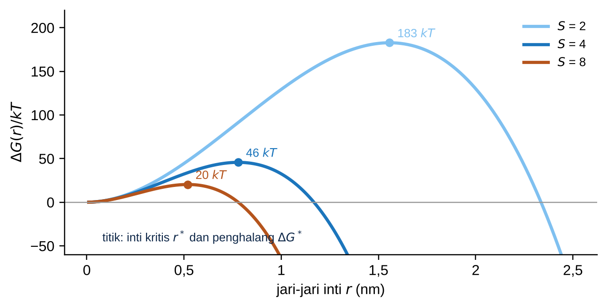

## 15.4 Persamaan Kelvin

Tekanan tambahan di dalam tetes kecil tidak hanya mendorong permukaannya; ia juga menaikkan potensial kimia cairan di dalamnya. Dari subbab 7.8, menaikkan tekanan sebesar Δ*p* pada cairan yang hampir tak termampatkan menaikkan potensial kimianya sebesar $V_\text{m}\Delta p$. Untuk tetes berjari-jari *r*, $\Delta p = 2\gamma/r$, sehingga

$$
\mu(\text{tetes}) = \mu(\text{datar}) + \frac{2\gamma V_\text{m}}{r} .
$$

Cairan dengan potensial kimia lebih tinggi lebih "ingin melarikan diri", dan pada kesetimbangan, uap di atasnya harus mempunyai potensial kimia yang sama. Untuk uap ideal, $\mu(g) = \mu^\circ + RT\ln(p/p^\circ)$, sehingga selisih potensial kimia $2\gamma V_\text{m}/r$ harus sama dengan $RT\ln(p/p^*)$, dengan $p^*$ tekanan uap di atas permukaan datar:

::: {.inti}
$$
\ln\frac{p}{p^*} = \frac{2\gamma V_\text{m}}{rRT} . \qquad \text{(15.6)}
$$

**Persamaan Kelvin.** Tekanan uap di atas permukaan cembung (tetes) lebih tinggi daripada di atas permukaan datar; di atas permukaan cekung (meniskus di dalam pori), *r* diberi tanda negatif dan tekanan uapnya lebih rendah.
:::

Gambar 15.6 memperlihatkan bahwa efek ini baru berarti untuk jari-jari di bawah sekitar 100 nm. Untuk tetes air berjari-jari 1 µm, tekanan uapnya hanya 0,1 persen di atas nilai normal; untuk 10 nm, 11 persen; untuk 1 nm (sekitar 140 molekul), hampir tiga kali lipat.

{width=80%}

::: {.contoh}
**Contoh 15.7 · Tetes kabut dan pori silika gel**

(a) Hitung $p/p^*$ di atas tetes air berjari-jari 10 nm dan 1,0 nm pada 25 °C (γ = 72,0 mN m⁻¹, $V_\text{m}$ = 18,07 cm³ mol⁻¹). (b) Silika gel mengandung pori berjari-jari sekitar 2 nm. Pada kelembapan relatif berapa air mulai mengembun di dalam pori itu (meniskus cekung berjari-jari 2 nm)? Ulangi untuk pori 5 nm.

**Penyelesaian.** Gugus $2\gamma V_\text{m}/RT = 2(0{,}0720)(18{,}07 \times 10^{-6})/[(8{,}314)(298{,}15)] = 1{,}050 \times 10^{-9}$ m.

(a) *r* = 10 nm: $\ln(p/p^*) = 0{,}105$, $p/p^* = 1{,}11$. *r* = 1,0 nm: $\ln(p/p^*) = 1{,}050$, $p/p^* = 2{,}86$.

(b) Pori 2 nm: $\ln(p/p^*) = -0{,}525$, $p/p^* = 0{,}59$: air mengembun di pori pada kelembapan relatif 59 persen. Pori 5 nm: $p/p^* = 0{,}81$.

**Memahami hasil.** Gejala (b) disebut **kondensasi kapiler**, dan inilah cara silika gel di dalam kemasan menyerap uap air dari udara yang belum jenuh. Gejala yang sama membuat tepung dan gula menggumpal di udara lembap, dan menjadi dasar penentuan sebaran ukuran pori bahan berpori dari isoterm adsorpsi (subbab 15.9). Gejala (a) mempunyai akibat sebaliknya: tetes kecil menguap ke udara yang sudah jenuh bagi tetes besar. Di dalam awan yang berisi tetes beraneka ukuran, tetes besar tumbuh dengan memakan tetes kecil.
:::

Persamaan Kelvin berlaku juga untuk padatan. Kristal kecil mempunyai potensial kimia lebih tinggi daripada kristal besar, sehingga lebih mudah larut: $\ln(s/s_\infty) = 2\gamma_\text{sl}V_\text{m}/(rRT)$ (persamaan Ostwald–Freundlich). Di dalam endapan yang dibiarkan bersama larutannya, kristal kecil perlahan larut dan kristal besar tumbuh. Proses ini, **pematangan Ostwald**, dimanfaatkan dalam analisis gravimetri: endapan "dimatangkan" dengan dipanaskan dalam larutan induknya supaya butirnya membesar dan mudah disaring.

::: {.contoh}
**Contoh 15.8 · Kelarutan kristal kecil**

Endapan suatu garam mempunyai tegangan antarmuka padat–cair 0,12 J m⁻² dan volume molar 52 cm³ mol⁻¹. Hitung perbandingan kelarutan kristal berjari-jari 5 nm dan 50 nm terhadap kristal besar pada 25 °C.

**Penyelesaian.** Dari persamaan Ostwald–Freundlich, $\ln(s/s_\infty) = 2\gamma_\text{sl}V_\text{m}/(rRT)$. Gugus $2\gamma_\text{sl}V_\text{m}/RT = 2(0{,}12)(52 \times 10^{-6})/[(8{,}314)(298{,}15)] = 5{,}03 \times 10^{-9}$ m. Untuk *r* = 5 nm: $s/s_\infty = e^{1{,}007} = 2{,}7$; untuk *r* = 50 nm: $e^{0{,}101} = 1{,}11$.

**Memahami hasil.** Kristal berukuran 5 nm hampir tiga kali lebih larut daripada kristal besar. Larutan yang jenuh terhadap kristal kecil sudah lewat jenuh terhadap kristal besar, sehingga zat berpindah dari yang kecil ke yang besar. Itulah pematangan Ostwald, dan juga alasan zat obat yang sukar larut kadang dibuat sebagai partikel nano: kelarutan dan laju pelarutannya naik.
:::

::: {.kuis}
**Kuis cepat 15.4** Mengapa es krim yang disimpan lama di lemari pembeku menjadi kasar berbutir, walaupun suhunya selalu di bawah titik beku?
:::

## 15.5 Nukleasi

Di Bab 8 kita melihat bahwa air dapat didinginkan sampai jauh di bawah 0 °C tanpa membeku, dan uap dapat dibuat lewat jenuh tanpa mengembun. Persamaan Kelvin menjelaskan mengapa. Fase baru harus lahir sebagai gugus yang sangat kecil, dan gugus kecil mempunyai potensial kimia tinggi karena permukaannya. Pada awalnya, fase baru justru tidak stabil.

### Penghalang energi

Pandang pembentukan tetes cair berjari-jari *r* dari uap lewat jenuh dengan perbandingan lewat jenuh $S = p/p^* > 1$. Energi Gibbs berubah karena dua sebab. Pertama, setiap mol yang berpindah dari uap ke cairan menurunkan energi Gibbs sebesar $RT\ln S$; per satuan volume cairan, ini $\Delta g_V = (RT/V_\text{m})\ln S$. Kedua, permukaan tetes harus dibuat, dengan biaya γ per luas. Jadi

$$
\Delta G(r) = -\tfrac43\pi r^3\,\Delta g_V + 4\pi r^2\gamma . \qquad \text{(15.7)}
$$

Suku permukaan sebanding dengan $r^2$ dan menang untuk *r* kecil; suku volume sebanding dengan $r^3$ dan menang untuk *r* besar. Akibatnya Δ*G*(*r*) mula-mula naik, mencapai puncak, lalu turun (Gambar 15.7). Puncaknya diperoleh dari $d\Delta G/dr = 0$:

::: {.inti}
$$
r^* = \frac{2\gamma}{\Delta g_V} , \qquad \Delta G^* = \frac{16\pi\gamma^3}{3\,\Delta g_V^2} . \qquad \text{(15.8)}
$$

Gugus yang lebih kecil dari **jari-jari kritis** $r^*$ cenderung menguap kembali; gugus yang lebih besar cenderung tumbuh. $\Delta G^*$ adalah **penghalang nukleasi**. Jari-jari kritis tidak lain adalah jari-jari tetes yang setimbang dengan uap ber-*S* itu menurut persamaan Kelvin.
:::

{width=80%}

Gugus-gugus kecil terus terbentuk dan pecah karena fluktuasi termal. Menurut sebaran Boltzmann (subbab 14.9), fraksi gugus yang berhasil mencapai puncak sebanding dengan $e^{-\Delta G^*/kT}$, sehingga laju nukleasi $J = J_0\,e^{-\Delta G^*/kT}$, dengan $J_0$ dalam orde $10^{30}$–$10^{35}$ inti per m³ per detik. Nukleasi menjadi teramati ketika $\Delta G^*$ turun ke sekitar 50–75 *kT*. Karena $\Delta G^* \propto 1/(\ln S)^2$, laju nukleasi berubah sangat tajam dengan *S*: di bawah suatu batas praktis tidak ada nukleasi, di atasnya nukleasi terjadi hampir seketika.

::: {.contoh}
**Contoh 15.9 · Awan tanpa debu dan air yang membeku sendiri**

(a) Untuk uap air pada 20 °C (γ = 72,8 mN m⁻¹, $V_\text{m}$ = 18,07 cm³ mol⁻¹), hitung $r^*$, $\Delta G^*/kT$, dan banyaknya molekul dalam inti kritis bila *S* = 4. (b) Untuk pembekuan air lewat dingin, $\Delta g_V = \Delta_\text{fus}H\,\Delta T/(T_\text{m}V_\text{m})$ dengan $\Delta_\text{fus}H$ = 6,01 kJ mol⁻¹, $V_\text{m}$(es) = 19,65 cm³ mol⁻¹, dan tegangan antarmuka es–air 29 mJ m⁻². Hitung $r^*$ dan $\Delta G^*/kT$ untuk ΔT = 10 K dan 38 K.

**Penyelesaian.** (a) $\Delta g_V = (8{,}314)(293{,}15)\ln4/(18{,}07 \times 10^{-6}) = 1{,}87 \times 10^8$ J m⁻³. Maka $r^* = 2(0{,}0728)/(1{,}87 \times 10^8) = 0{,}78$ nm dan
$$
\Delta G^* = \frac{16\pi(0{,}0728)^3}{3(1{,}87 \times 10^8)^2} = 1{,}85 \times 10^{-19}\ \text{J} = 46\,kT .
$$
Inti kritis bervolume $\tfrac43\pi r^{*3}$ berisi $\tfrac43\pi r^{*3}N_\text{A}/V_\text{m} \approx 66$ molekul.

(b) ΔT = 10 K: $\Delta g_V = (6010)(10)/[(273{,}15)(19{,}65 \times 10^{-6})] = 1{,}12 \times 10^7$ J m⁻³, $r^* = 5{,}2$ nm, $\Delta G^* = 897\,kT$. ΔT = 38 K: $\Delta g_V = 4{,}25 \times 10^7$ J m⁻³, $r^* = 1{,}36$ nm, $\Delta G^* = 70\,kT$.

**Memahami hasil.** Pada *S* = 4, penghalangnya 46 *kT*, sehingga udara yang benar-benar bersih harus lewat jenuh sekitar empat kali sebelum tetes terbentuk sendiri; di atmosfer nyata, awan terbentuk pada lewat jenuh kurang dari satu persen karena uap mengembun pada partikel garam, debu, dan jelaga yang sudah ada. Air murni yang didinginkan sepuluh derajat menghadapi penghalang hampir 900 *kT*, dan $e^{-900}$ berarti tidak akan pernah membeku sendiri. Penghalang turun ke sekitar 70 *kT* baru pada −38 °C, dan memang di sekitar suhu itulah tetes air murni di awan tinggi membeku spontan.
:::

### Nukleasi heterogen

Pada kenyataannya, fase baru hampir selalu lahir di atas permukaan yang sudah ada: dinding wadah, debu, atau goresan. Bila cairan yang terbentuk membasahi permukaan itu dengan sudut kontak θ, gugus kritis berbentuk tudung bola yang volumenya lebih kecil, dan penghalangnya berkurang menjadi $\Delta G^*_\text{het} = f(\theta)\,\Delta G^*$, dengan $f(\theta) = (2 + \cos\theta)(1 - \cos\theta)^2/4$. Untuk θ = 60°, *f* = 0,16; untuk θ = 30°, *f* = 0,013. Inilah prinsip penyemaian awan dengan perak iodida, yang kisi kristalnya mirip es sehingga "dibasahi" dengan baik oleh es, dan prinsip batu didih yang mencegah cairan mendidih secara meletup di laboratorium.

::: {.contoh}
**Contoh 15.10 · Penyemaian awan**

Penghalang nukleasi homogen es pada air yang didinginkan 10 K adalah 897 *kT* (Contoh 15.9). Hitung penghalang nukleasi heterogen di atas permukaan dengan sudut kontak 30°, dan bandingkan.

**Penyelesaian.** $f(30°) = (2 + \cos30°)(1 - \cos30°)^2/4 = (2{,}866)(0{,}134)^2/4 = 0{,}0129$. Maka $\Delta G^*_\text{het} = (0{,}0129)(897\,kT) = 11{,}5\,kT$.

**Memahami hasil.** Penghalang turun hampir delapan puluh kali, dari mustahil menjadi mudah dilewati. Kristal perak iodida mempunyai kisi heksagonal dengan jarak antaratom hanya sekitar satu persen berbeda dari es, sehingga es "membasahi" permukaannya dengan sangat baik. Partikel AgI yang ditaburkan ke awan berisi tetes lewat dingin membuat tetes membeku pada −5 sampai −10 °C, bukan −38 °C, dan kristal es yang terbentuk tumbuh menjadi butir hujan atau salju.
:::

::: {.kuis}
**Kuis cepat 15.5** Mengapa gelembung di dalam gelas minuman bersoda selalu muncul dari titik-titik tertentu di dinding gelas, bukan di tengah cairan?
:::
