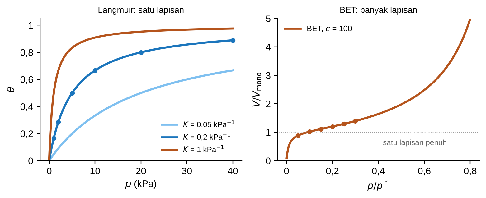

## 15.6 Persamaan adsorpsi Gibbs

Setetes sabun atau alkohol menurunkan tegangan permukaan air dengan tajam, sedangkan garam dapur justru sedikit menaikkannya. Perbedaan ini mencerminkan ke mana zat terlarut pergi: zat yang menurunkan γ berkumpul di permukaan, zat yang menaikkan γ menjauhi permukaan. Gibbs menurunkan hubungan kuantitatif di antara keduanya pada 1878, dan hubungan itu memungkinkan kita "menimbang" lapisan setebal satu molekul hanya dengan mengukur tegangan permukaan.

### Kelebihan permukaan

Di dekat permukaan larutan, konsentrasi zat terlarut berubah dalam lapisan setebal beberapa molekul. Gibbs menghindari pertanyaan "di mana tepatnya permukaan itu" dengan membayangkan **bidang pembagi** khayal, lalu menghitung berapa banyak zat terlarut yang **berlebih** dibandingkan bila kedua fase homogen sampai tepat di bidang itu. **Kelebihan permukaan** $\Gamma_\text{B} = n_\text{B}^\sigma/A$ adalah banyaknya mol berlebih per satuan luas. Bidang pembagi dipilih sehingga kelebihan pelarut nol; dengan pilihan itu, $\Gamma_\text{B}$ positif bila B berkumpul di permukaan dan negatif bila B menjauhinya.

### Penurunan

Untuk permukaan, analog persamaan Gibbs–Duhem (subbab 9.4) pada suhu tetap adalah $A\,d\gamma + \sum_\text{J} n_\text{J}^\sigma\,d\mu_\text{J} = 0$, atau $d\gamma = -\sum\Gamma_\text{J}\,d\mu_\text{J}$. Dengan kelebihan pelarut nol, hanya zat terlarut yang tersisa: $d\gamma = -\Gamma_\text{B}\,d\mu_\text{B}$. Untuk larutan encer ideal, $d\mu_\text{B} = RT\,d\ln c_\text{B}$, sehingga

::: {.inti}
$$
\Gamma_\text{B} = -\frac{1}{RT}\left(\frac{\partial\gamma}{\partial\ln c_\text{B}}\right)_T = -\frac{c_\text{B}}{RT}\left(\frac{\partial\gamma}{\partial c_\text{B}}\right)_T . \qquad \text{(15.9)}
$$

**Persamaan adsorpsi Gibbs.** Zat yang menurunkan tegangan permukaan ($d\gamma/dc < 0$) berkumpul di permukaan; zat yang menaikkannya terusir dari permukaan. Untuk surfaktan ionik 1:1 tanpa garam tambahan, kation dan anion sama-sama menyumbang pada $d\mu$, sehingga faktor *RT* diganti 2*RT*.
:::

::: {.contoh}
**Contoh 15.11 · Luas yang ditempati satu molekul surfaktan**

(a) Untuk larutan surfaktan nonionik pada 25 °C, kemiringan γ terhadap ln *c* sedikit di bawah CMC adalah −6,0 mN m⁻¹. Hitung kelebihan permukaan dan luas yang ditempati satu molekul. (b) Ulangi untuk natrium dodesil sulfat (SDS), surfaktan ionik 1:1, dengan kemiringan −13,0 mN m⁻¹. (c) Tegangan permukaan larutan NaCl naik sekitar 1,6 mN m⁻¹ per mol L⁻¹. Hitung kelebihan permukaan NaCl pada 1,0 mol L⁻¹ dan tafsirkan.

**Penyelesaian.** (a) $\Gamma = (6{,}0 \times 10^{-3})/[(8{,}314)(298{,}15)] = 2{,}42 \times 10^{-6}$ mol m⁻². Luas per molekul $1/(\Gamma N_\text{A}) = 6{,}9 \times 10^{-19}$ m² = 0,69 nm².

(b) Dengan faktor 2*RT*: $\Gamma = (13{,}0 \times 10^{-3})/[2(8{,}314)(298{,}15)] = 2{,}62 \times 10^{-6}$ mol m⁻², luas per molekul 0,63 nm².

(c) Dengan faktor 2*RT* dan $c\,d\gamma/dc = (1{,}0)(1{,}6 \times 10^{-3})$ N m⁻¹: $\Gamma = -(1{,}6 \times 10^{-3})/[2(8{,}314)(298{,}15)] = -3{,}2 \times 10^{-7}$ mol m⁻². Dibagi konsentrasi 1000 mol m⁻³, ini setara dengan lapisan setebal 0,32 nm yang sama sekali tidak mengandung garam.

**Memahami hasil.** Luas sekitar 0,6–0,7 nm² per molekul adalah luas kepala hidrofilik surfaktan yang tersusun rapat; ekor hidrokarbonnya, yang penampangnya hanya sekitar 0,2 nm², berdiri ke arah udara. Hasil ini diperoleh hanya dari pengukuran tegangan permukaan, tanpa pernah melihat molekulnya, dan cocok dengan pengukuran langsung dengan pemantulan neutron. Untuk garam, ion-ion yang terhidrasi kuat menjauhi permukaan, tempat mereka akan kehilangan sebagian selubung airnya; lapisan teratas air garam setebal kira-kira satu molekul air hampir murni.
:::

::: {.contoh}
**Contoh 15.12 · Dari persamaan Szyszkowski ke lapisan penuh**

Tegangan permukaan larutan encer suatu surfaktan nonionik pada 25 °C mengikuti persamaan empiris Szyszkowski $\gamma = \gamma_0 - a\ln(1 + bc)$ dengan *a* = 10,0 mN m⁻¹ dan *b* = 200 L mol⁻¹. Hitung Γ sebagai fungsi *c*, kelebihan permukaan maksimum, luas per molekul pada lapisan penuh, dan fraksi penutupan pada *c* = 5,0 mmol L⁻¹.

**Penyelesaian.** $\partial\gamma/\partial\ln c = c\,\partial\gamma/\partial c = -abc/(1 + bc)$. Dengan (15.9): $\Gamma = (a/RT)\,bc/(1 + bc)$. Kelebihan maksimum (untuk $bc \gg 1$): $\Gamma_\text{maks} = a/RT = (0{,}0100)/[(8{,}314)(298{,}15)] = 4{,}03 \times 10^{-6}$ mol m⁻², atau 0,41 nm² per molekul. Pada *c* = 5,0 mmol L⁻¹, *bc* = 1,0, sehingga $\Gamma/\Gamma_\text{maks} = 0{,}50$.

**Memahami hasil.** Bentuk $bc/(1 + bc)$ adalah isoterm Langmuir (subbab 15.8) untuk molekul yang menempati tempat-tempat di permukaan larutan. Persamaan empiris Szyszkowski, yang ditemukan dari data pada 1908, ternyata adalah persamaan adsorpsi Gibbs yang digabung dengan isoterm Langmuir. Pada konsentrasi yang hanya beberapa milimolar, permukaan sudah separuh tertutup: surfaktan bekerja pada konsentrasi sangat kecil.
:::

::: {.kuis}
**Kuis cepat 15.6** Etanol menurunkan tegangan permukaan air. Apakah konsentrasi etanol di lapisan permukaan larutan etanol–air lebih tinggi atau lebih rendah daripada di dalam larutan?
:::

## 15.7 Surfaktan dan misel

**Surfaktan** (zat aktif permukaan) adalah molekul yang mempunyai dua bagian dengan sifat bertentangan: **kepala** hidrofilik yang larut dalam air (gugus sulfat, karboksilat, amonium, atau rantai polietilena glikol) dan **ekor** hidrofobik berupa rantai hidrokarbon panjang. Sabun (garam natrium asam lemak), deterjen (SDS), dan fosfolipid membran sel adalah surfaktan.

Ketika surfaktan dilarutkan, molekulnya mula-mula berkumpul di permukaan, dengan ekor menghadap udara, dan tegangan permukaan turun tajam (Gambar 15.8, kiri). Tetapi permukaan hanya dapat menampung satu lapisan. Di atas suatu konsentrasi tertentu, **konsentrasi misel kritis** (CMC), molekul surfaktan berkumpul di dalam larutan membentuk **misel**: gugus berisi 50–100 molekul, dengan ekor di dalam yang terlindung dari air dan kepala di luar yang menghadap air. Penambahan surfaktan lebih lanjut hanya menambah banyaknya misel, sehingga konsentrasi molekul bebas, dan karena itu tegangan permukaan, hampir tidak berubah lagi.

{width=94%}

### Termodinamika misellisasi

Misel dapat dipandang sebagai fase terpisah yang terbentuk ketika konsentrasi molekul bebas mencapai CMC, mirip dengan kelarutan. Potensial kimia surfaktan di dalam misel sama dengan potensial kimia molekul bebas pada CMC, sehingga energi Gibbs standar perpindahan satu mol surfaktan dari larutan ke misel adalah, untuk surfaktan nonionik,

$$
\Delta G^\circ_\text{mis} \approx RT\ln x_\text{CMC} , \qquad \text{(15.10)}
$$

dengan $x_\text{CMC}$ fraksi mol surfaktan pada CMC. Untuk surfaktan ionik, ion lawan yang terikat pada misel menambah suku koreksi, tetapi bentuk (15.10) tetap memberi gambaran yang baik tentang **perbedaan** antara anggota satu deret.

::: {.contoh}
**Contoh 15.13 · Setiap gugus CH₂ menambah dorongan**

CMC natrium alkil sulfat dalam air pada 25 °C: C₁₀ 33 mmol L⁻¹, C₁₂ (SDS) 8,2 mmol L⁻¹, C₁₄ 2,1 mmol L⁻¹. Hitung $RT\ln x_\text{CMC}$ untuk ketiganya, dan sumbangan setiap gugus CH₂.

**Penyelesaian.** Dengan $x_\text{CMC} \approx c_\text{CMC}/(55{,}5\ \text{mol L}^{-1})$ dan *RT* = 2,479 kJ mol⁻¹:

| Surfaktan | C₁₀ | C₁₂ | C₁₄ |
|---|---|---|---|
| $RT\ln x_\text{CMC}$ (kJ mol⁻¹) | −18,4 | −21,9 | −25,2 |

Setiap dua gugus CH₂ menurunkan CMC sekitar empat kali, sehingga setiap gugus CH₂ menyumbang $RT\ln(1/2) = -1{,}7$ kJ mol⁻¹.

**Memahami hasil.** Dorongan pembentukan misel bertambah teratur dengan panjang ekor: setiap gugus CH₂ yang disembunyikan dari air menurunkan energi Gibbs. Pengukuran pada beberapa suhu menunjukkan bahwa dorongan ini terutama **entropi**, bukan entalpi: air di sekitar rantai hidrokarbon membentuk susunan ikatan hidrogen yang lebih teratur, dan ketika rantai bersembunyi di dalam misel, air itu dibebaskan. Inilah **efek hidrofobik**, yang juga melipat protein dan menyusun membran sel. Untuk surfaktan nonionik, yang tidak mempunyai ion lawan, sumbangan per CH₂ lebih besar, sekitar −3 kJ mol⁻¹.
:::

Cara sabun membersihkan kini jelas. Molekul sabun menurunkan tegangan antarmuka air–minyak, sehingga air dapat membasahi kain berminyak. Lemak dan kotoran kemudian terbungkus di dalam inti misel yang hidrofobik dan terbawa air. Karena misel baru terbentuk di atas CMC, deterjen harus dipakai di atas konsentrasi itu, dan menambah lebih banyak lagi hanya sedikit menambah daya bersih.

::: {.contoh}
**Contoh 15.14 · Berapa banyak surfaktan di dalam misel?**

Larutan SDS 0,020 mol L⁻¹ pada 25 °C (CMC 8,2 mmol L⁻¹) berisi misel dengan rata-rata 64 molekul. Hitung konsentrasi misel dan fraksi SDS yang berada di dalam misel.

**Penyelesaian.** Di atas CMC, konsentrasi molekul bebas hampir tetap sama dengan CMC. Sisanya, $0{,}020 - 0{,}0082 = 0{,}0118$ mol L⁻¹, berada di dalam misel. Konsentrasi misel $= 0{,}0118/64 = 1{,}8 \times 10^{-4}$ mol L⁻¹, dan fraksi SDS di dalam misel $0{,}0118/0{,}020 = 0{,}59$.

**Memahami hasil.** Walaupun lebih dari separuh surfaktan berada di dalam misel, banyaknya misel kecil karena setiap misel berisi puluhan molekul. Model "fase terpisah" yang kita pakai, molekul bebas tetap sama dengan CMC, adalah pendekatan; dalam kenyataan konsentrasi molekul bebas masih naik sedikit di atas CMC, sama seperti tegangan permukaan pada Gambar 15.8 yang hampir, tetapi tidak sepenuhnya, datar.
:::

::: {.kuis}
**Kuis cepat 15.7** Mengapa CMC surfaktan ionik turun bila ke dalam larutan ditambahkan NaCl?
:::

## 15.8 Adsorpsi gas pada padatan: isoterm Langmuir

Permukaan padatan juga dapat menarik molekul dari gas atau larutan di sekitarnya; peristiwa ini disebut **adsorpsi** (penempelan di permukaan, berbeda dengan absorpsi, penyerapan ke dalam). Arang aktif menghilangkan bau, silika gel menyerap air, dan hampir semua katalis industri bekerja dengan menjerap pereaksi di permukaan logam atau oksida. Ada dua jenis yang berbeda:

- **Fisisorpsi**: molekul terikat oleh gaya van der Waals; entalpi adsorpsi −5 sampai −40 kJ mol⁻¹, sebanding dengan entalpi pengembunan; dapat membentuk banyak lapisan; mudah dibalik.
- **Kemisorpsi**: molekul membentuk ikatan kimia dengan atom permukaan; entalpi adsorpsi −40 sampai −800 kJ mol⁻¹; hanya satu lapisan; molekul sering terurai (misalnya H₂ menjadi atom H pada platina).

Adsorpsi gas hampir selalu **eksoterm**. Alasannya termodinamika: molekul yang terjerap kehilangan sebagian besar kebebasan geraknya, sehingga $\Delta_\text{ads}S < 0$, dan agar $\Delta_\text{ads}G = \Delta_\text{ads}H - T\Delta_\text{ads}S$ negatif, $\Delta_\text{ads}H$ harus negatif.

### Penurunan isoterm Langmuir

Langmuir (1916) membayangkan permukaan sebagai kumpulan tempat yang setara, masing-masing dapat menampung satu molekul, tanpa interaksi antara molekul terjerap. Misalkan fraksi tempat yang terisi θ. Laju adsorpsi sebanding dengan tekanan gas dan dengan fraksi tempat kosong, $k_\text{a}p(1 - \theta)$; laju desorpsi sebanding dengan fraksi tempat terisi, $k_\text{d}\theta$. Pada kesetimbangan keduanya sama, dan dengan $K = k_\text{a}/k_\text{d}$:

::: {.inti}
$$
\theta = \frac{V}{V_\text{mono}} = \frac{Kp}{1 + Kp} , \qquad \frac{p}{V} = \frac{1}{KV_\text{mono}} + \frac{p}{V_\text{mono}} . \qquad \text{(15.11)}
$$

**Isoterm Langmuir.** θ naik lurus dengan *p* pada tekanan rendah dan mendekati 1 (satu lapisan penuh) pada tekanan tinggi. Bentuk kedua memberi garis lurus *p*/*V* terhadap *p* dengan kemiringan $1/V_\text{mono}$.
:::

*K* adalah tetapan kesetimbangan adsorpsi, dan seperti tetapan kesetimbangan lain ia mengikuti persamaan van 't Hoff (subbab 12.6): $d\ln K/d(1/T) = -\Delta_\text{ads}H/R$. Entalpi yang diperoleh dengan cara ini disebut **entalpi adsorpsi isosterik**.

{width=94%}

::: {.contoh}
**Contoh 15.15 · Menganalisis data adsorpsi**

Volume gas (diubah ke STP) yang terjerap pada 1,00 g suatu padatan pada 273 K:

| *p* (kPa) | 1 | 2 | 5 | 10 | 20 | 40 |
|---|---|---|---|---|---|---|
| *V* (cm³) | 0,417 | 0,714 | 1,250 | 1,667 | 2,000 | 2,222 |

(a) Tentukan $V_\text{mono}$ dan *K*. (b) Pada 298 K, *K* = 0,080 kPa⁻¹. Hitung entalpi adsorpsi isosterik dan fraksi permukaan yang tertutup pada 10 kPa untuk kedua suhu.

**Penyelesaian.** (a) Hitung *p*/*V*: 2,40; 2,80; 4,00; 6,00; 10,0; 18,0 kPa cm⁻³. Regresi linear terhadap *p* memberi kemiringan 0,400 cm⁻³ dan titik potong 2,00 kPa cm⁻³. Maka $V_\text{mono} = 1/0{,}400 = 2{,}50$ cm³ dan $K = 0{,}400/2{,}00 = 0{,}200$ kPa⁻¹.

(b) $\Delta_\text{ads}H = R\ln(K_1/K_2)/(1/T_2 - 1/T_1) = (8{,}314)\ln(0{,}200/0{,}080)/(1/298{,}15 - 1/273{,}15) = -24{,}8$ kJ mol⁻¹. Pada 10 kPa: θ(273 K) = 2,00/3,00 = 0,67 dan θ(298 K) = 0,80/1,80 = 0,44.

**Memahami hasil.** Entalpi −25 kJ mol⁻¹ menandakan fisisorpsi. Kenaikan suhu 25 K menurunkan penutupan permukaan dari dua pertiga menjadi kurang dari separuh, sesuai asas Le Chatelier untuk proses eksoterm. Cara inilah yang dipakai dalam **adsorpsi ayunan suhu**: gas dijerap pada suhu rendah lalu dilepas dengan pemanasan, misalnya untuk menangkap CO₂ dari gas buang. Dalam katalisis, penutupan permukaan menentukan laju: bila *Kp* ≫ 1, permukaan jenuh dan laju tidak lagi bergantung pada tekanan, gejala yang akan dibahas di *Kimia Fisika 2*.
:::

::: {.contoh}
**Contoh 15.16 · Dua gas berebut permukaan katalis**

Pada katalis logam, CO terjerap kuat ($K_\text{CO}$ = 2,0 kPa⁻¹) dan H₂ lemah ($K_\text{H}$ = 0,10 kPa⁻¹, anggap tidak terurai). Untuk campuran dengan $p_\text{CO}$ = 1,0 kPa dan $p_{\text{H}_2}$ = 50 kPa, hitung fraksi permukaan yang ditempati masing-masing gas.

**Penyelesaian.** Untuk dua gas yang bersaing memperebutkan tempat yang sama, perluasan isoterm Langmuir memberi $\theta_\text{J} = K_\text{J}p_\text{J}/(1 + K_\text{CO}p_\text{CO} + K_\text{H}p_\text{H})$. Penyebutnya $1 + 2{,}0 + 5{,}0 = 8{,}0$, sehingga $\theta_\text{CO} = 2{,}0/8{,}0 = 0{,}25$, $\theta_\text{H} = 5{,}0/8{,}0 = 0{,}63$, dan tempat kosong 0,12.

**Memahami hasil.** Walaupun tekanan CO hanya 2 persen dari H₂, CO menempati seperempat permukaan karena terikat dua puluh kali lebih kuat. Inilah mekanisme **peracunan katalis**: sedikit CO di dalam hidrogen untuk sel bahan bakar (subbab 13.8) menutupi platina dan menurunkan kinerjanya, sehingga hidrogen untuk sel bahan bakar harus dimurnikan sampai CO di bawah beberapa ppm.
:::

::: {.kuis}
**Kuis cepat 15.8** Pada tekanan berapa separuh permukaan padatan dalam Contoh 15.15 tertutup pada 273 K?
:::

## 15.9 Adsorpsi banyak lapisan dan luas permukaan: isoterm BET

Isoterm Langmuir mengandaikan satu lapisan. Pada fisisorpsi di dekat titik embun gas, molekul terus menumpuk di atas lapisan pertama, karena lapisan kedua dan seterusnya terikat seperti cairan. Brunauer, Emmett, dan Teller (1938) memperluas model Langmuir untuk banyak lapisan, dengan anggapan bahwa lapisan pertama terikat dengan energi $E_1$ dan lapisan-lapisan berikutnya dengan entalpi pengembunan $E_\text{L}$:

::: {.inti}
$$
\frac{V}{V_\text{mono}} = \frac{cx}{(1 - x)(1 - x + cx)} , \qquad \frac{x}{V(1 - x)} = \frac{1}{cV_\text{mono}} + \frac{(c - 1)x}{cV_\text{mono}} , \qquad x = \frac{p}{p^*} . \qquad \text{(15.12)}
$$

**Isoterm BET.** $p^*$ adalah tekanan uap gas yang dijerap pada suhu percobaan, dan $c \approx e^{(E_1 - E_\text{L})/RT}$. Plot $x/[V(1 - x)]$ terhadap *x* lurus untuk *x* sekitar 0,05–0,30.
:::

Gunanya yang terpenting adalah mengukur **luas permukaan**. Dari $V_\text{mono}$, banyaknya molekul dalam satu lapisan diketahui; dikalikan luas penampang satu molekul, hasilnya luas permukaan padatan. Baku industri memakai N₂ pada 77 K (titik didihnya, sehingga $p^*$ = 1 atm) dengan luas penampang 0,162 nm² per molekul.

::: {.contoh}
**Contoh 15.17 · Luas permukaan arang aktif**

Adsorpsi N₂ pada 77 K oleh 1,00 g bahan berpori memberi (volume STP):

| $x = p/p^*$ | 0,05 | 0,10 | 0,15 | 0,20 | 0,25 | 0,30 |
|---|---|---|---|---|---|---|
| *V* (cm³ g⁻¹) | 35,4 | 40,8 | 44,5 | 48,1 | 51,8 | 55,8 |

Tentukan $V_\text{mono}$, *c*, dan luas permukaan spesifik.

**Penyelesaian.** Hitung $y = x/[V(1 - x)]$ untuk setiap titik, lalu regresi linear terhadap *x*. Hasilnya: kemiringan $(c-1)/(cV_\text{mono}) = 0{,}0248$ g cm⁻³ dan titik potong $1/(cV_\text{mono}) = 2{,}48 \times 10^{-4}$ g cm⁻³. Jumlah keduanya $1/V_\text{mono}$, sehingga $V_\text{mono} = 40{,}0$ cm³ g⁻¹ dan $c = 1 + 0{,}0248/2{,}48 \times 10^{-4} \approx 101$. Banyaknya molekul dalam satu lapisan $= (40{,}0/22\,414)(6{,}022 \times 10^{23}) = 1{,}075 \times 10^{21}$, dan luas permukaannya $(1{,}075 \times 10^{21})(0{,}162 \times 10^{-18}\ \text{m}^2) = 174$ m² g⁻¹.

**Memahami hasil.** Satu gram bahan ini mempunyai luas permukaan sekitar dua perlima lapangan basket (28 m × 15 m). Arang aktif yang baik mencapai 500–1500 m² g⁻¹, dan bahan berpori modern seperti kerangka logam–organik (MOF) lebih dari 5000 m² g⁻¹. Nilai *c* ≈ 100 berarti lapisan pertama terikat lebih kuat daripada pengembunan biasa sebesar $RT\ln c = (8{,}314)(77)\ln100 = 2{,}9$ kJ mol⁻¹. Pada *x* di atas sekitar 0,4, gas juga mengembun di dalam pori sempit menurut persamaan Kelvin (subbab 15.4), sehingga bagian isoterm itu memberi sebaran ukuran pori.
:::

::: {.contoh}
**Contoh 15.18 · Metode BET satu titik**

Bila *c* besar, persamaan BET mendekati $V_\text{mono} \approx V(1 - x)$. Pakai titik *x* = 0,20 dari Contoh 15.17 untuk menaksir luas permukaan, dan bandingkan dengan analisis lengkap (174 m² g⁻¹).

**Penyelesaian.** $V_\text{mono} \approx (48{,}1)(1 - 0{,}20) = 38{,}5$ cm³ g⁻¹, sehingga luas permukaan $= (38{,}5/22\,414)(6{,}022 \times 10^{23})(0{,}162 \times 10^{-18}) = 167$ m² g⁻¹.

**Memahami hasil.** Selisihnya hanya 4 persen. Metode satu titik banyak dipakai dalam pengendalian mutu industri karena cepat, tetapi hanya sah bila *c* besar (biasanya di atas 50), seperti pada kebanyakan bahan karbon dan oksida dengan nitrogen.
:::

::: {.kuis}
**Kuis cepat 15.9** Mengapa pengukuran luas permukaan dilakukan dengan N₂ pada 77 K, bukan pada suhu kamar?
:::

## Penutup: satu fungsi, banyak wajah

Kita memulai buku ini dengan molekul gas yang bergerak acak di dalam wadah, dan mengakhirinya dengan molekul di batas antara dua fase: di permukaan tetes, di dinding pori, dan di dalam misel. Di antara keduanya, hampir setiap gejala yang kita bahas dapat ditelusuri ke satu besaran: energi Gibbs, dan turunannya, potensial kimia.

Hukum pertama memberi kita neraca energi: kalor dan kerja tidak hilang. Hukum kedua memberi arah: entropi alam semesta tidak berkurang. Energi Gibbs menggabungkan keduanya menjadi satu kriteria yang hanya memerlukan sifat sistem, dan potensial kimia memecahnya menjadi sumbangan setiap zat. Dari sana muncul semuanya: titik didih yang turun di gunung, es yang mencair ketika ditekan, garam yang menurunkan titik beku, osmosis yang memecah sel darah, distilasi yang memisahkan minyak bumi, kesetimbangan yang memberi makan dunia, dan tegangan sel yang mengukur semuanya dengan sebuah voltmeter. Bab 14 menunjukkan bahwa energi Gibbs itu sendiri dapat dihitung dari tingkat energi molekul, dan bab ini menunjukkan bahwa satu suku tambahan, γ*dA*, cukup untuk menjelaskan tetes, gelembung, kapiler, awan, sabun, dan katalis.

Termodinamika mempunyai satu keterbatasan yang sudah kita temui berulang kali: ia mengatakan ke mana proses **dapat** berjalan, tetapi tidak seberapa cepat. Intan seharusnya berubah menjadi grafit, benzena seharusnya terurai, kayu di udara seharusnya terbakar, dan uap lewat jenuh seharusnya mengembun; semuanya tidak terjadi, atau terjadi lambat, karena **laju**. Subbab 14.9 dan 15.5 baru memberi isyarat: laju ditentukan oleh fraksi molekul yang dapat melewati penghalang energi, ekor sebaran Boltzmann. Pertanyaan tentang laju, tentang mengapa reaksi memerlukan energi aktivasi dan bagaimana katalis di permukaan padatan bekerja, adalah pokok buku berikutnya dalam seri ini: *Kimia Fisika 2: Kinetika Kimia*.
